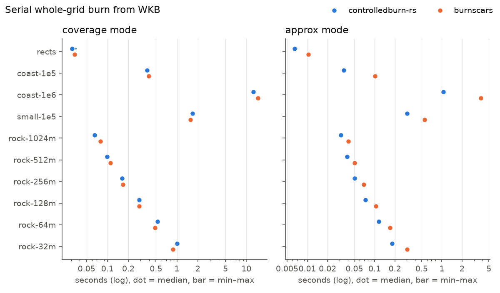
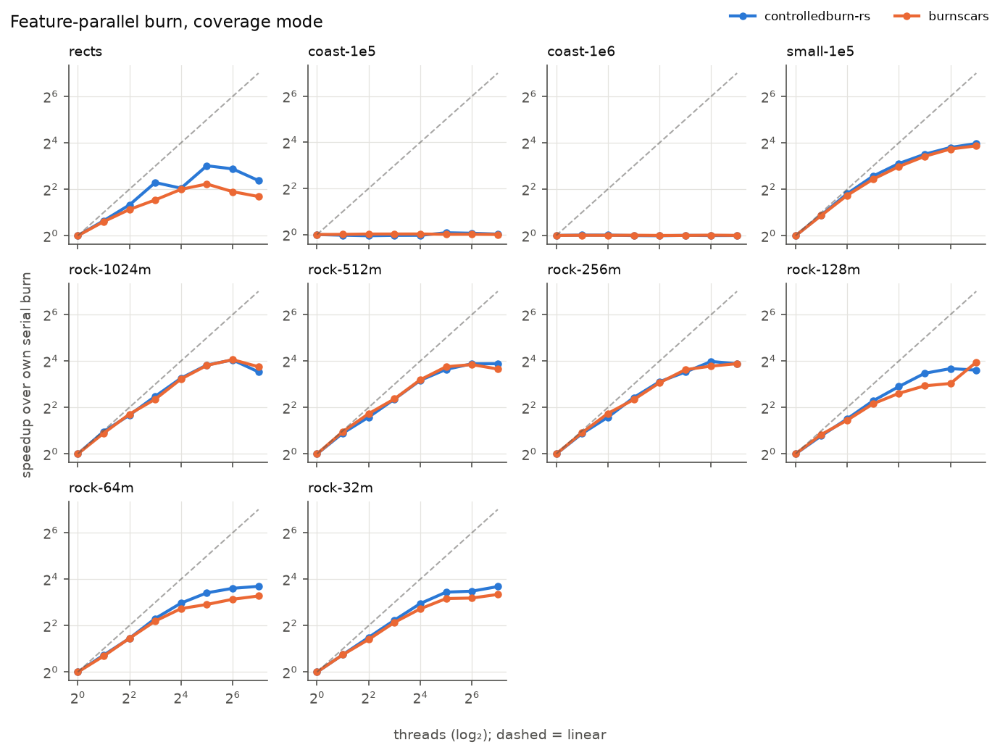
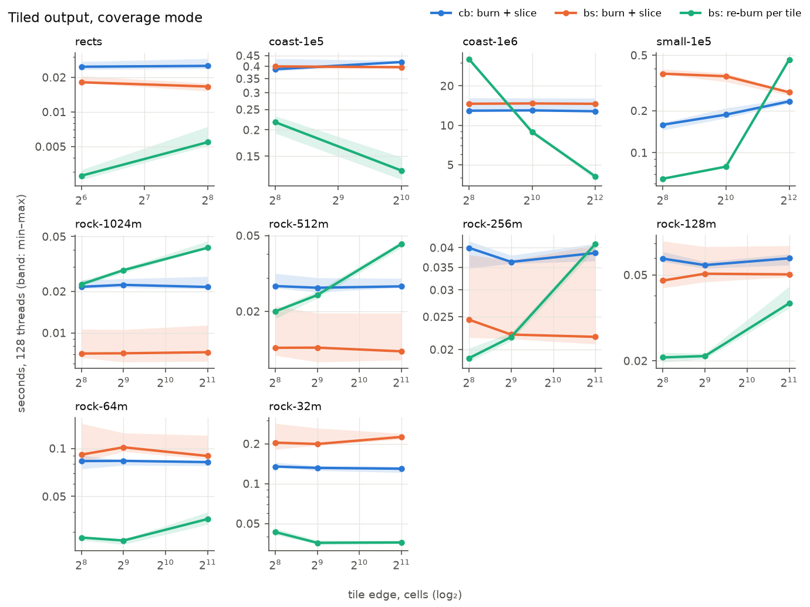

# Results

Machine: AMD EPYC 7763 64-Core Processor (256 logical CPUs, 250.6 GB), Ubuntu 24.04.5 LTS, kernel 6.4.0-150700.53.87-default. Label: setonix-work Slurm job 52790194.  
controlledburn-rs `e1696fc543`, burnscars `1d24ef7f14`, rustc 1.99.1 (58cf8f9c3 2026-10-13).

Times are seconds, median [min–max] over the repeats after one warm-up. RSS is the peak resident set of the whole process (input included), MB.

## Correctness (before timing)

Cells compared per geometry id, with records on the same cell summed (cb keeps one record per polygon part, bs one per geometry). `equal` is bit-equal; `≤1e-6` differs only by float rounding.

| input | mode | cells | equal | ≤1e-6 | differ | only cb | only bs | bs failed | par = serial (cb/bs) | area rel. err cb / bs | exact oracle cb / bs |
|---|---|---|---|---|---|---|---|---|---|---|---|
| rects | coverage | 3,070,060 | 3,070,060 | 0 | 0 | 0 | 0 | 0 | True/True | 4.6e-08 / 4.6e-08 | 0 / 0 cells wrong, 1 below tol. |
| rects | approx | 2,953,284 | 2,953,284 | 0 | 0 | 0 | 0 | 0 | True/True | – | – |
| coast-1e5 | coverage | 8,792,488 | 8,792,488 | 0 | 0 | 0 | 0 | 0 | True/True | 9.1e-13 / 9.1e-13 | – |
| coast-1e5 | approx | 8,498,929 | 8,498,929 | 0 | 0 | 0 | 0 | 0 | True/True | – | – |
| coast-1e6 | coverage | 141,096,607 | 141,096,607 | 0 | 0 | 0 | 0 | 0 | True/True | 1.5e-13 / 1.5e-13 | – |
| coast-1e6 | approx | 135,987,644 | 135,987,644 | 0 | 0 | 0 | 0 | 0 | True/True | – | – |
| small-1e5 | coverage | 46,880,169 | 46,880,169 | 0 | 0 | 0 | 0 | 0 | True/True | 1.8e-07 / 1.8e-07 | – |
| small-1e5 | approx | 41,118,887 | 41,118,887 | 0 | 0 | 0 | 0 | 0 | True/True | – | – |
| rock-1024m | coverage | 190,172 | 190,172 | 0 | 0 | 0 | 0 | 0 | True/True | 6.1e-05 / 6.1e-05 | – |
| rock-1024m | approx | 68,215 | 68,215 | 0 | 0 | 0 | 0 | 0 | True/True | – | – |
| rock-512m | coverage | 499,386 | 499,386 | 0 | 0 | 0 | 0 | 0 | True/True | 1.1e-05 / 1.1e-05 | – |
| rock-512m | approx | 272,827 | 272,827 | 0 | 0 | 0 | 0 | 0 | True/True | – | – |
| rock-256m | coverage | 1,529,471 | 1,529,471 | 0 | 0 | 0 | 0 | 0 | True/True | 1.1e-05 / 1.1e-05 | – |
| rock-256m | approx | 1,091,557 | 1,091,557 | 0 | 0 | 0 | 0 | 0 | True/True | – | – |
| rock-128m | coverage | 5,226,174 | 5,226,174 | 0 | 0 | 0 | 0 | 0 | True/True | 6.0e-07 / 6.0e-07 | – |
| rock-128m | approx | 4,365,945 | 4,365,945 | 0 | 0 | 0 | 0 | 0 | True/True | – | – |
| rock-64m | coverage | 19,167,350 | 19,167,350 | 0 | 0 | 0 | 0 | 0 | True/True | 4.4e-07 / 4.4e-07 | – |
| rock-64m | approx | 17,465,467 | 17,465,467 | 0 | 0 | 0 | 0 | 0 | True/True | – | – |
| rock-32m | coverage | 73,248,217 | 73,248,216 | 0 | 1 | 0 | 0 | 0 | True/True | 2.9e-05 / 1.4e-03 | – |
| rock-32m | approx | 69,858,116 | 69,858,116 | 0 | 0 | 0 | 1 | 0 | True/True | – | – |

- rock-32m coverage: t0 id 25589 row 33647 col 11075: a 1 b 0.020908592268824577
- rock-32m approx: only b: t0 id 25938 row 33523 cols 11740..11741 v 1

## A. Single thread, whole grid

| input | mode | records cb / bs | cb_burn | bs_burn | RSS cb / bs |
|---|---|---|---|---|---|
| rects | coverage | 300,873 / 357,049 | 0.0308 [0.0305–0.0351] | 0.0337 [0.0333–0.0341] | 8 / 9 |
| rects | approx | 75,559 / 75,559 | 0.00648 [0.00646–0.00707] | 0.0103 [0.0102–0.0107] | 2 / 4 |
| coast-1e5 | coverage | 598,361 / 598,513 | 0.373 [0.369–0.393] | 0.392 [0.391–0.395] | 324 / 349 |
| coast-1e5 | approx | 88,164 / 226,436 | 0.0349 [0.0348–0.0359] | 0.101 [0.101–0.106] | 40 / 76 |
| coast-1e6 | coverage | 10,246,638 / 10,248,896 | 12.6 [12.6–12.7] | 14.6 [14.5–14.6] | 9034 / 12468 |
| coast-1e6 | approx | 1,441,909 / 4,408,666 | 1.05 [1.04–1.07] | 3.79 [3.78–3.79] | 1276 / 2747 |
| small-1e5 | coverage | 13,648,408 / 13,654,453 | 1.67 [1.67–1.69] | 1.57 [1.56–1.59] | 263 / 325 |
| small-1e5 | approx | 2,719,190 / 2,783,483 | 0.305 [0.304–0.309] | 0.557 [0.544–0.559] | 97 / 159 |
| rock-1024m | coverage | 180,873 / 180,883 | 0.0652 [0.0645–0.0665] | 0.079 [0.0787–0.0791] | 44 / 44 |
| rock-1024m | approx | 35,557 / 38,130 | 0.0315 [0.0312–0.0322] | 0.0406 [0.0402–0.041] | 43 / 44 |
| rock-512m | coverage | 418,762 / 418,824 | 0.0986 [0.0978–0.0994] | 0.11 [0.109–0.111] | 44 / 44 |
| rock-512m | approx | 92,154 / 95,412 | 0.0389 [0.0385–0.0401] | 0.0508 [0.0505–0.0514] | 44 / 43 |
| rock-256m | coverage | 961,060 / 961,357 | 0.164 [0.163–0.165] | 0.167 [0.166–0.168] | 52 / 52 |
| rock-256m | approx | 201,464 / 204,559 | 0.0507 [0.0501–0.0518] | 0.0689 [0.0686–0.0697] | 44 / 44 |
| rock-128m | coverage | 2,032,881 / 2,033,672 | 0.285 [0.285–0.285] | 0.288 [0.287–0.293] | 80 / 77 |
| rock-128m | approx | 415,818 / 419,077 | 0.073 [0.0723–0.0731] | 0.105 [0.104–0.106] | 44 / 43 |
| rock-64m | coverage | 4,148,168 / 4,150,047 | 0.528 [0.526–0.528] | 0.485 [0.484–0.485] | 108 / 128 |
| rock-64m | approx | 843,822 / 847,553 | 0.115 [0.115–0.115] | 0.17 [0.169–0.172] | 44 / 54 |
| rock-32m | coverage | 8,378,234 / 8,382,115 | 1 [1–1.01] | 0.879 [0.878–0.919] | 196 / 214 |
| rock-32m | approx | 1,700,501 / 1,704,484 | 0.182 [0.182–0.182] | 0.305 [0.299–0.317] | 72 / 78 |

## B. Thread scaling, feature-parallel whole-grid burn

Speedup is the serial median over the parallel median, each engine against its own serial burn.

| input | mode | threads | cb_par | speedup | bs_par | speedup | RSS cb / bs |
|---|---|---|---|---|---|---|---|
| rects | coverage | 2 | 0.0197 [0.0197–0.0199] | 1.6× | 0.0222 [0.0217–0.0231] | 1.5× | 16 / 16 |
| rects | coverage | 4 | 0.0123 [0.0105–0.0135] | 2.5× | 0.0154 [0.0142–0.0159] | 2.2× | 21 / 20 |
| rects | coverage | 8 | 0.0063 [0.00585–0.0104] | 4.9× | 0.0116 [0.0115–0.0125] | 2.9× | 12 / 14 |
| rects | coverage | 16 | 0.00746 [0.00714–0.00869] | 4.1× | 0.00843 [0.00789–0.00895] | 4.0× | 12 / 15 |
| rects | coverage | 32 | 0.00382 [0.00323–0.00578] | 8.1× | 0.0072 [0.00683–0.00772] | 4.7× | 15 / 13 |
| rects | coverage | 64 | 0.00419 [0.00394–0.00744] | 7.4× | 0.00905 [0.00891–0.00995] | 3.7× | 25 / 17 |
| rects | coverage | 128 | 0.00594 [0.00552–0.00919] | 5.2× | 0.0105 [0.00965–0.0107] | 3.2× | 34 / 22 |
| rects | approx | 2 | 0.00335 [0.00328–0.00387] | 1.9× | 0.00607 [0.00587–0.00637] | 1.7× | 2 / 6 |
| rects | approx | 4 | 0.00172 [0.00171–0.00243] | 3.8× | 0.00338 [0.00327–0.00371] | 3.1× | 2 / 4 |
| rects | approx | 8 | 0.00119 [0.00109–0.00177] | 5.5× | 0.00294 [0.00276–0.00321] | 3.5× | 2 / 4 |
| rects | approx | 16 | 0.000786 [0.000729–0.00136] | 8.2× | 0.00241 [0.00226–0.00251] | 4.3× | 5 / 7 |
| rects | approx | 32 | 0.000679 [0.000616–0.00147] | 9.5× | 0.00267 [0.00244–0.00298] | 3.9× | 5 / 5 |
| rects | approx | 64 | 0.00095 [0.000882–0.00172] | 6.8× | 0.00376 [0.00322–0.00397] | 2.8× | 7 / 9 |
| rects | approx | 128 | 0.00279 [0.00197–0.00436] | 2.3× | 0.00646 [0.00562–0.00733] | 1.6× | 11 / 19 |
| coast-1e5 | coverage | 2 | 0.381 [0.378–0.385] | 1.0× | 0.39 [0.384–0.391] | 1.0× | 323 / 350 |
| coast-1e5 | coverage | 4 | 0.387 [0.383–0.387] | 1.0× | 0.386 [0.383–0.389] | 1.0× | 323 / 358 |
| coast-1e5 | coverage | 8 | 0.382 [0.379–0.385] | 1.0× | 0.385 [0.385–0.391] | 1.0× | 324 / 356 |
| coast-1e5 | coverage | 16 | 0.382 [0.377–0.386] | 1.0× | 0.385 [0.381–0.39] | 1.0× | 323 / 352 |
| coast-1e5 | coverage | 32 | 0.353 [0.352–0.412] | 1.1× | 0.39 [0.384–0.394] | 1.0× | 480 / 355 |
| coast-1e5 | coverage | 64 | 0.359 [0.352–0.415] | 1.0× | 0.389 [0.387–0.39] | 1.0× | 500 / 352 |
| coast-1e5 | coverage | 128 | 0.368 [0.364–0.422] | 1.0× | 0.391 [0.388–0.393] | 1.0× | 489 / 361 |
| coast-1e5 | approx | 2 | 0.0351 [0.0349–0.0352] | 1.0× | 0.103 [0.102–0.107] | 1.0× | 39 / 78 |
| coast-1e5 | approx | 4 | 0.0352 [0.0351–0.0354] | 1.0× | 0.102 [0.101–0.106] | 1.0× | 39 / 76 |
| coast-1e5 | approx | 8 | 0.0349 [0.0349–0.0353] | 1.0× | 0.104 [0.104–0.111] | 1.0× | 39 / 115 |
| coast-1e5 | approx | 16 | 0.0352 [0.0351–0.0515] | 1.0× | 0.104 [0.103–0.112] | 1.0× | 64 / 115 |
| coast-1e5 | approx | 32 | 0.0351 [0.035–0.0354] | 1.0× | 0.101 [0.101–0.105] | 1.0× | 40 / 76 |
| coast-1e5 | approx | 64 | 0.0357 [0.0351–0.0511] | 1.0× | 0.105 [0.104–0.111] | 1.0× | 66 / 119 |
| coast-1e5 | approx | 128 | 0.0352 [0.035–0.0514] | 1.0× | 0.108 [0.104–0.111] | 0.9× | 69 / 157 |
| coast-1e6 | coverage | 2 | 12.5 [12.5–15.8] | 1.0× | 14.5 [14.5–14.6] | 1.0× | 13044 / 12467 |
| coast-1e6 | coverage | 4 | 12.5 [12.5–12.7] | 1.0× | 14.5 [14.5–14.6] | 1.0× | 9055 / 12480 |
| coast-1e6 | coverage | 8 | 12.7 [12.5–12.7] | 1.0× | 14.5 [14.4–14.5] | 1.0× | 9032 / 12460 |
| coast-1e6 | coverage | 16 | 12.7 [12.7–16] | 1.0× | 14.6 [14.5–14.6] | 1.0× | 13041 / 12479 |
| coast-1e6 | coverage | 32 | 12.6 [12.5–16] | 1.0× | 14.6 [14.5–14.6] | 1.0× | 13040 / 12524 |
| coast-1e6 | coverage | 64 | 12.7 [12.6–15.9] | 1.0× | 14.4 [14.4–14.5] | 1.0× | 13225 / 12527 |
| coast-1e6 | coverage | 128 | 12.7 [12.6–15.9] | 1.0× | 14.6 [14.5–14.6] | 1.0× | 13228 / 12533 |
| coast-1e6 | approx | 2 | 1.14 [1.08–1.21] | 0.9× | 3.8 [3.8–3.82] | 1.0× | 1282 / 2729 |
| coast-1e6 | approx | 4 | 1.17 [1.06–1.21] | 0.9× | 3.77 [3.77–3.78] | 1.0× | 1283 / 2768 |
| coast-1e6 | approx | 8 | 1.14 [1.07–1.5] | 0.9× | 3.78 [3.78–3.78] | 1.0× | 1948 / 2767 |
| coast-1e6 | approx | 16 | 1.14 [1.08–1.22] | 0.9× | 3.77 [3.76–3.78] | 1.0× | 1282 / 2768 |
| coast-1e6 | approx | 32 | 1.13 [1.06–1.2] | 0.9× | 3.78 [3.77–3.78] | 1.0× | 1274 / 2789 |
| coast-1e6 | approx | 64 | 1.2 [1.07–1.49] | 0.9× | 3.79 [3.78–3.8] | 1.0× | 2114 / 2794 |
| coast-1e6 | approx | 128 | 1.2 [1.07–1.5] | 0.9× | 3.8 [3.78–3.82] | 1.0× | 2119 / 2797 |
| small-1e5 | coverage | 2 | 0.9 [0.898–0.907] | 1.9× | 0.854 [0.843–0.88] | 1.8× | 344 / 552 |
| small-1e5 | coverage | 4 | 0.477 [0.472–0.48] | 3.5× | 0.469 [0.462–0.482] | 3.3× | 553 / 563 |
| small-1e5 | coverage | 8 | 0.283 [0.28–0.286] | 5.9× | 0.29 [0.284–0.297] | 5.4× | 463 / 518 |
| small-1e5 | coverage | 16 | 0.194 [0.192–0.197] | 8.6× | 0.199 [0.196–0.207] | 7.9× | 458 / 634 |
| small-1e5 | coverage | 32 | 0.147 [0.139–0.149] | 11.4× | 0.147 [0.132–0.152] | 10.7× | 383 / 674 |
| small-1e5 | coverage | 64 | 0.12 [0.118–0.127] | 13.9× | 0.118 [0.115–0.122] | 13.3× | 369 / 635 |
| small-1e5 | coverage | 128 | 0.107 [0.106–0.114] | 15.7× | 0.107 [0.105–0.109] | 14.6× | 319 / 661 |
| small-1e5 | approx | 2 | 0.171 [0.17–0.172] | 1.8× | 0.283 [0.28–0.308] | 2.0× | 124 / 199 |
| small-1e5 | approx | 4 | 0.0959 [0.0951–0.097] | 3.2× | 0.149 [0.145–0.167] | 3.7× | 141 / 216 |
| small-1e5 | approx | 8 | 0.0583 [0.0574–0.0614] | 5.2× | 0.0967 [0.094–0.0983] | 5.8× | 120 / 221 |
| small-1e5 | approx | 16 | 0.0409 [0.0406–0.0411] | 7.4× | 0.0531 [0.0512–0.0667] | 10.5× | 113 / 223 |
| small-1e5 | approx | 32 | 0.03 [0.0295–0.0322] | 10.1× | 0.0333 [0.0324–0.0513] | 16.7× | 100 / 213 |
| small-1e5 | approx | 64 | 0.0254 [0.0248–0.0266] | 12.0× | 0.0434 [0.0415–0.046] | 12.8× | 97 / 253 |
| small-1e5 | approx | 128 | 0.0235 [0.022–0.0251] | 12.9× | 0.0477 [0.0292–0.0579] | 11.7× | 97 / 143 |
| rock-1024m | coverage | 2 | 0.0336 [0.0334–0.0345] | 1.9× | 0.0426 [0.0424–0.0429] | 1.9× | 44 / 44 |
| rock-1024m | coverage | 4 | 0.0205 [0.0181–0.0219] | 3.2× | 0.0241 [0.0226–0.0252] | 3.3× | 43 / 42 |
| rock-1024m | coverage | 8 | 0.0117 [0.011–0.0141] | 5.6× | 0.0154 [0.013–0.0157] | 5.1× | 44 / 44 |
| rock-1024m | coverage | 16 | 0.00679 [0.00588–0.00923] | 9.6× | 0.00845 [0.00722–0.00954] | 9.3× | 43 / 43 |
| rock-1024m | coverage | 32 | 0.00459 [0.00395–0.0048] | 14.2× | 0.00562 [0.00494–0.0082] | 14.0× | 43 / 43 |
| rock-1024m | coverage | 64 | 0.00394 [0.00343–0.00626] | 16.5× | 0.00474 [0.00429–0.00719] | 16.6× | 45 / 44 |
| rock-1024m | coverage | 128 | 0.00564 [0.00488–0.00605] | 11.6× | 0.00586 [0.00471–0.0083] | 13.5× | 43 / 44 |
| rock-1024m | approx | 2 | 0.0172 [0.0171–0.0172] | 1.8× | 0.0222 [0.0222–0.0225] | 1.8× | 44 / 44 |
| rock-1024m | approx | 4 | 0.00869 [0.00842–0.0091] | 3.6× | 0.0116 [0.0114–0.0118] | 3.5× | 44 / 45 |
| rock-1024m | approx | 8 | 0.005 [0.00464–0.00584] | 6.3× | 0.00693 [0.00638–0.00777] | 5.8× | 44 / 41 |
| rock-1024m | approx | 16 | 0.00281 [0.00271–0.00346] | 11.2× | 0.004 [0.00395–0.00411] | 10.1× | 44 / 43 |
| rock-1024m | approx | 32 | 0.00184 [0.00167–0.0021] | 17.1× | 0.00324 [0.0031–0.00337] | 12.5× | 44 / 44 |
| rock-1024m | approx | 64 | 0.00159 [0.00133–0.00191] | 19.8× | 0.00404 [0.00352–0.00473] | 10.0× | 44 / 43 |
| rock-1024m | approx | 128 | 0.0024 [0.00184–0.00278] | 13.1× | 0.00627 [0.00557–0.00677] | 6.5× | 45 / 43 |
| rock-512m | coverage | 2 | 0.053 [0.0529–0.0546] | 1.9× | 0.0566 [0.0563–0.0569] | 1.9× | 44 / 50 |
| rock-512m | coverage | 4 | 0.0329 [0.029–0.0371] | 3.0× | 0.0331 [0.032–0.0355] | 3.3× | 59 / 50 |
| rock-512m | coverage | 8 | 0.0192 [0.018–0.0199] | 5.1× | 0.0213 [0.018–0.0261] | 5.2× | 43 / 55 |
| rock-512m | coverage | 16 | 0.011 [0.0108–0.0116] | 9.0× | 0.012 [0.0108–0.0123] | 9.1× | 43 / 45 |
| rock-512m | coverage | 32 | 0.00791 [0.00763–0.0132] | 12.5× | 0.00816 [0.00753–0.0139] | 13.5× | 53 / 48 |
| rock-512m | coverage | 64 | 0.0067 [0.00493–0.0098] | 14.7× | 0.00765 [0.0059–0.0112] | 14.4× | 49 / 52 |
| rock-512m | coverage | 128 | 0.00668 [0.0063–0.0113] | 14.8× | 0.00873 [0.00685–0.0132] | 12.6× | 61 / 56 |
| rock-512m | approx | 2 | 0.021 [0.021–0.0223] | 1.8× | 0.0273 [0.0272–0.0276] | 1.9× | 43 / 44 |
| rock-512m | approx | 4 | 0.0113 [0.0105–0.0119] | 3.4× | 0.0154 [0.0143–0.0163] | 3.3× | 43 / 44 |
| rock-512m | approx | 8 | 0.00666 [0.0057–0.00718] | 5.8× | 0.0099 [0.00811–0.0114] | 5.1× | 44 / 43 |
| rock-512m | approx | 16 | 0.00358 [0.00354–0.00394] | 10.9× | 0.00525 [0.00517–0.00651] | 9.7× | 44 / 42 |
| rock-512m | approx | 32 | 0.00238 [0.00226–0.00316] | 16.4× | 0.00398 [0.00382–0.0056] | 12.8× | 43 / 44 |
| rock-512m | approx | 64 | 0.00214 [0.00189–0.00272] | 18.2× | 0.00607 [0.00508–0.00762] | 8.4× | 44 / 43 |
| rock-512m | approx | 128 | 0.00322 [0.00203–0.00358] | 12.1× | 0.00755 [0.00718–0.00999] | 6.7× | 44 / 44 |
| rock-256m | coverage | 2 | 0.089 [0.0887–0.0898] | 1.8× | 0.0884 [0.088–0.0897] | 1.9× | 63 / 70 |
| rock-256m | coverage | 4 | 0.0547 [0.0489–0.0591] | 3.0× | 0.0498 [0.0475–0.0578] | 3.3× | 83 / 85 |
| rock-256m | coverage | 8 | 0.0304 [0.0295–0.0334] | 5.4× | 0.033 [0.0303–0.0414] | 5.1× | 74 / 95 |
| rock-256m | coverage | 16 | 0.019 [0.0182–0.027] | 8.6× | 0.0199 [0.019–0.0244] | 8.4× | 107 / 97 |
| rock-256m | coverage | 32 | 0.0142 [0.0108–0.0154] | 11.5× | 0.0135 [0.0119–0.0195] | 12.4× | 101 / 100 |
| rock-256m | coverage | 64 | 0.0104 [0.00856–0.0149] | 15.8× | 0.0121 [0.0103–0.0226] | 13.7× | 92 / 97 |
| rock-256m | coverage | 128 | 0.0111 [0.0101–0.0157] | 14.7× | 0.0113 [0.0108–0.0196] | 14.8× | 93 / 107 |
| rock-256m | approx | 2 | 0.0274 [0.0272–0.0274] | 1.9× | 0.0361 [0.036–0.0362] | 1.9× | 44 / 42 |
| rock-256m | approx | 4 | 0.0157 [0.0151–0.0173] | 3.2× | 0.0201 [0.0196–0.024] | 3.4× | 43 / 45 |
| rock-256m | approx | 8 | 0.00944 [0.00909–0.0115] | 5.4× | 0.0148 [0.0115–0.0156] | 4.6× | 44 / 45 |
| rock-256m | approx | 16 | 0.00524 [0.00487–0.00654] | 9.7× | 0.00755 [0.00748–0.00831] | 9.1× | 44 / 44 |
| rock-256m | approx | 32 | 0.00357 [0.00301–0.00475] | 14.2× | 0.00575 [0.0052–0.00889] | 12.0× | 43 / 45 |
| rock-256m | approx | 64 | 0.00309 [0.00259–0.00472] | 16.4× | 0.00674 [0.00581–0.00948] | 10.2× | 45 / 43 |
| rock-256m | approx | 128 | 0.00407 [0.00286–0.005] | 12.4× | 0.0112 [0.00906–0.0161] | 6.2× | 43 / 49 |
| rock-128m | coverage | 2 | 0.166 [0.163–0.169] | 1.7× | 0.161 [0.161–0.163] | 1.8× | 111 / 109 |
| rock-128m | coverage | 4 | 0.1 [0.0907–0.104] | 2.8× | 0.105 [0.0957–0.109] | 2.7× | 145 / 145 |
| rock-128m | coverage | 8 | 0.0586 [0.0546–0.0633] | 4.9× | 0.0646 [0.0577–0.066] | 4.5× | 181 / 136 |
| rock-128m | coverage | 16 | 0.0382 [0.0353–0.0405] | 7.5× | 0.0472 [0.045–0.0484] | 6.1× | 159 / 157 |
| rock-128m | coverage | 32 | 0.0257 [0.0253–0.0324] | 11.1× | 0.0377 [0.035–0.0386] | 7.6× | 202 / 158 |
| rock-128m | coverage | 64 | 0.0224 [0.0184–0.0277] | 12.7× | 0.0352 [0.0338–0.0372] | 8.2× | 204 / 142 |
| rock-128m | coverage | 128 | 0.0234 [0.0216–0.0287] | 12.2× | 0.0186 [0.0168–0.0341] | 15.5× | 199 / 195 |
| rock-128m | approx | 2 | 0.039 [0.0389–0.0392] | 1.9× | 0.0548 [0.0538–0.0572] | 1.9× | 44 / 45 |
| rock-128m | approx | 4 | 0.0215 [0.0211–0.0239] | 3.4× | 0.0344 [0.0309–0.037] | 3.0× | 50 / 61 |
| rock-128m | approx | 8 | 0.0145 [0.0117–0.0175] | 5.0× | 0.0222 [0.0203–0.0234] | 4.7× | 45 / 59 |
| rock-128m | approx | 16 | 0.00762 [0.00662–0.01] | 9.6× | 0.0115 [0.0105–0.0149] | 9.1× | 44 / 47 |
| rock-128m | approx | 32 | 0.00515 [0.00456–0.0084] | 14.2× | 0.00811 [0.00678–0.0141] | 12.9× | 48 / 54 |
| rock-128m | approx | 64 | 0.00385 [0.00367–0.00762] | 18.9× | 0.00887 [0.00827–0.0143] | 11.8× | 48 / 57 |
| rock-128m | approx | 128 | 0.00426 [0.00395–0.0085] | 17.1× | 0.013 [0.0106–0.0219] | 8.0× | 53 / 65 |
| rock-64m | coverage | 2 | 0.319 [0.311–0.322] | 1.7× | 0.301 [0.294–0.303] | 1.6× | 191 / 190 |
| rock-64m | coverage | 4 | 0.193 [0.172–0.194] | 2.7× | 0.177 [0.155–0.201] | 2.7× | 246 / 278 |
| rock-64m | coverage | 8 | 0.107 [0.102–0.117] | 4.9× | 0.106 [0.102–0.112] | 4.6× | 306 / 317 |
| rock-64m | coverage | 16 | 0.0674 [0.0668–0.0774] | 7.8× | 0.0729 [0.0617–0.0804] | 6.6× | 294 / 285 |
| rock-64m | coverage | 32 | 0.0496 [0.0459–0.0548] | 10.6× | 0.0644 [0.0612–0.066] | 7.5× | 348 / 308 |
| rock-64m | coverage | 64 | 0.0433 [0.0406–0.0449] | 12.2× | 0.0552 [0.0371–0.0581] | 8.8× | 397 / 339 |
| rock-64m | coverage | 128 | 0.0409 [0.038–0.0437] | 12.9× | 0.05 [0.0342–0.0551] | 9.7× | 410 / 433 |
| rock-64m | approx | 2 | 0.0613 [0.0599–0.062] | 1.9× | 0.092 [0.0915–0.0939] | 1.8× | 57 / 62 |
| rock-64m | approx | 4 | 0.0352 [0.0325–0.0378] | 3.3× | 0.0561 [0.0487–0.0661] | 3.0× | 68 / 98 |
| rock-64m | approx | 8 | 0.0215 [0.0201–0.0278] | 5.3× | 0.0335 [0.0323–0.0355] | 5.1× | 80 / 78 |
| rock-64m | approx | 16 | 0.0119 [0.0116–0.0169] | 9.7× | 0.0201 [0.0191–0.0218] | 8.5× | 70 / 79 |
| rock-64m | approx | 32 | 0.00748 [0.00718–0.0121] | 15.4× | 0.0128 [0.012–0.0219] | 13.3× | 64 / 94 |
| rock-64m | approx | 64 | 0.00604 [0.0057–0.0119] | 19.0× | 0.0129 [0.0106–0.0251] | 13.2× | 56 / 96 |
| rock-64m | approx | 128 | 0.0058 [0.0051–0.0118] | 19.8× | 0.0149 [0.0143–0.0263] | 11.4× | 65 / 97 |
| rock-32m | coverage | 2 | 0.596 [0.59–0.598] | 1.7× | 0.523 [0.513–0.533] | 1.7× | 318 / 367 |
| rock-32m | coverage | 4 | 0.357 [0.332–0.372] | 2.8× | 0.332 [0.301–0.345] | 2.6× | 420 / 506 |
| rock-32m | coverage | 8 | 0.213 [0.205–0.22] | 4.7× | 0.199 [0.183–0.227] | 4.4× | 554 / 581 |
| rock-32m | coverage | 16 | 0.13 [0.123–0.146] | 7.7× | 0.133 [0.122–0.136] | 6.6× | 570 / 535 |
| rock-32m | coverage | 32 | 0.0923 [0.0885–0.1] | 10.9× | 0.098 [0.0918–0.113] | 9.0× | 681 / 620 |
| rock-32m | coverage | 64 | 0.0897 [0.0811–0.094] | 11.2× | 0.0965 [0.0918–0.101] | 9.1× | 783 / 697 |
| rock-32m | coverage | 128 | 0.0782 [0.0768–0.0808] | 12.8× | 0.0867 [0.0829–0.0916] | 10.1× | 890 / 699 |
| rock-32m | approx | 2 | 0.106 [0.102–0.111] | 1.7× | 0.176 [0.175–0.179] | 1.7× | 101 / 111 |
| rock-32m | approx | 4 | 0.0632 [0.058–0.0722] | 2.9× | 0.101 [0.0924–0.114] | 3.0× | 148 / 139 |
| rock-32m | approx | 8 | 0.0371 [0.0325–0.04] | 4.9× | 0.0672 [0.0631–0.0702] | 4.5× | 142 / 159 |
| rock-32m | approx | 16 | 0.0234 [0.0218–0.029] | 7.8× | 0.0478 [0.0431–0.0496] | 6.4× | 132 / 137 |
| rock-32m | approx | 32 | 0.017 [0.0154–0.0201] | 10.7× | 0.0253 [0.0231–0.036] | 12.0× | 109 / 142 |
| rock-32m | approx | 64 | 0.0161 [0.0152–0.0206] | 11.3× | 0.0311 [0.0242–0.0336] | 9.8× | 94 / 121 |
| rock-32m | approx | 128 | 0.0148 [0.0137–0.0185] | 12.3× | 0.0358 [0.0211–0.041] | 8.5× | 90 / 115 |

## C. Tiles: burn once and slice, against re-burn per fixed tile

`cb_slice` / `bs_slice`: whole-grid burn (feature-parallel when threads > 1), then a one-pass slice; burn and slice times shown. cb slices on the same threads (`slice_tiles_par`), bs's slice is serial. `bs_reburn`: each tile burns the geometries whose bbox meets it onto `grid.window(tile)`, parallel over tiles. pairs = geometry–tile pairs burned.

| input | mode | tile | threads | tiles (non-empty) | cb_slice total (burn + slice) | bs_slice total (burn + slice) | bs_reburn total (pairs) | RSS cb / bs / reburn |
|---|---|---|---|---|---|---|---|---|
| rects | coverage | 64 | 1 | 176 (176) | 0.0405 [0.04–0.0447] (0.0335 + 0.00639) | 0.0414 [0.0409–0.0419] (0.0335 + 0.00684) | 0.0437 [0.0431–0.0442] (5,193) | 14 / 17 / 2 |
| rects | coverage | 64 | 128 | 176 (176) | 0.0247 [0.0233–0.0274] (0.00624 + 0.0182) | 0.0181 [0.0179–0.0205] (0.00934 + 0.0078) | 0.00278 [0.00257–0.00314] (5,193) | 37 / 33 / 11 |
| rects | coverage | 256 | 1 | 12 (12) | 0.0399 [0.0383–0.0451] (0.0332 + 0.00602) | 0.0412 [0.0407–0.0416] (0.0337 + 0.00659) | 0.038 [0.0379–0.0384] (2,506) | 13 / 16 / 2 |
| rects | coverage | 256 | 2 | 12 (12) | 0.0244 [0.0227–0.0289] (0.0192 + 0.00417) | 0.028 [0.0277–0.0305] (0.0215 + 0.00568) | 0.0203 [0.02–0.0212] (2,506) | 17 / 21 / 2 |
| rects | coverage | 256 | 4 | 12 (12) | 0.0164 [0.0161–0.0182] (0.0125 + 0.00384) | 0.022 [0.0203–0.0241] (0.0155 + 0.00553) | 0.0103 [0.00962–0.0109] (2,506) | 27 / 21 / 2 |
| rects | coverage | 256 | 8 | 12 (12) | 0.011 [0.0107–0.0156] (0.00693 + 0.00448) | 0.0174 [0.017–0.0191] (0.0107 + 0.00548) | 0.00778 [0.00733–0.00836] (2,506) | 34 / 16 / 2 |
| rects | coverage | 256 | 16 | 12 (12) | 0.0132 [0.0122–0.0143] (0.00795 + 0.00507) | 0.0161 [0.0156–0.0178] (0.00801 + 0.00707) | 0.00486 [0.00469–0.00495] (2,506) | 33 / 18 / 2 |
| rects | coverage | 256 | 32 | 12 (12) | 0.0107 [0.0099–0.0134] (0.00412 + 0.00664) | 0.0132 [0.013–0.0155] (0.00511 + 0.0076) | 0.00517 [0.00477–0.00543] (2,506) | 35 / 21 / 7 |
| rects | coverage | 256 | 64 | 12 (12) | 0.0161 [0.0153–0.0187] (0.00496 + 0.0107) | 0.016 [0.0105–0.0164] (0.00824 + 0.00671) | 0.00498 [0.00475–0.00732] (2,506) | 41 / 24 / 7 |
| rects | coverage | 256 | 128 | 12 (12) | 0.0252 [0.0238–0.0291] (0.00691 + 0.0184) | 0.0166 [0.0152–0.0178] (0.0086 + 0.00705) | 0.00546 [0.00508–0.00745] (2,506) | 52 / 27 / 11 |
| rects | approx | 64 | 1 | 176 (176) | 0.0103 [0.0102–0.0106] (0.00719 + 0.00282) | 0.0134 [0.0127–0.0136] (0.0106 + 0.00247) | 0.016 [0.0159–0.016] (5,193) | 6 / 6 / 2 |
| rects | approx | 64 | 128 | 176 (176) | 0.0192 [0.0178–0.0197] (0.00296 + 0.016) | 0.00869 [0.00815–0.00938] (0.00592 + 0.0025) | 0.00382 [0.00366–0.00454] (5,193) | 25 / 17 / 11 |
| rects | approx | 256 | 1 | 12 (12) | 0.0095 [0.00946–0.00975] (0.00709 + 0.00222) | 0.0132 [0.0117–0.0135] (0.0107 + 0.00186) | 0.0109 [0.0108–0.011] (2,506) | 6 / 6 / 2 |
| rects | approx | 256 | 2 | 12 (12) | 0.00547 [0.00527–0.00681] (0.00374 + 0.00167) | 0.00857 [0.00833–0.00869] (0.00654 + 0.00185) | 0.00622 [0.00592–0.00662] (2,506) | 2 / 4 / 2 |
| rects | approx | 256 | 4 | 12 (12) | 0.00398 [0.00353–0.00512] (0.00225 + 0.00171) | 0.00594 [0.00518–0.00616] (0.00375 + 0.00184) | 0.0032 [0.00318–0.00361] (2,506) | 2 / 6 / 2 |
| rects | approx | 256 | 8 | 12 (12) | 0.00362 [0.00295–0.00434] (0.00141 + 0.00204) | 0.00486 [0.00466–0.0049] (0.00284 + 0.00181) | 0.0026 [0.00233–0.00296] (2,506) | 4 / 4 / 2 |
| rects | approx | 256 | 16 | 12 (12) | 0.00354 [0.00314–0.00475] (0.00112 + 0.00241) | 0.00465 [0.00451–0.00469] (0.00244 + 0.00195) | 0.0019 [0.00179–0.00193] (2,506) | 6 / 8 / 5 |
| rects | approx | 256 | 32 | 12 (12) | 0.00527 [0.00481–0.00653] (0.00101 + 0.00425) | 0.00541 [0.00514–0.00563] (0.00287 + 0.00224) | 0.00203 [0.0018–0.00218] (2,506) | 10 / 9 / 5 |
| rects | approx | 256 | 64 | 12 (12) | 0.00914 [0.00885–0.0109] (0.00114 + 0.00795) | 0.00552 [0.00534–0.00603] (0.00314 + 0.00201) | 0.00201 [0.00173–0.00219] (2,506) | 13 / 11 / 7 |
| rects | approx | 256 | 128 | 12 (12) | 0.0181 [0.0174–0.0196] (0.003 + 0.0152) | 0.0069 [0.00652–0.00766] (0.00483 + 0.00176) | 0.00197 [0.00194–0.00208] (2,506) | 20 / 15 / 11 |
| coast-1e5 | coverage | 256 | 1 | 256 (177) | 0.383 [0.379–0.384] (0.374 + 0.00701) | 0.401 [0.401–0.402] (0.393 + 0.00704) | 2.7 [2.7–2.71] (256) | 312 / 346 / 115 |
| coast-1e5 | coverage | 256 | 128 | 256 (177) | 0.388 [0.379–0.435] (0.367 + 0.0186) | 0.4 [0.39–0.403] (0.391 + 0.00773) | 0.218 [0.193–0.233] (256) | 481 / 365 / 6447 |
| coast-1e5 | coverage | 1024 | 1 | 16 (16) | 0.386 [0.383–0.389] (0.377 + 0.00663) | 0.401 [0.399–0.405] (0.393 + 0.00704) | 0.856 [0.855–0.859] (16) | 315 / 349 / 134 |
| coast-1e5 | coverage | 1024 | 2 | 16 (16) | 0.382 [0.38–0.423] (0.375 + 0.00765) | 0.394 [0.388–0.397] (0.386 + 0.00835) | 0.466 [0.46–0.473] (16) | 493 / 346 / 367 |
| coast-1e5 | coverage | 1024 | 4 | 16 (16) | 0.403 [0.401–0.424] (0.397 + 0.00548) | 0.399 [0.391–0.407] (0.391 + 0.0084) | 0.267 [0.263–0.323] (16) | 323 / 346 / 604 |
| coast-1e5 | coverage | 1024 | 8 | 16 (16) | 0.389 [0.378–0.42] (0.383 + 0.0053) | 0.396 [0.391–0.399] (0.387 + 0.00668) | 0.183 [0.18–0.191] (16) | 526 / 360 / 1021 |
| coast-1e5 | coverage | 1024 | 16 | 16 (16) | 0.383 [0.379–0.425] (0.378 + 0.00674) | 0.398 [0.395–0.406] (0.391 + 0.00667) | 0.134 [0.121–0.153] (16) | 538 / 362 / 1729 |
| coast-1e5 | coverage | 1024 | 32 | 16 (16) | 0.403 [0.401–0.413] (0.394 + 0.00903) | 0.401 [0.399–0.402] (0.392 + 0.0078) | 0.118 [0.112–0.175] (16) | 355 / 346 / 2136 |
| coast-1e5 | coverage | 1024 | 64 | 16 (16) | 0.379 [0.375–0.424] (0.367 + 0.0127) | 0.394 [0.39–0.399] (0.387 + 0.00667) | 0.139 [0.116–0.167] (16) | 547 / 367 / 2040 |
| coast-1e5 | coverage | 1024 | 128 | 16 (16) | 0.419 [0.417–0.426] (0.399 + 0.0199) | 0.397 [0.39–0.403] (0.387 + 0.00747) | 0.128 [0.116–0.148] (16) | 380 / 370 / 1933 |
| coast-1e5 | approx | 256 | 1 | 256 (173) | 0.0362 [0.0362–0.0365] (0.0338 + 0.00148) | 0.11 [0.109–0.111] (0.107 + 0.00333) | 1.63 [1.63–1.63] (256) | 39 / 80 / 22 |
| coast-1e5 | approx | 256 | 128 | 256 (173) | 0.0582 [0.0564–0.0726] (0.0408 + 0.0176) | 0.108 [0.105–0.115] (0.105 + 0.00326) | 0.0701 [0.0597–0.0734] (256) | 74 / 157 / 1635 |
| coast-1e5 | approx | 1024 | 1 | 16 (16) | 0.0363 [0.036–0.0373] (0.0341 + 0.00121) | 0.104 [0.104–0.109] (0.101 + 0.0031) | 0.347 [0.346–0.347] (16) | 40 / 79 / 52 |
| coast-1e5 | approx | 1024 | 2 | 16 (16) | 0.0397 [0.0381–0.0421] (0.0374 + 0.00216) | 0.104 [0.104–0.108] (0.101 + 0.00307) | 0.184 [0.183–0.187] (16) | 42 / 77 / 104 |
| coast-1e5 | approx | 1024 | 4 | 16 (16) | 0.0383 [0.038–0.0545] (0.0365 + 0.00172) | 0.104 [0.104–0.109] (0.101 + 0.00304) | 0.109 [0.106–0.111] (16) | 62 / 78 / 183 |
| coast-1e5 | approx | 1024 | 8 | 16 (16) | 0.0388 [0.0383–0.0537] (0.0364 + 0.00215) | 0.108 [0.108–0.115] (0.105 + 0.00304) | 0.0666 [0.0583–0.068] (16) | 66 / 148 / 290 |
| coast-1e5 | approx | 1024 | 16 | 16 (16) | 0.0408 [0.0393–0.0583] (0.0381 + 0.00266) | 0.108 [0.108–0.114] (0.105 + 0.00302) | 0.0473 [0.0438–0.0487] (16) | 64 / 148 / 493 |
| coast-1e5 | approx | 1024 | 32 | 16 (16) | 0.0446 [0.0425–0.0605] (0.0389 + 0.00497) | 0.111 [0.108–0.117] (0.108 + 0.00309) | 0.0503 [0.049–0.0527] (16) | 66 / 149 / 601 |
| coast-1e5 | approx | 1024 | 64 | 16 (16) | 0.048 [0.0472–0.0725] (0.039 + 0.00895) | 0.108 [0.105–0.115] (0.105 + 0.00304) | 0.0454 [0.0438–0.0502] (16) | 70 / 152 / 645 |
| coast-1e5 | approx | 1024 | 128 | 16 (16) | 0.0539 [0.0531–0.0684] (0.0382 + 0.0157) | 0.111 [0.107–0.115] (0.108 + 0.0031) | 0.0487 [0.0475–0.0504] (16) | 75 / 159 / 594 |
| coast-1e6 | coverage | 256 | 1 | 4,096 (2,317) | 12.7 [12.6–12.7] (12.5 + 0.119) | 14.6 [14.6–14.6] (14.5 + 0.125) | 463 [462–464] (3,540) | 9034 / 12571 / 809 |
| coast-1e6 | coverage | 256 | 128 | 4,096 (2,317) | 12.9 [12.9–16.2] (12.9 + 0.0408) | 14.6 [14.6–14.8] (14.4 + 0.16) | 32 [31.5–32.2] (3,540) | 13361 / 12502 / 34086 |
| coast-1e6 | coverage | 1024 | 1 | 256 (178) | 12.7 [12.7–12.7] (12.6 + 0.115) | 14.6 [14.6–14.6] (14.4 + 0.147) | 117 [117–117] (256) | 9035 / 12485 / 2168 |
| coast-1e6 | coverage | 1024 | 2 | 256 (178) | 12.9 [12.7–13] (12.8 + 0.113) | 14.8 [14.8–14.8] (14.7 + 0.147) | 58.7 [58.6–58.7] (256) | 9062 / 12476 / 4007 |
| coast-1e6 | coverage | 1024 | 4 | 256 (178) | 12.7 [12.7–13] (12.6 + 0.0671) | 14.7 [14.7–14.7] (14.6 + 0.138) | 39.7 [31.5–39.9] (256) | 9183 / 12495 / 7202 |
| coast-1e6 | coverage | 1024 | 8 | 256 (178) | 13 [13–16.2] (13 + 0.0597) | 14.8 [14.7–14.8] (14.6 + 0.138) | 18.2 [17.8–18.4] (256) | 13214 / 12495 / 11583 |
| coast-1e6 | coverage | 1024 | 16 | 256 (178) | 12.8 [12.7–15.9] (12.7 + 0.0318) | 14.9 [14.9–15] (14.7 + 0.152) | 11.5 [11.4–11.7] (256) | 13338 / 12479 / 18929 |
| coast-1e6 | coverage | 1024 | 32 | 256 (178) | 13 [13–16.1] (13 + 0.0437) | 14.8 [14.8–14.9] (14.7 + 0.138) | 8.89 [8.57–9.01] (256) | 13555 / 12488 / 31704 |
| coast-1e6 | coverage | 1024 | 64 | 256 (178) | 13 [12.7–16.3] (12.9 + 0.0421) | 14.7 [14.7–14.9] (14.6 + 0.142) | 8.59 [8.35–8.89] (256) | 13792 / 12496 / 58067 |
| coast-1e6 | coverage | 1024 | 128 | 256 (178) | 13 [12.8–16.1] (13 + 0.0535) | 14.7 [14.7–14.8] (14.5 + 0.142) | 8.88 [8.81–9.32] (256) | 13388 / 12496 / 71465 |
| coast-1e6 | coverage | 4096 | 1 | 16 (16) | 12.8 [12.7–12.8] (12.6 + 0.119) | 14.6 [14.5–14.7] (14.4 + 0.118) | 33.8 [33.8–33.8] (16) | 9042 / 12476 / 4923 |
| coast-1e6 | coverage | 4096 | 128 | 16 (16) | 12.8 [12.8–16.1] (12.7 + 0.0724) | 14.6 [14.6–14.6] (14.5 + 0.106) | 4.07 [3.85–4.16] (16) | 13343 / 12486 / 44076 |
| coast-1e6 | approx | 256 | 1 | 4,096 (2,303) | 1.08 [1.07–1.1] (1.05 + 0.0252) | 3.84 [3.83–3.86] (3.77 + 0.0691) | 244 [243–245] (3,540) | 1274 / 2786 / 233 |
| coast-1e6 | approx | 256 | 128 | 4,096 (2,303) | 1.24 [1.11–1.52] (1.21 + 0.0234) | 3.86 [3.85–3.89] (3.78 + 0.0707) | 6.75 [6.56–7.2] (3,540) | 2308 / 2856 / 18810 |
| coast-1e6 | approx | 1024 | 1 | 256 (176) | 1.08 [1.07–1.1] (1.05 + 0.0204) | 3.83 [3.82–3.85] (3.77 + 0.0615) | 54.9 [54.9–55] (256) | 1276 / 2784 / 535 |
| coast-1e6 | approx | 1024 | 2 | 256 (176) | 1.19 [1.07–1.24] (1.17 + 0.018) | 3.85 [3.84–3.87] (3.78 + 0.0747) | 27.6 [27.6–27.6] (256) | 1312 / 2764 / 962 |
| coast-1e6 | approx | 1024 | 4 | 256 (176) | 1.22 [1.16–1.5] (1.2 + 0.0121) | 3.83 [3.82–3.85] (3.76 + 0.0736) | 14.4 [14.3–22.3] (256) | 2277 / 2762 / 2134 |
| coast-1e6 | approx | 1024 | 8 | 256 (176) | 1.18 [1.08–1.25] (1.17 + 0.0102) | 3.84 [3.83–3.86] (3.76 + 0.0736) | 7.57 [7.55–7.64] (256) | 1322 / 2763 / 4272 |
| coast-1e6 | approx | 1024 | 16 | 256 (176) | 1.1 [1.09–1.25] (1.09 + 0.00833) | 3.83 [3.82–3.86] (3.76 + 0.0621) | 4.08 [4.01–4.13] (256) | 1320 / 2841 / 7299 |
| coast-1e6 | approx | 1024 | 32 | 256 (176) | 1.23 [1.08–1.51] (1.22 + 0.0107) | 3.84 [3.82–3.84] (3.76 + 0.0684) | 2.77 [2.59–2.86] (256) | 2130 / 2783 / 14184 |
| coast-1e6 | approx | 1024 | 64 | 256 (176) | 1.24 [1.09–1.51] (1.23 + 0.0149) | 3.84 [3.82–3.86] (3.78 + 0.0645) | 2.13 [1.96–2.17] (256) | 2057 / 2903 / 23651 |
| coast-1e6 | approx | 1024 | 128 | 256 (176) | 1.24 [1.1–1.51] (1.22 + 0.0229) | 3.85 [3.83–3.89] (3.77 + 0.0788) | 1.98 [1.86–2.22] (256) | 2119 / 2935 / 33177 |
| coast-1e6 | approx | 4096 | 1 | 16 (16) | 1.07 [1.06–1.09] (1.05 + 0.0202) | 3.84 [3.83–3.84] (3.77 + 0.066) | 13.3 [13.3–13.3] (16) | 1275 / 2779 / 1113 |
| coast-1e6 | approx | 4096 | 128 | 16 (16) | 1.25 [1.1–1.52] (1.22 + 0.0301) | 3.85 [3.84–3.86] (3.78 + 0.0684) | 1.65 [1.63–1.95] (16) | 2384 / 2867 / 10822 |
| small-1e5 | coverage | 256 | 1 | 1,024 (1,024) | 1.96 [1.96–1.98] (1.67 + 0.274) | 1.87 [1.84–1.9] (1.57 + 0.274) | 1.78 [1.76–1.78] (120,440) | 568 / 604 / 97 |
| small-1e5 | coverage | 256 | 128 | 1,024 (1,024) | 0.159 [0.145–0.164] (0.0934 + 0.0524) | 0.369 [0.365–0.397] (0.0931 + 0.262) | 0.0651 [0.0641–0.0657] (120,440) | 1018 / 999 / 97 |
| small-1e5 | coverage | 1024 | 1 | 64 (64) | 1.97 [1.96–2] (1.68 + 0.276) | 1.81 [1.78–1.84] (1.56 + 0.232) | 1.75 [1.74–1.76] (104,421) | 611 / 646 / 97 |
| small-1e5 | coverage | 1024 | 2 | 64 (64) | 1.1 [1.09–1.1] (0.883 + 0.191) | 1.1 [1.06–1.12] (0.837 + 0.239) | 0.894 [0.891–0.896] (104,421) | 707 / 781 / 96 |
| small-1e5 | coverage | 1024 | 4 | 64 (64) | 0.604 [0.598–0.611] (0.469 + 0.108) | 0.735 [0.727–0.772] (0.465 + 0.253) | 0.471 [0.467–0.477] (104,421) | 850 / 831 / 97 |
| small-1e5 | coverage | 1024 | 8 | 64 (64) | 0.378 [0.371–0.385] (0.277 + 0.0655) | 0.523 [0.501–0.559] (0.289 + 0.218) | 0.263 [0.254–0.266] (104,421) | 767 / 896 / 95 |
| small-1e5 | coverage | 1024 | 16 | 64 (64) | 0.284 [0.282–0.29] (0.18 + 0.0682) | 0.412 [0.384–0.44] (0.172 + 0.224) | 0.159 [0.157–0.163] (104,421) | 968 / 1055 / 124 |
| small-1e5 | coverage | 1024 | 32 | 64 (64) | 0.233 [0.218–0.237] (0.129 + 0.0695) | 0.36 [0.352–0.395] (0.114 + 0.228) | 0.121 [0.113–0.123] (104,421) | 1067 / 968 / 180 |
| small-1e5 | coverage | 1024 | 64 | 64 (64) | 0.195 [0.184–0.208] (0.102 + 0.0622) | 0.364 [0.364–0.4] (0.102 + 0.247) | 0.0791 [0.0786–0.0839] (104,421) | 1110 / 1063 / 267 |
| small-1e5 | coverage | 1024 | 128 | 64 (64) | 0.188 [0.177–0.209] (0.0846 + 0.0705) | 0.353 [0.322–0.371] (0.0927 + 0.243) | 0.0795 [0.0785–0.0815] (104,421) | 985 / 1054 / 331 |
| small-1e5 | coverage | 4096 | 1 | 4 (4) | 1.86 [1.85–1.88] (1.67 + 0.182) | 1.74 [1.74–1.84] (1.56 + 0.169) | 1.66 [1.61–1.67] (100,609) | 530 / 588 / 164 |
| small-1e5 | coverage | 4096 | 128 | 4 (4) | 0.233 [0.225–0.245] (0.0857 + 0.134) | 0.271 [0.257–0.275] (0.0985 + 0.162) | 0.465 [0.459–0.472] (100,609) | 1220 / 849 / 425 |
| small-1e5 | approx | 256 | 1 | 1,024 (1,024) | 0.38 [0.378–0.382] (0.307 + 0.0672) | 0.604 [0.601–0.635] (0.546 + 0.056) | 0.643 [0.642–0.645] (120,440) | 157 / 191 / 97 |
| small-1e5 | approx | 256 | 128 | 1,024 (1,024) | 0.0572 [0.0511–0.0594] (0.0248 + 0.0293) | 0.11 [0.104–0.125] (0.0411 + 0.0617) | 0.0556 [0.0553–0.0594] (120,440) | 186 / 215 / 97 |
| small-1e5 | approx | 1024 | 1 | 64 (64) | 0.371 [0.368–0.373] (0.304 + 0.0623) | 0.597 [0.594–0.608] (0.54 + 0.0522) | 0.627 [0.625–0.632] (104,421) | 156 / 191 / 97 |
| small-1e5 | approx | 1024 | 2 | 64 (64) | 0.233 [0.232–0.237] (0.173 + 0.0532) | 0.33 [0.32–0.356] (0.276 + 0.052) | 0.327 [0.326–0.328] (104,421) | 164 / 233 / 96 |
| small-1e5 | approx | 1024 | 4 | 64 (64) | 0.133 [0.131–0.138] (0.0994 + 0.0312) | 0.223 [0.2–0.235] (0.168 + 0.05) | 0.183 [0.181–0.183] (104,421) | 229 / 242 / 97 |
| small-1e5 | approx | 1024 | 8 | 64 (64) | 0.0938 [0.0909–0.0959] (0.0659 + 0.0257) | 0.15 [0.149–0.152] (0.0828 + 0.0627) | 0.107 [0.105–0.108] (104,421) | 228 / 362 / 97 |
| small-1e5 | approx | 1024 | 16 | 64 (64) | 0.0632 [0.0619–0.0665] (0.041 + 0.0193) | 0.11 [0.101–0.137] (0.0526 + 0.0544) | 0.0756 [0.0728–0.0766] (104,421) | 307 / 270 / 96 |
| small-1e5 | approx | 1024 | 32 | 64 (64) | 0.0542 [0.05–0.0556] (0.0304 + 0.0213) | 0.0934 [0.0879–0.106] (0.034 + 0.0548) | 0.0585 [0.0554–0.0602] (104,421) | 289 / 265 / 96 |
| small-1e5 | approx | 1024 | 64 | 64 (64) | 0.0539 [0.0495–0.0588] (0.0276 + 0.0234) | 0.0954 [0.0927–0.107] (0.0371 + 0.0545) | 0.0486 [0.0481–0.0495] (104,421) | 212 / 209 / 94 |
| small-1e5 | approx | 1024 | 128 | 64 (64) | 0.0606 [0.0599–0.064] (0.0259 + 0.0332) | 0.109 [0.103–0.117] (0.0464 + 0.0583) | 0.048 [0.0474–0.0496] (104,421) | 183 / 178 / 98 |
| small-1e5 | approx | 4096 | 1 | 4 (4) | 0.356 [0.353–0.36] (0.308 + 0.0455) | 0.591 [0.583–0.604] (0.543 + 0.0448) | 0.608 [0.601–0.609] (100,609) | 171 / 222 / 94 |
| small-1e5 | approx | 4096 | 128 | 4 (4) | 0.0818 [0.0787–0.0867] (0.0211 + 0.0565) | 0.0985 [0.0914–0.101] (0.0446 + 0.0466) | 0.178 [0.176–0.181] (100,609) | 186 / 204 / 156 |
| rock-1024m | coverage | 256 | 1 | 483 (115) | 0.0671 [0.0661–0.0674] (0.065 + 0.002) | 0.0808 [0.0807–0.0823] (0.0791 + 0.00168) | 0.094 [0.0939–0.0946] (26,946) | 43 / 43 / 45 |
| rock-1024m | coverage | 256 | 128 | 483 (115) | 0.0216 [0.021–0.0243] (0.00451 + 0.017) | 0.00708 [0.0066–0.0106] (0.00504 + 0.00201) | 0.0225 [0.022–0.0239] (26,946) | 56 / 49 / 44 |
| rock-1024m | coverage | 512 | 1 | 132 (56) | 0.0669 [0.0668–0.0689] (0.0649 + 0.00198) | 0.0807 [0.0805–0.0809] (0.079 + 0.00165) | 0.0931 [0.0925–0.0935] (26,554) | 43 / 44 / 45 |
| rock-1024m | coverage | 512 | 2 | 132 (56) | 0.037 [0.0367–0.0388] (0.0345 + 0.00235) | 0.0443 [0.0441–0.0444] (0.0426 + 0.00165) | 0.0614 [0.0612–0.0616] (26,554) | 44 / 44 / 44 |
| rock-1024m | coverage | 512 | 4 | 132 (56) | 0.0208 [0.0203–0.0231] (0.0189 + 0.00188) | 0.0267 [0.0263–0.0295] (0.0248 + 0.00185) | 0.0386 [0.0378–0.0394] (26,554) | 43 / 45 / 44 |
| rock-1024m | coverage | 512 | 8 | 132 (56) | 0.0152 [0.014–0.0163] (0.013 + 0.00222) | 0.0174 [0.0169–0.0213] (0.0153 + 0.00203) | 0.0312 [0.0303–0.0319] (26,554) | 45 / 44 / 43 |
| rock-1024m | coverage | 512 | 16 | 132 (56) | 0.0102 [0.00933–0.0113] (0.00705 + 0.00306) | 0.0108 [0.00981–0.0127] (0.0086 + 0.00216) | 0.0266 [0.0254–0.0292] (26,554) | 43 / 45 / 43 |
| rock-1024m | coverage | 512 | 32 | 132 (56) | 0.0106 [0.00968–0.0114] (0.00563 + 0.00473) | 0.0075 [0.00681–0.0113] (0.00544 + 0.00199) | 0.0282 [0.0275–0.0289] (26,554) | 45 / 45 / 44 |
| rock-1024m | coverage | 512 | 64 | 132 (56) | 0.0138 [0.013–0.0148] (0.00487 + 0.00881) | 0.00684 [0.00624–0.0101] (0.0049 + 0.00193) | 0.0284 [0.0279–0.0332] (26,554) | 43 / 44 / 44 |
| rock-1024m | coverage | 512 | 128 | 132 (56) | 0.0223 [0.0212–0.0247] (0.0058 + 0.0167) | 0.00711 [0.00614–0.0106] (0.00514 + 0.00214) | 0.0285 [0.0272–0.0294] (26,554) | 57 / 47 / 43 |
| rock-1024m | coverage | 2048 | 1 | 9 (9) | 0.0671 [0.0669–0.0679] (0.0652 + 0.00189) | 0.081 [0.0805–0.0819] (0.0794 + 0.00152) | 0.0912 [0.0906–0.0915] (26,032) | 45 / 42 / 44 |
| rock-1024m | coverage | 2048 | 128 | 9 (9) | 0.0215 [0.0208–0.0256] (0.00466 + 0.0166) | 0.00723 [0.00621–0.0113] (0.00532 + 0.0019) | 0.0415 [0.0411–0.0464] (26,032) | 53 / 49 / 47 |
| rock-1024m | approx | 256 | 1 | 483 (114) | 0.0321 [0.0317–0.0357] (0.0316 + 0.000524) | 0.0409 [0.0409–0.0416] (0.0403 + 0.000553) | 0.0534 [0.0532–0.054] (26,946) | 43 / 44 / 45 |
| rock-1024m | approx | 256 | 128 | 483 (114) | 0.0184 [0.018–0.02] (0.00247 + 0.016) | 0.00741 [0.00672–0.00771] (0.00663 + 0.000756) | 0.0193 [0.0188–0.0198] (26,946) | 44 / 44 / 43 |
| rock-1024m | approx | 512 | 1 | 132 (56) | 0.032 [0.0318–0.0336] (0.0315 + 0.000489) | 0.041 [0.0408–0.0416] (0.0403 + 0.000545) | 0.0527 [0.0525–0.0534] (26,554) | 43 / 45 / 43 |
| rock-1024m | approx | 512 | 2 | 132 (56) | 0.0187 [0.0184–0.0193] (0.0175 + 0.00118) | 0.0229 [0.0228–0.023] (0.022 + 0.000856) | 0.0378 [0.0376–0.0379] (26,554) | 44 / 44 / 44 |
| rock-1024m | approx | 512 | 4 | 132 (56) | 0.00998 [0.00967–0.0105] (0.00884 + 0.00104) | 0.0123 [0.012–0.0129] (0.0116 + 0.000691) | 0.0255 [0.0251–0.0263] (26,554) | 43 / 42 / 43 |
| rock-1024m | approx | 512 | 8 | 132 (56) | 0.00662 [0.00582–0.00691] (0.00531 + 0.00136) | 0.00777 [0.00679–0.00894] (0.00711 + 0.000658) | 0.0217 [0.0194–0.0223] (26,554) | 43 / 44 / 45 |
| rock-1024m | approx | 512 | 16 | 132 (56) | 0.00521 [0.00468–0.00557] (0.00288 + 0.00214) | 0.00474 [0.00442–0.00574] (0.00399 + 0.00073) | 0.0214 [0.0192–0.0217] (26,554) | 43 / 44 / 44 |
| rock-1024m | approx | 512 | 32 | 132 (56) | 0.00633 [0.00608–0.00684] (0.00203 + 0.0042) | 0.00414 [0.00359–0.00481] (0.00344 + 0.0007) | 0.021 [0.0194–0.0221] (26,554) | 43 / 42 / 45 |
| rock-1024m | approx | 512 | 64 | 132 (56) | 0.00985 [0.00949–0.0108] (0.00191 + 0.00796) | 0.00476 [0.00441–0.00553] (0.00403 + 0.000713) | 0.0213 [0.0212–0.0219] (26,554) | 45 / 45 / 44 |
| rock-1024m | approx | 512 | 128 | 132 (56) | 0.0189 [0.0186–0.0201] (0.00272 + 0.0163) | 0.00788 [0.00624–0.0094] (0.0071 + 0.000824) | 0.0219 [0.0215–0.0247] (26,554) | 44 / 45 / 42 |
| rock-1024m | approx | 2048 | 1 | 9 (9) | 0.0319 [0.0317–0.0328] (0.0314 + 0.000504) | 0.041 [0.0409–0.0417] (0.0405 + 0.000537) | 0.0522 [0.0515–0.0523] (26,032) | 41 / 44 / 45 |
| rock-1024m | approx | 2048 | 128 | 9 (9) | 0.0176 [0.0172–0.0179] (0.00268 + 0.0149) | 0.00661 [0.00588–0.00892] (0.00589 + 0.000713) | 0.0303 [0.0277–0.0312] (26,032) | 41 / 44 / 43 |
| rock-512m | coverage | 256 | 1 | 1,890 (271) | 0.104 [0.103–0.105] (0.0991 + 0.00489) | 0.113 [0.113–0.114] (0.109 + 0.00418) | 0.128 [0.128–0.129] (27,162) | 44 / 45 / 43 |
| rock-512m | coverage | 256 | 128 | 1,890 (271) | 0.0272 [0.0265–0.0316] (0.00828 + 0.0189) | 0.0129 [0.0117–0.0214] (0.00784 + 0.00489) | 0.02 [0.0183–0.0205] (27,162) | 68 / 74 / 43 |
| rock-512m | coverage | 512 | 1 | 483 (115) | 0.103 [0.103–0.105] (0.0988 + 0.00477) | 0.114 [0.114–0.115] (0.11 + 0.00402) | 0.125 [0.124–0.125] (26,661) | 43 / 45 / 43 |
| rock-512m | coverage | 512 | 2 | 483 (115) | 0.0589 [0.0584–0.0596] (0.0535 + 0.00517) | 0.0606 [0.0603–0.0609] (0.0563 + 0.004) | 0.0793 [0.0789–0.0797] (26,661) | 52 / 51 / 41 |
| rock-512m | coverage | 512 | 4 | 483 (115) | 0.0378 [0.0345–0.0379] (0.0342 + 0.00345) | 0.0401 [0.0361–0.0453] (0.0361 + 0.00424) | 0.0434 [0.0433–0.0486] (26,661) | 56 / 69 / 44 |
| rock-512m | coverage | 512 | 8 | 483 (115) | 0.0229 [0.0225–0.0246] (0.0197 + 0.00325) | 0.0247 [0.024–0.0315] (0.0206 + 0.00427) | 0.031 [0.0305–0.0336] (26,661) | 69 / 66 / 43 |
| rock-512m | coverage | 512 | 16 | 483 (115) | 0.0161 [0.0157–0.0175] (0.0121 + 0.00393) | 0.0168 [0.0165–0.025] (0.0121 + 0.00453) | 0.0253 [0.0249–0.0258] (26,661) | 48 / 63 / 44 |
| rock-512m | coverage | 512 | 32 | 483 (115) | 0.015 [0.0134–0.0187] (0.00881 + 0.00581) | 0.0136 [0.0132–0.0197] (0.00885 + 0.00477) | 0.0241 [0.0235–0.0245] (26,661) | 71 / 61 / 44 |
| rock-512m | coverage | 512 | 64 | 483 (115) | 0.0184 [0.0179–0.0215] (0.00868 + 0.0105) | 0.0118 [0.0114–0.0191] (0.0073 + 0.00451) | 0.0255 [0.0228–0.028] (26,661) | 69 / 64 / 44 |
| rock-512m | coverage | 512 | 128 | 483 (115) | 0.0266 [0.0252–0.03] (0.008 + 0.0179) | 0.0129 [0.0108–0.0196] (0.00816 + 0.00468) | 0.0244 [0.0234–0.0256] (26,661) | 80 / 71 / 43 |
| rock-512m | coverage | 2048 | 1 | 36 (22) | 0.102 [0.102–0.103] (0.0977 + 0.00453) | 0.115 [0.114–0.115] (0.111 + 0.00392) | 0.122 [0.122–0.122] (26,196) | 44 / 45 / 45 |
| rock-512m | coverage | 2048 | 128 | 36 (22) | 0.0271 [0.0267–0.0298] (0.00803 + 0.0189) | 0.0123 [0.0111–0.0195] (0.00735 + 0.00469) | 0.0452 [0.0432–0.0468] (26,196) | 84 / 70 / 57 |
| rock-512m | approx | 256 | 1 | 1,890 (267) | 0.0403 [0.0398–0.0451] (0.039 + 0.00133) | 0.0518 [0.0516–0.052] (0.0503 + 0.00138) | 0.0656 [0.065–0.0662] (27,162) | 44 / 45 / 43 |
| rock-512m | approx | 256 | 128 | 1,890 (267) | 0.0225 [0.0209–0.0225] (0.00335 + 0.0189) | 0.0084 [0.00725–0.011] (0.00668 + 0.00168) | 0.0202 [0.0191–0.0207] (27,162) | 44 / 45 / 43 |
| rock-512m | approx | 512 | 1 | 483 (115) | 0.0403 [0.04–0.0439] (0.039 + 0.00126) | 0.0525 [0.0519–0.053] (0.0509 + 0.00147) | 0.0642 [0.064–0.0649] (26,661) | 44 / 43 / 43 |
| rock-512m | approx | 512 | 2 | 483 (115) | 0.0247 [0.0231–0.0254] (0.0227 + 0.00206) | 0.0286 [0.0285–0.0294] (0.0273 + 0.00132) | 0.0437 [0.0436–0.0437] (26,661) | 44 / 44 / 44 |
| rock-512m | approx | 512 | 4 | 483 (115) | 0.0133 [0.0124–0.0137] (0.0118 + 0.00148) | 0.0171 [0.0158–0.0178] (0.0156 + 0.00153) | 0.0288 [0.0259–0.0291] (26,661) | 45 / 42 / 41 |
| rock-512m | approx | 512 | 8 | 483 (115) | 0.00896 [0.00826–0.00959] (0.00706 + 0.00172) | 0.0113 [0.00911–0.012] (0.00959 + 0.00165) | 0.0234 [0.0211–0.0252] (26,661) | 43 / 43 / 45 |
| rock-512m | approx | 512 | 16 | 483 (115) | 0.0064 [0.00611–0.0078] (0.00408 + 0.00248) | 0.00693 [0.00618–0.00742] (0.00542 + 0.00149) | 0.0192 [0.0188–0.0203] (26,661) | 43 / 41 / 43 |
| rock-512m | approx | 512 | 32 | 483 (115) | 0.0075 [0.00716–0.00895] (0.00266 + 0.0048) | 0.00617 [0.00542–0.00886] (0.00439 + 0.00176) | 0.0192 [0.0183–0.0198] (26,661) | 43 / 43 / 45 |
| rock-512m | approx | 512 | 64 | 483 (115) | 0.0117 [0.011–0.0127] (0.00248 + 0.00938) | 0.00652 [0.00599–0.00841] (0.00506 + 0.00144) | 0.019 [0.0181–0.0203] (26,661) | 44 / 44 / 42 |
| rock-512m | approx | 512 | 128 | 483 (115) | 0.0196 [0.0187–0.0207] (0.00264 + 0.0164) | 0.00915 [0.00779–0.0117] (0.00743 + 0.0017) | 0.0203 [0.0194–0.0206] (26,661) | 44 / 44 / 45 |
| rock-512m | approx | 2048 | 1 | 36 (22) | 0.0406 [0.0405–0.0421] (0.0393 + 0.0014) | 0.0522 [0.052–0.0532] (0.0509 + 0.00128) | 0.0629 [0.0626–0.0633] (26,196) | 44 / 45 / 42 |
| rock-512m | approx | 2048 | 128 | 36 (22) | 0.0191 [0.0185–0.0201] (0.00257 + 0.0163) | 0.00921 [0.00842–0.0118] (0.0074 + 0.0018) | 0.029 [0.0276–0.0311] (26,196) | 45 / 44 / 41 |
| rock-256m | coverage | 256 | 1 | 7,560 (640) | 0.174 [0.173–0.175] (0.162 + 0.0116) | 0.176 [0.175–0.178] (0.166 + 0.00985) | 0.195 [0.194–0.195] (27,788) | 64 / 69 / 44 |
| rock-256m | coverage | 256 | 128 | 7,560 (640) | 0.04 [0.0347–0.0418] (0.0133 + 0.0241) | 0.0245 [0.0217–0.0381] (0.0127 + 0.0116) | 0.0189 [0.0184–0.0202] (27,788) | 129 / 135 / 44 |
| rock-256m | coverage | 512 | 1 | 1,890 (271) | 0.174 [0.173–0.175] (0.163 + 0.0112) | 0.175 [0.175–0.176] (0.166 + 0.00938) | 0.186 [0.184–0.189] (26,929) | 64 / 68 / 45 |
| rock-256m | coverage | 512 | 2 | 1,890 (271) | 0.105 [0.101–0.107] (0.0944 + 0.0103) | 0.0977 [0.0967–0.105] (0.088 + 0.00985) | 0.111 [0.111–0.113] (26,929) | 83 / 94 / 44 |
| rock-256m | coverage | 512 | 4 | 1,890 (271) | 0.0623 [0.0585–0.067] (0.0565 + 0.0062) | 0.0666 [0.0559–0.0786] (0.0568 + 0.00974) | 0.0603 [0.057–0.065] (26,929) | 124 / 126 / 45 |
| rock-256m | coverage | 512 | 8 | 1,890 (271) | 0.0419 [0.0391–0.0448] (0.037 + 0.00513) | 0.0424 [0.0412–0.0445] (0.0326 + 0.00964) | 0.0371 [0.0363–0.0393] (26,929) | 121 / 92 / 44 |
| rock-256m | coverage | 512 | 16 | 1,890 (271) | 0.0274 [0.0254–0.0286] (0.0225 + 0.00506) | 0.0307 [0.0291–0.0443] (0.0197 + 0.0112) | 0.0277 [0.0272–0.029] (26,929) | 114 / 138 / 44 |
| rock-256m | coverage | 512 | 32 | 1,890 (271) | 0.0236 [0.023–0.0242] (0.0158 + 0.00779) | 0.0251 [0.0232–0.0413] (0.0137 + 0.0112) | 0.0238 [0.0224–0.0248] (26,929) | 99 / 129 / 44 |
| rock-256m | coverage | 512 | 64 | 1,890 (271) | 0.0287 [0.0277–0.0292] (0.0147 + 0.0138) | 0.0228 [0.0219–0.0379] (0.0118 + 0.0109) | 0.0221 [0.0214–0.0241] (26,929) | 136 / 124 / 44 |
| rock-256m | coverage | 512 | 128 | 1,890 (271) | 0.0363 [0.0359–0.038] (0.0151 + 0.021) | 0.0221 [0.0215–0.0367] (0.0109 + 0.0111) | 0.0218 [0.0212–0.0224] (26,929) | 146 / 136 / 43 |
| rock-256m | coverage | 2048 | 1 | 132 (56) | 0.171 [0.171–0.174] (0.161 + 0.0106) | 0.174 [0.173–0.175] (0.165 + 0.00913) | 0.181 [0.181–0.182] (26,285) | 65 / 67 / 44 |
| rock-256m | coverage | 2048 | 128 | 132 (56) | 0.0386 [0.0365–0.0411] (0.0148 + 0.0231) | 0.0218 [0.0208–0.0407] (0.011 + 0.0108) | 0.041 [0.0396–0.0417] (26,285) | 140 / 89 / 95 |
| rock-256m | approx | 256 | 1 | 7,560 (638) | 0.0543 [0.0538–0.0593] (0.0513 + 0.00297) | 0.0719 [0.0716–0.0723] (0.0685 + 0.00331) | 0.0901 [0.0895–0.0905] (27,788) | 44 / 44 / 43 |
| rock-256m | approx | 256 | 128 | 7,560 (638) | 0.0248 [0.0244–0.0276] (0.00383 + 0.0211) | 0.0142 [0.0121–0.019] (0.0102 + 0.00394) | 0.0231 [0.0209–0.0267] (27,788) | 51 / 55 / 44 |
| rock-256m | approx | 512 | 1 | 1,890 (269) | 0.0539 [0.0532–0.0584] (0.051 + 0.00279) | 0.0715 [0.0713–0.0728] (0.0686 + 0.00294) | 0.0848 [0.084–0.0855] (26,929) | 44 / 44 / 44 |
| rock-256m | approx | 512 | 2 | 1,890 (269) | 0.0322 [0.032–0.0346] (0.0292 + 0.00304) | 0.0389 [0.0386–0.0391] (0.0358 + 0.00289) | 0.0548 [0.0545–0.0549] (26,929) | 43 / 44 / 45 |
| rock-256m | approx | 512 | 4 | 1,890 (269) | 0.0175 [0.0174–0.0195] (0.0151 + 0.00243) | 0.0257 [0.024–0.0266] (0.0224 + 0.00322) | 0.0339 [0.0317–0.0342] (26,929) | 45 / 43 / 44 |
| rock-256m | approx | 512 | 8 | 1,890 (269) | 0.0114 [0.0106–0.0119] (0.00899 + 0.00229) | 0.0168 [0.0161–0.0199] (0.0136 + 0.00319) | 0.0257 [0.0234–0.0264] (26,929) | 44 / 46 / 45 |
| rock-256m | approx | 512 | 16 | 1,890 (269) | 0.0087 [0.00821–0.0122] (0.00567 + 0.00303) | 0.0117 [0.0111–0.0159] (0.00824 + 0.00338) | 0.02 [0.0192–0.0207] (26,929) | 45 / 44 / 44 |
| rock-256m | approx | 512 | 32 | 1,890 (269) | 0.0101 [0.00954–0.0117] (0.00401 + 0.00594) | 0.00852 [0.00848–0.00982] (0.00533 + 0.00317) | 0.0187 [0.0177–0.019] (26,929) | 44 / 43 / 45 |
| rock-256m | approx | 512 | 64 | 1,890 (269) | 0.0141 [0.014–0.016] (0.00346 + 0.0107) | 0.0106 [0.00966–0.0159] (0.00713 + 0.00346) | 0.0201 [0.0199–0.0218] (26,929) | 45 / 44 / 45 |
| rock-256m | approx | 512 | 128 | 1,890 (269) | 0.0223 [0.0216–0.0319] (0.0037 + 0.0183) | 0.0151 [0.0132–0.0185] (0.0114 + 0.0037) | 0.0214 [0.0209–0.0221] (26,929) | 51 / 46 / 44 |
| rock-256m | approx | 2048 | 1 | 132 (56) | 0.0532 [0.0531–0.0566] (0.0504 + 0.00282) | 0.0719 [0.0715–0.074] (0.069 + 0.00277) | 0.0815 [0.0813–0.0819] (26,285) | 42 / 44 / 43 |
| rock-256m | approx | 2048 | 128 | 132 (56) | 0.0211 [0.0205–0.0245] (0.0035 + 0.0176) | 0.0141 [0.0128–0.0195] (0.0105 + 0.00348) | 0.0264 [0.026–0.0272] (26,285) | 48 / 51 / 44 |
| rock-128m | coverage | 256 | 1 | 29,893 (1,591) | 0.311 [0.311–0.315] (0.285 + 0.025) | 0.296 [0.295–0.299] (0.273 + 0.0221) | 0.331 [0.329–0.332] (29,205) | 108 / 116 / 45 |
| rock-128m | coverage | 256 | 128 | 29,893 (1,591) | 0.0595 [0.0575–0.064] (0.0274 + 0.0295) | 0.0471 [0.0435–0.0717] (0.02 + 0.0262) | 0.0207 [0.0197–0.0218] (29,205) | 291 / 276 / 44 |
| rock-128m | coverage | 512 | 1 | 7,560 (640) | 0.311 [0.31–0.315] (0.287 + 0.0235) | 0.303 [0.299–0.304] (0.272 + 0.0297) | 0.308 [0.307–0.313] (27,573) | 104 / 109 / 44 |
| rock-128m | coverage | 512 | 2 | 7,560 (640) | 0.19 [0.19–0.193] (0.167 + 0.0208) | 0.178 [0.178–0.192] (0.15 + 0.0265) | 0.172 [0.172–0.174] (27,573) | 155 / 133 / 43 |
| rock-128m | coverage | 512 | 4 | 7,560 (640) | 0.125 [0.121–0.129] (0.111 + 0.0132) | 0.116 [0.105–0.124] (0.0952 + 0.0207) | 0.0891 [0.088–0.0906] (27,573) | 217 / 174 / 44 |
| rock-128m | coverage | 512 | 8 | 7,560 (640) | 0.0791 [0.0745–0.0798] (0.0664 + 0.0115) | 0.0841 [0.0783–0.105] (0.0543 + 0.0287) | 0.0512 [0.0512–0.0527] (27,573) | 192 / 239 / 44 |
| rock-128m | coverage | 512 | 16 | 7,560 (640) | 0.0555 [0.053–0.0574] (0.0451 + 0.00968) | 0.0598 [0.058–0.0807] (0.035 + 0.0247) | 0.038 [0.0357–0.0464] (27,573) | 198 / 262 / 51 |
| rock-128m | coverage | 512 | 32 | 7,560 (640) | 0.0457 [0.0429–0.0488] (0.0339 + 0.0112) | 0.0518 [0.0453–0.0776] (0.0263 + 0.0253) | 0.0281 [0.0258–0.0288] (27,573) | 268 / 278 / 46 |
| rock-128m | coverage | 512 | 64 | 7,560 (640) | 0.0462 [0.0446–0.0482] (0.0298 + 0.0159) | 0.0468 [0.0448–0.0736] (0.0215 + 0.0251) | 0.0231 [0.0222–0.0242] (27,573) | 298 / 269 / 60 |
| rock-128m | coverage | 512 | 128 | 7,560 (640) | 0.0555 [0.0536–0.0575] (0.0271 + 0.027) | 0.0506 [0.0464–0.0676] (0.0203 + 0.03) | 0.021 [0.0204–0.0217] (27,573) | 275 / 259 / 61 |
| rock-128m | coverage | 2048 | 1 | 483 (115) | 0.324 [0.323–0.325] (0.29 + 0.0312) | 0.305 [0.303–0.314] (0.274 + 0.0289) | 0.294 [0.29–0.294] (26,449) | 98 / 112 / 44 |
| rock-128m | coverage | 2048 | 128 | 483 (115) | 0.0597 [0.0555–0.0624] (0.0295 + 0.0283) | 0.0503 [0.0489–0.0683] (0.0203 + 0.0294) | 0.0369 [0.035–0.0442] (26,449) | 289 / 220 / 171 |
| rock-128m | approx | 256 | 1 | 29,893 (1,585) | 0.0815 [0.0811–0.0824] (0.0748 + 0.00657) | 0.112 [0.111–0.112] (0.104 + 0.00683) | 0.141 [0.141–0.142] (29,205) | 44 / 51 / 44 |
| rock-128m | approx | 256 | 128 | 29,893 (1,585) | 0.0324 [0.0315–0.0354] (0.0051 + 0.0268) | 0.0215 [0.0197–0.0314] (0.0126 + 0.00869) | 0.0287 [0.027–0.031] (29,205) | 87 / 85 / 41 |
| rock-128m | approx | 512 | 1 | 7,560 (639) | 0.0797 [0.079–0.0832] (0.0738 + 0.00582) | 0.11 [0.109–0.111] (0.104 + 0.00609) | 0.128 [0.128–0.129] (27,573) | 45 / 47 / 45 |
| rock-128m | approx | 512 | 2 | 7,560 (639) | 0.0472 [0.0468–0.0483] (0.0412 + 0.00608) | 0.061 [0.0602–0.0623] (0.0548 + 0.0061) | 0.0771 [0.0767–0.0787] (27,573) | 47 / 53 / 44 |
| rock-128m | approx | 512 | 4 | 7,560 (639) | 0.0273 [0.0268–0.03] (0.0232 + 0.00418) | 0.0415 [0.0352–0.0449] (0.0349 + 0.00622) | 0.0425 [0.0416–0.0435] (27,573) | 53 / 72 / 44 |
| rock-128m | approx | 512 | 8 | 7,560 (639) | 0.0191 [0.0171–0.0213] (0.0152 + 0.00363) | 0.0266 [0.0245–0.0363] (0.0199 + 0.00665) | 0.03 [0.0295–0.0307] (27,573) | 58 / 71 / 42 |
| rock-128m | approx | 512 | 16 | 7,560 (639) | 0.0127 [0.0124–0.0135] (0.00863 + 0.00414) | 0.0199 [0.0174–0.0272] (0.0124 + 0.00686) | 0.0234 [0.0226–0.0272] (27,573) | 43 / 64 / 44 |
| rock-128m | approx | 512 | 32 | 7,560 (639) | 0.013 [0.0125–0.0158] (0.00643 + 0.00643) | 0.0158 [0.0148–0.0268] (0.00873 + 0.00703) | 0.0208 [0.0203–0.0232] (27,573) | 64 / 63 / 45 |
| rock-128m | approx | 512 | 64 | 7,560 (639) | 0.0183 [0.0177–0.0224] (0.0054 + 0.0129) | 0.0179 [0.015–0.028] (0.00993 + 0.00749) | 0.0219 [0.0211–0.0224] (27,573) | 66 / 67 / 45 |
| rock-128m | approx | 512 | 128 | 7,560 (639) | 0.0278 [0.0275–0.0317] (0.00518 + 0.0225) | 0.0184 [0.016–0.027] (0.0113 + 0.00702) | 0.0268 [0.0244–0.0286] (27,573) | 70 / 75 / 45 |
| rock-128m | approx | 2048 | 1 | 483 (115) | 0.0798 [0.0796–0.0824] (0.0738 + 0.00595) | 0.11 [0.11–0.112] (0.104 + 0.00606) | 0.119 [0.118–0.12] (26,449) | 45 / 48 / 42 |
| rock-128m | approx | 2048 | 128 | 483 (115) | 0.0242 [0.0236–0.0274] (0.00547 + 0.0188) | 0.0185 [0.0171–0.0265] (0.0119 + 0.00678) | 0.0249 [0.0242–0.0255] (26,449) | 69 / 69 / 44 |
| rock-64m | coverage | 256 | 1 | 118,881 (4,138) | 0.605 [0.604–0.61] (0.526 + 0.0745) | 0.526 [0.525–0.534] (0.477 + 0.0476) | 0.633 [0.632–0.647] (32,350) | 192 / 214 / 43 |
| rock-64m | coverage | 256 | 128 | 118,881 (4,138) | 0.0833 [0.0743–0.0905] (0.0444 + 0.0355) | 0.0914 [0.082–0.143] (0.0381 + 0.0519) | 0.0276 [0.0266–0.0277] (32,350) | 619 / 572 / 95 |
| rock-64m | coverage | 512 | 1 | 29,893 (1,591) | 0.598 [0.597–0.605] (0.526 + 0.0684) | 0.547 [0.545–0.549] (0.484 + 0.0577) | 0.555 [0.553–0.556] (28,994) | 179 / 193 / 44 |
| rock-64m | coverage | 512 | 2 | 29,893 (1,591) | 0.379 [0.376–0.381] (0.31 + 0.063) | 0.348 [0.346–0.356] (0.289 + 0.0566) | 0.3 [0.296–0.3] (28,994) | 272 / 216 / 45 |
| rock-64m | coverage | 512 | 4 | 29,893 (1,591) | 0.222 [0.18–0.237] (0.192 + 0.0266) | 0.204 [0.203–0.259] (0.154 + 0.0493) | 0.15 [0.149–0.151] (28,994) | 349 / 451 / 43 |
| rock-64m | coverage | 512 | 8 | 29,893 (1,591) | 0.139 [0.134–0.144] (0.116 + 0.0181) | 0.165 [0.153–0.173] (0.107 + 0.0573) | 0.0829 [0.0819–0.0895] (28,994) | 398 / 339 / 44 |
| rock-64m | coverage | 512 | 16 | 29,893 (1,591) | 0.108 [0.104–0.111] (0.0872 + 0.0175) | 0.143 [0.136–0.173] (0.0718 + 0.0722) | 0.058 [0.0542–0.0604] (28,994) | 406 / 469 / 55 |
| rock-64m | coverage | 512 | 32 | 29,893 (1,591) | 0.089 [0.0733–0.0922] (0.0665 + 0.018) | 0.102 [0.094–0.139] (0.0451 + 0.0549) | 0.0365 [0.0351–0.0383] (28,994) | 469 / 515 / 77 |
| rock-64m | coverage | 512 | 64 | 29,893 (1,591) | 0.0861 [0.0787–0.0901] (0.0576 + 0.0232) | 0.106 [0.104–0.141] (0.0406 + 0.0628) | 0.0297 [0.0284–0.0313] (28,994) | 526 / 535 / 108 |
| rock-64m | coverage | 512 | 128 | 29,893 (1,591) | 0.0836 [0.0783–0.0842] (0.0482 + 0.0319) | 0.102 [0.0955–0.125] (0.036 + 0.0621) | 0.0265 [0.025–0.0269] (28,994) | 617 / 565 / 143 |
| rock-64m | coverage | 2048 | 1 | 1,890 (271) | 0.594 [0.592–0.607] (0.527 + 0.0634) | 0.566 [0.564–0.569] (0.497 + 0.0652) | 0.511 [0.51–0.513] (26,730) | 176 / 181 / 43 |
| rock-64m | coverage | 2048 | 128 | 1,890 (271) | 0.082 [0.0779–0.0843] (0.0494 + 0.0298) | 0.0896 [0.0856–0.121] (0.0346 + 0.0532) | 0.0361 [0.0334–0.04] (26,730) | 631 / 569 / 265 |
| rock-64m | approx | 256 | 1 | 118,881 (4,128) | 0.129 [0.129–0.131] (0.113 + 0.0163) | 0.184 [0.184–0.187] (0.168 + 0.0158) | 0.261 [0.261–0.264] (32,350) | 74 / 84 / 43 |
| rock-64m | approx | 256 | 128 | 118,881 (4,128) | 0.038 [0.0365–0.0411] (0.00853 + 0.0279) | 0.0393 [0.0327–0.0526] (0.0164 + 0.0209) | 0.0321 [0.0308–0.0398] (32,350) | 102 / 161 / 44 |
| rock-64m | approx | 512 | 1 | 29,893 (1,588) | 0.127 [0.127–0.128] (0.115 + 0.0125) | 0.181 [0.18–0.182] (0.168 + 0.0137) | 0.217 [0.216–0.218] (28,994) | 64 / 72 / 44 |
| rock-64m | approx | 512 | 2 | 29,893 (1,588) | 0.0742 [0.0731–0.0775] (0.0626 + 0.0115) | 0.104 [0.104–0.115] (0.0915 + 0.013) | 0.122 [0.121–0.124] (28,994) | 76 / 100 / 45 |
| rock-64m | approx | 512 | 4 | 29,893 (1,588) | 0.0479 [0.0469–0.0493] (0.0398 + 0.00774) | 0.0698 [0.0653–0.0735] (0.0569 + 0.0131) | 0.0652 [0.0648–0.0667] (28,994) | 92 / 94 / 43 |
| rock-64m | approx | 512 | 8 | 29,893 (1,588) | 0.0291 [0.027–0.0329] (0.0229 + 0.00584) | 0.047 [0.0459–0.0612] (0.0326 + 0.0135) | 0.0422 [0.0419–0.043] (28,994) | 103 / 118 / 44 |
| rock-64m | approx | 512 | 16 | 29,893 (1,588) | 0.0202 [0.0192–0.0214] (0.0141 + 0.00561) | 0.0353 [0.0348–0.039] (0.0207 + 0.0144) | 0.0319 [0.031–0.0327] (28,994) | 88 / 96 / 45 |
| rock-64m | approx | 512 | 32 | 29,893 (1,588) | 0.0181 [0.0176–0.021] (0.00942 + 0.00814) | 0.0283 [0.0268–0.0466] (0.0135 + 0.0146) | 0.0285 [0.0283–0.0295] (28,994) | 88 / 113 / 45 |
| rock-64m | approx | 512 | 64 | 29,893 (1,588) | 0.024 [0.023–0.0255] (0.00875 + 0.0149) | 0.0297 [0.0259–0.0459] (0.0144 + 0.0147) | 0.0282 [0.0257–0.0317] (28,994) | 89 / 117 / 44 |
| rock-64m | approx | 512 | 128 | 29,893 (1,588) | 0.0355 [0.0347–0.0369] (0.00841 + 0.0268) | 0.0326 [0.029–0.0455] (0.0151 + 0.0159) | 0.0311 [0.0284–0.0372] (28,994) | 99 / 115 / 44 |
| rock-64m | approx | 2048 | 1 | 1,890 (271) | 0.123 [0.122–0.123] (0.111 + 0.0117) | 0.181 [0.18–0.182] (0.169 + 0.0124) | 0.189 [0.188–0.191] (26,730) | 58 / 70 / 45 |
| rock-64m | approx | 2048 | 128 | 1,890 (271) | 0.0304 [0.0299–0.0358] (0.00838 + 0.0224) | 0.0326 [0.0271–0.0456] (0.0173 + 0.0136) | 0.0273 [0.0263–0.0286] (26,730) | 106 / 116 / 43 |
| rock-32m | coverage | 256 | 1 | 475,524 (10,699) | 1.18 [1.17–1.19] (1 + 0.17) | 0.99 [0.984–1.05] (0.873 + 0.111) | 1.29 [1.29–1.31] (39,692) | 398 / 421 / 43 |
| rock-32m | coverage | 256 | 128 | 475,524 (10,699) | 0.134 [0.133–0.145] (0.0805 + 0.0459) | 0.204 [0.181–0.284] (0.0769 + 0.132) | 0.0431 [0.0411–0.046] (39,692) | 1271 / 1153 / 215 |
| rock-32m | coverage | 512 | 1 | 118,881 (4,138) | 1.16 [1.15–1.17] (0.997 + 0.155) | 1 [0.988–1.03] (0.879 + 0.117) | 1.11 [1.08–1.14] (32,150) | 344 / 382 / 43 |
| rock-32m | coverage | 512 | 2 | 118,881 (4,138) | 0.726 [0.725–0.733] (0.585 + 0.128) | 0.655 [0.644–0.666] (0.529 + 0.123) | 0.578 [0.576–0.579] (32,150) | 454 / 481 / 43 |
| rock-32m | coverage | 512 | 4 | 118,881 (4,138) | 0.431 [0.395–0.44] (0.371 + 0.0573) | 0.444 [0.421–0.468] (0.327 + 0.112) | 0.289 [0.287–0.291] (32,150) | 555 / 581 / 44 |
| rock-32m | coverage | 512 | 8 | 118,881 (4,138) | 0.263 [0.25–0.28] (0.219 + 0.0354) | 0.315 [0.309–0.331] (0.193 + 0.124) | 0.154 [0.152–0.173] (32,150) | 741 / 637 / 53 |
| rock-32m | coverage | 512 | 16 | 118,881 (4,138) | 0.184 [0.17–0.189] (0.149 + 0.0271) | 0.262 [0.24–0.322] (0.129 + 0.131) | 0.0916 [0.09–0.094] (32,150) | 827 / 1054 / 76 |
| rock-32m | coverage | 512 | 32 | 118,881 (4,138) | 0.136 [0.116–0.15] (0.105 + 0.0249) | 0.221 [0.203–0.282] (0.0865 + 0.128) | 0.0581 [0.0578–0.0598] (32,150) | 940 / 1059 / 100 |
| rock-32m | coverage | 512 | 64 | 118,881 (4,138) | 0.127 [0.105–0.132] (0.093 + 0.0292) | 0.2 [0.196–0.266] (0.0801 + 0.115) | 0.0438 [0.0434–0.0513] (32,150) | 1056 / 1095 / 160 |
| rock-32m | coverage | 512 | 128 | 118,881 (4,138) | 0.131 [0.125–0.136] (0.0828 + 0.0413) | 0.199 [0.195–0.263] (0.0765 + 0.116) | 0.0357 [0.0347–0.0374] (32,150) | 1260 / 1046 / 251 |
| rock-32m | coverage | 2048 | 1 | 7,560 (640) | 1.15 [1.15–1.18] (0.994 + 0.147) | 1.02 [1.01–1.07] (0.886 + 0.131) | 0.928 [0.925–0.965] (27,413) | 312 / 370 / 44 |
| rock-32m | coverage | 2048 | 128 | 7,560 (640) | 0.13 [0.121–0.135] (0.0863 + 0.0382) | 0.225 [0.216–0.239] (0.0764 + 0.139) | 0.036 [0.035–0.0371] (27,413) | 1293 / 908 / 440 |
| rock-32m | approx | 256 | 1 | 475,524 (10,664) | 0.228 [0.227–0.232] (0.184 + 0.0434) | 0.335 [0.334–0.34] (0.289 + 0.0414) | 0.557 [0.552–0.564] (39,692) | 154 / 173 / 44 |
| rock-32m | approx | 256 | 128 | 475,524 (10,664) | 0.0577 [0.0541–0.0583] (0.0196 + 0.0345) | 0.0742 [0.0703–0.103] (0.0239 + 0.0458) | 0.0491 [0.0466–0.0681] (39,692) | 168 / 295 / 55 |
| rock-32m | approx | 512 | 1 | 118,881 (4,134) | 0.212 [0.212–0.214] (0.184 + 0.0276) | 0.317 [0.316–0.32] (0.289 + 0.0275) | 0.435 [0.428–0.44] (32,150) | 107 / 129 / 44 |
| rock-32m | approx | 512 | 2 | 118,881 (4,134) | 0.137 [0.136–0.144] (0.112 + 0.0233) | 0.198 [0.191–0.202] (0.17 + 0.0275) | 0.225 [0.224–0.227] (32,150) | 135 / 144 / 45 |
| rock-32m | approx | 512 | 4 | 118,881 (4,134) | 0.0855 [0.0813–0.0925] (0.0707 + 0.0147) | 0.126 [0.11–0.142] (0.091 + 0.0342) | 0.131 [0.128–0.14] (32,150) | 163 / 205 / 44 |
| rock-32m | approx | 512 | 8 | 118,881 (4,134) | 0.0515 [0.0501–0.0555] (0.0385 + 0.0116) | 0.0849 [0.0833–0.0884] (0.0565 + 0.0276) | 0.0801 [0.0749–0.084] (32,150) | 158 / 162 / 44 |
| rock-32m | approx | 512 | 16 | 118,881 (4,134) | 0.0398 [0.0379–0.0419] (0.0295 + 0.00914) | 0.0688 [0.0658–0.0966] (0.0348 + 0.033) | 0.0692 [0.0573–0.0712] (32,150) | 173 / 265 / 44 |
| rock-32m | approx | 512 | 32 | 118,881 (4,134) | 0.0351 [0.0336–0.0355] (0.0215 + 0.0113) | 0.0573 [0.0536–0.0795] (0.0246 + 0.0323) | 0.0434 [0.0409–0.0486] (32,150) | 160 / 274 / 42 |
| rock-32m | approx | 512 | 64 | 118,881 (4,134) | 0.0398 [0.0395–0.044] (0.0197 + 0.0182) | 0.0603 [0.0576–0.0822] (0.0226 + 0.0371) | 0.0462 [0.0408–0.0505] (32,150) | 159 / 240 / 44 |
| rock-32m | approx | 512 | 128 | 118,881 (4,134) | 0.0525 [0.0495–0.0533] (0.0194 + 0.0308) | 0.0605 [0.0533–0.093] (0.0251 + 0.0321) | 0.0428 [0.0362–0.054] (32,150) | 146 / 258 / 44 |
| rock-32m | approx | 2048 | 1 | 7,560 (640) | 0.22 [0.214–0.22] (0.182 + 0.0349) | 0.319 [0.312–0.319] (0.292 + 0.0241) | 0.333 [0.332–0.336] (27,413) | 87 / 106 / 45 |
| rock-32m | approx | 2048 | 128 | 7,560 (640) | 0.0476 [0.0461–0.0495] (0.0199 + 0.026) | 0.0621 [0.056–0.0718] (0.0266 + 0.0335) | 0.0301 [0.0289–0.0333] (27,413) | 153 / 191 / 51 |

## E. `crop()` per tile, for scale

- rock-32m approx, tile 2048 (7,560 tiles): crop loop 5.53 s after a 0.182 s burn; `slice_tiles` on the same burn: 0.0349 s.
