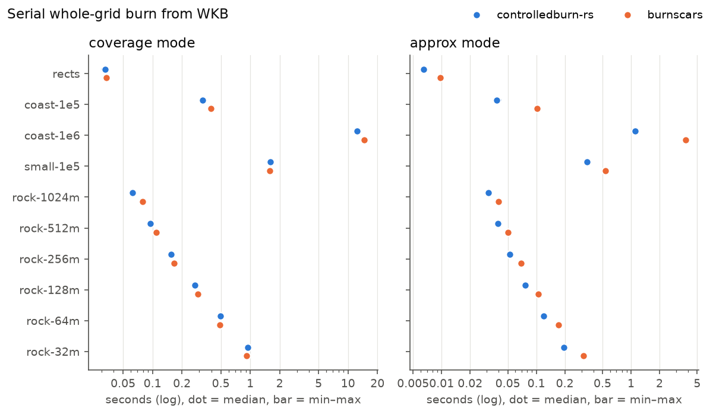
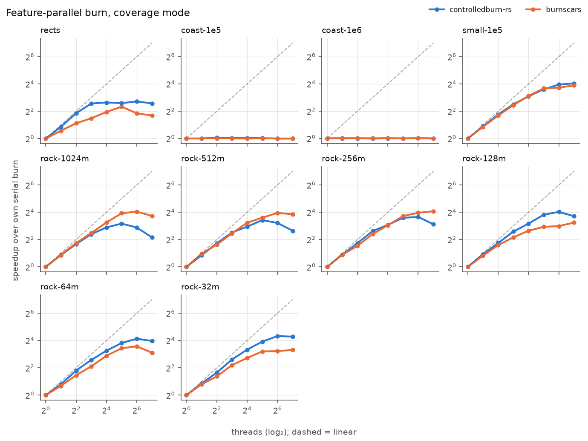
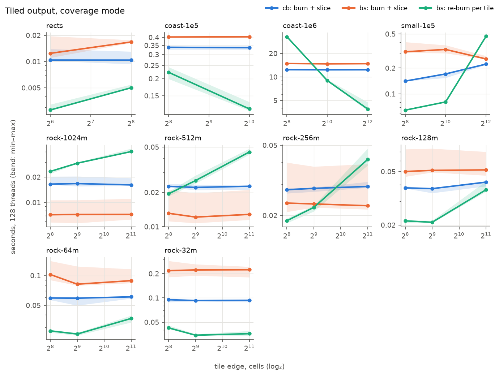

# Results

Machine: AMD EPYC 7763 64-Core Processor (256 logical CPUs, 250.6 GB), Ubuntu 24.04.5 LTS, kernel 6.4.0-150700.53.87-default. Label: setonix-work Slurm job 52949684.  
controlledburn-rs `0.3.2`, burnscars `1d24ef7f14`, rustc 1.99.1 (58cf8f9c3 2026-10-13).

Times are seconds, median [min–max] over the repeats after one warm-up. RSS is the peak resident set of the whole process (input included), MB.

Memory: transparent huge pages `[always] madvise never` (defrag `always defer defer+madvise [madvise] never`), glibc 2.39, GLIBC_TUNABLES `unset`, MALLOC_ARENA_MAX `unset`.

## Correctness (before timing)

Cells compared per geometry id, with records on the same cell summed (cb keeps one record per polygon part, bs one per geometry). `equal` is bit-equal; `≤1e-6` differs only by float rounding.

| input | mode | cells | equal | ≤1e-6 | differ | only cb | only bs | bs failed | par = serial (cb/bs) | area rel. err cb / bs | exact oracle cb / bs |
|---|---|---|---|---|---|---|---|---|---|---|---|
| rects | coverage | 3,070,060 | 3,070,060 | 0 | 0 | 0 | 0 | 0 | True/True | 4.6e-08 / 4.6e-08 | 0 / 0 cells wrong, 1 below tol. |
| rects | approx | 2,953,284 | 2,953,284 | 0 | 0 | 0 | 0 | 0 | True/True | – | – |
| coast-1e5 | coverage | 8,792,488 | 8,792,488 | 0 | 0 | 0 | 0 | 0 | True/True | 9.1e-13 / 9.1e-13 | – |
| coast-1e5 | approx | 8,498,929 | 8,498,929 | 0 | 0 | 0 | 0 | 0 | True/True | – | – |
| coast-1e6 | coverage | 141,096,607 | 141,096,607 | 0 | 0 | 0 | 0 | 0 | True/True | 1.5e-13 / 1.5e-13 | – |
| coast-1e6 | approx | 135,987,644 | 135,987,644 | 0 | 0 | 0 | 0 | 0 | True/True | – | – |
| small-1e5 | coverage | 46,880,169 | 46,880,169 | 0 | 0 | 0 | 0 | 0 | True/True | 1.8e-07 / 1.8e-07 | – |
| small-1e5 | approx | 41,118,887 | 41,118,887 | 0 | 0 | 0 | 0 | 0 | True/True | – | – |
| rock-1024m | coverage | 190,172 | 190,172 | 0 | 0 | 0 | 0 | 0 | True/True | 6.1e-05 / 6.1e-05 | – |
| rock-1024m | approx | 68,215 | 68,215 | 0 | 0 | 0 | 0 | 0 | True/True | – | – |
| rock-512m | coverage | 499,386 | 499,386 | 0 | 0 | 0 | 0 | 0 | True/True | 1.1e-05 / 1.1e-05 | – |
| rock-512m | approx | 272,827 | 272,827 | 0 | 0 | 0 | 0 | 0 | True/True | – | – |
| rock-256m | coverage | 1,529,471 | 1,529,471 | 0 | 0 | 0 | 0 | 0 | True/True | 1.1e-05 / 1.1e-05 | – |
| rock-256m | approx | 1,091,557 | 1,091,557 | 0 | 0 | 0 | 0 | 0 | True/True | – | – |
| rock-128m | coverage | 5,226,174 | 5,226,174 | 0 | 0 | 0 | 0 | 0 | True/True | 6.0e-07 / 6.0e-07 | – |
| rock-128m | approx | 4,365,945 | 4,365,945 | 0 | 0 | 0 | 0 | 0 | True/True | – | – |
| rock-64m | coverage | 19,167,350 | 19,167,350 | 0 | 0 | 0 | 0 | 0 | True/True | 4.4e-07 / 4.4e-07 | – |
| rock-64m | approx | 17,465,467 | 17,465,467 | 0 | 0 | 0 | 0 | 0 | True/True | – | – |
| rock-32m | coverage | 73,248,217 | 73,248,216 | 0 | 1 | 0 | 0 | 0 | True/True | 2.9e-05 / 1.4e-03 | – |
| rock-32m | approx | 69,858,116 | 69,858,116 | 0 | 0 | 0 | 1 | 0 | True/True | – | – |

- rock-32m coverage: t0 id 25589 row 33647 col 11075: a 1 b 0.020908592268824577
- rock-32m approx: only b: t0 id 25938 row 33523 cols 11740..11741 v 1

## A. Single thread, whole grid

| input | mode | records cb / bs | cb_burn | bs_burn | RSS cb / bs |
|---|---|---|---|---|---|
| rects | coverage | 300,873 / 357,049 | 0.0327 [0.0304–0.0338] | 0.0336 [0.0332–0.0338] | 10 / 9 |
| rects | approx | 75,559 / 75,559 | 0.00642 [0.00636–0.00697] | 0.00968 [0.00936–0.0103] | 2 / 4 |
| coast-1e5 | coverage | 598,361 / 598,513 | 0.325 [0.323–0.33] | 0.394 [0.393–0.397] | 325 / 350 |
| coast-1e5 | approx | 88,164 / 226,436 | 0.0379 [0.0377–0.0419] | 0.101 [0.101–0.106] | 40 / 77 |
| coast-1e6 | coverage | 10,246,638 / 10,248,896 | 12.4 [12.3–12.4] | 14.7 [14.6–14.7] | 6921 / 12467 |
| coast-1e6 | approx | 1,441,909 / 4,408,666 | 1.1 [1.1–1.13] | 3.76 [3.76–3.76] | 1277 / 2748 |
| small-1e5 | coverage | 13,648,408 / 13,654,453 | 1.61 [1.6–1.61] | 1.58 [1.57–1.59] | 263 / 324 |
| small-1e5 | approx | 2,719,190 / 2,783,483 | 0.344 [0.344–0.348] | 0.537 [0.534–0.552] | 97 / 147 |
| rock-1024m | coverage | 180,873 / 180,883 | 0.0629 [0.0627–0.0635] | 0.0788 [0.0786–0.0794] | 43 / 44 |
| rock-1024m | approx | 35,557 / 38,130 | 0.0312 [0.0312–0.0318] | 0.0401 [0.0399–0.0405] | 45 / 43 |
| rock-512m | coverage | 418,762 / 418,824 | 0.0947 [0.0947–0.095] | 0.109 [0.109–0.11] | 44 / 45 |
| rock-512m | approx | 92,154 / 95,412 | 0.0391 [0.0389–0.0396] | 0.0505 [0.0504–0.0509] | 45 / 44 |
| rock-256m | coverage | 961,060 / 961,357 | 0.155 [0.155–0.155] | 0.166 [0.166–0.167] | 51 / 52 |
| rock-256m | approx | 201,464 / 204,559 | 0.0522 [0.0521–0.0532] | 0.0695 [0.0694–0.0702] | 45 / 43 |
| rock-128m | coverage | 2,032,881 / 2,033,672 | 0.273 [0.272–0.273] | 0.29 [0.29–0.29] | 80 / 76 |
| rock-128m | approx | 415,818 / 419,077 | 0.0762 [0.0759–0.0776] | 0.105 [0.105–0.107] | 44 / 44 |
| rock-64m | coverage | 4,148,168 / 4,150,047 | 0.497 [0.497–0.498] | 0.486 [0.485–0.488] | 105 / 125 |
| rock-64m | approx | 843,822 / 847,553 | 0.12 [0.119–0.12] | 0.172 [0.172–0.174] | 44 / 55 |
| rock-32m | coverage | 8,378,234 / 8,382,115 | 0.938 [0.936–0.939] | 0.916 [0.888–0.92] | 194 / 214 |
| rock-32m | approx | 1,700,501 / 1,704,484 | 0.196 [0.196–0.196] | 0.313 [0.304–0.316] | 71 / 78 |

## B. Thread scaling, feature-parallel whole-grid burn

Speedup is the serial median over the parallel median, each engine against its own serial burn.

| input | mode | threads | cb_par | speedup | bs_par | speedup | RSS cb / bs |
|---|---|---|---|---|---|---|---|
| rects | coverage | 2 | 0.0179 [0.0176–0.0193] | 1.8× | 0.0225 [0.0216–0.0233] | 1.5× | 10 / 16 |
| rects | coverage | 4 | 0.00901 [0.00876–0.0118] | 3.6× | 0.0154 [0.0149–0.0158] | 2.2× | 7 / 15 |
| rects | coverage | 8 | 0.00551 [0.00524–0.00818] | 5.9× | 0.012 [0.0117–0.0125] | 2.8× | 14 / 15 |
| rects | coverage | 16 | 0.00522 [0.00519–0.00735] | 6.3× | 0.00868 [0.00822–0.00923] | 3.9× | 9 / 10 |
| rects | coverage | 32 | 0.00539 [0.0053–0.00736] | 6.1× | 0.00666 [0.00659–0.00685] | 5.0× | 8 / 11 |
| rects | coverage | 64 | 0.00495 [0.00477–0.00746] | 6.6× | 0.00931 [0.00866–0.00948] | 3.6× | 16 / 18 |
| rects | coverage | 128 | 0.00547 [0.00508–0.00718] | 6.0× | 0.0104 [0.0101–0.0108] | 3.2× | 23 / 21 |
| rects | approx | 2 | 0.00365 [0.00347–0.00522] | 1.8× | 0.00594 [0.00566–0.00628] | 1.6× | 4 / 4 |
| rects | approx | 4 | 0.00244 [0.00226–0.0029] | 2.6× | 0.0034 [0.00339–0.00363] | 2.8× | 2 / 4 |
| rects | approx | 8 | 0.0016 [0.00148–0.00242] | 4.0× | 0.00284 [0.00273–0.00289] | 3.4× | 4 / 4 |
| rects | approx | 16 | 0.00167 [0.00162–0.00261] | 3.9× | 0.00245 [0.00229–0.00268] | 3.9× | 4 / 4 |
| rects | approx | 32 | 0.00165 [0.00159–0.00242] | 3.9× | 0.00349 [0.00324–0.00366] | 2.8× | 5 / 7 |
| rects | approx | 64 | 0.00184 [0.00157–0.00244] | 3.5× | 0.00355 [0.0032–0.00462] | 2.7× | 7 / 9 |
| rects | approx | 128 | 0.00183 [0.00166–0.00271] | 3.5× | 0.00552 [0.00508–0.00624] | 1.8× | 11 / 17 |
| coast-1e5 | coverage | 2 | 0.325 [0.32–0.336] | 1.0× | 0.392 [0.39–0.394] | 1.0× | 310 / 351 |
| coast-1e5 | coverage | 4 | 0.31 [0.309–0.326] | 1.0× | 0.392 [0.391–0.397] | 1.0× | 343 / 356 |
| coast-1e5 | coverage | 8 | 0.317 [0.313–0.339] | 1.0× | 0.394 [0.392–0.396] | 1.0× | 342 / 349 |
| coast-1e5 | coverage | 16 | 0.318 [0.312–0.332] | 1.0× | 0.395 [0.395–0.399] | 1.0× | 310 / 357 |
| coast-1e5 | coverage | 32 | 0.319 [0.311–0.329] | 1.0× | 0.392 [0.391–0.393] | 1.0× | 329 / 348 |
| coast-1e5 | coverage | 64 | 0.327 [0.314–0.335] | 1.0× | 0.393 [0.392–0.397] | 1.0× | 347 / 361 |
| coast-1e5 | coverage | 128 | 0.325 [0.317–0.334] | 1.0× | 0.396 [0.392–0.398] | 1.0× | 351 / 360 |
| coast-1e5 | approx | 2 | 0.0378 [0.0377–0.0379] | 1.0× | 0.102 [0.101–0.106] | 1.0× | 40 / 76 |
| coast-1e5 | approx | 4 | 0.038 [0.0378–0.0542] | 1.0× | 0.104 [0.104–0.113] | 1.0× | 63 / 80 |
| coast-1e5 | approx | 8 | 0.0379 [0.0379–0.0543] | 1.0× | 0.104 [0.104–0.111] | 1.0× | 63 / 82 |
| coast-1e5 | approx | 16 | 0.0376 [0.0375–0.054] | 1.0× | 0.102 [0.102–0.106] | 1.0× | 63 / 76 |
| coast-1e5 | approx | 32 | 0.0378 [0.0377–0.0554] | 1.0× | 0.104 [0.104–0.113] | 1.0× | 62 / 115 |
| coast-1e5 | approx | 64 | 0.0379 [0.0378–0.0553] | 1.0× | 0.104 [0.104–0.111] | 1.0× | 68 / 84 |
| coast-1e5 | approx | 128 | 0.0381 [0.0376–0.0551] | 1.0× | 0.108 [0.104–0.112] | 0.9× | 71 / 157 |
| coast-1e6 | coverage | 2 | 12.4 [12.4–12.4] | 1.0× | 14.6 [14.6–14.7] | 1.0× | 6923 / 12460 |
| coast-1e6 | coverage | 4 | 12.3 [12.2–12.5] | 1.0× | 14.6 [14.6–14.7] | 1.0× | 7457 / 12481 |
| coast-1e6 | coverage | 8 | 12.5 [12.4–14.3] | 1.0× | 14.7 [14.6–14.8] | 1.0× | 7456 / 12480 |
| coast-1e6 | coverage | 16 | 12.4 [12.2–12.8] | 1.0× | 14.6 [14.6–14.7] | 1.0× | 7457 / 12481 |
| coast-1e6 | coverage | 32 | 12.4 [12.3–12.8] | 1.0× | 14.8 [14.7–14.8] | 1.0× | 7460 / 12480 |
| coast-1e6 | coverage | 64 | 12.3 [12.2–12.7] | 1.0× | 14.6 [14.6–14.7] | 1.0× | 7460 / 12484 |
| coast-1e6 | coverage | 128 | 12.5 [12.4–12.7] | 1.0× | 14.7 [14.6–14.8] | 1.0× | 7469 / 12504 |
| coast-1e6 | approx | 2 | 1.1 [1.1–1.13] | 1.0× | 3.78 [3.78–3.78] | 1.0× | 1276 / 2728 |
| coast-1e6 | approx | 4 | 1.1 [1.1–1.13] | 1.0× | 3.77 [3.76–3.77] | 1.0× | 1277 / 2768 |
| coast-1e6 | approx | 8 | 1.1 [1.1–1.52] | 1.0× | 3.77 [3.77–3.78] | 1.0× | 1940 / 2767 |
| coast-1e6 | approx | 16 | 1.1 [1.1–1.53] | 1.0× | 3.78 [3.77–3.78] | 1.0× | 1941 / 2729 |
| coast-1e6 | approx | 32 | 1.11 [1.1–1.53] | 1.0× | 3.78 [3.77–3.78] | 1.0× | 1940 / 2717 |
| coast-1e6 | approx | 64 | 1.1 [1.1–1.52] | 1.0× | 3.77 [3.77–3.78] | 1.0× | 1944 / 2771 |
| coast-1e6 | approx | 128 | 1.13 [1.11–1.54] | 1.0× | 3.78 [3.78–3.79] | 1.0× | 2095 / 2796 |
| small-1e5 | coverage | 2 | 0.86 [0.854–0.867] | 1.9× | 0.867 [0.857–0.891] | 1.8× | 504 / 555 |
| small-1e5 | coverage | 4 | 0.473 [0.472–0.478] | 3.4× | 0.491 [0.482–0.497] | 3.2× | 485 / 561 |
| small-1e5 | coverage | 8 | 0.28 [0.278–0.284] | 5.7× | 0.288 [0.278–0.304] | 5.5× | 428 / 572 |
| small-1e5 | coverage | 16 | 0.188 [0.18–0.189] | 8.5× | 0.179 [0.178–0.201] | 8.8× | 405 / 648 |
| small-1e5 | coverage | 32 | 0.131 [0.129–0.132] | 12.2× | 0.123 [0.121–0.141] | 12.8× | 395 / 618 |
| small-1e5 | coverage | 64 | 0.103 [0.103–0.104] | 15.6× | 0.118 [0.116–0.12] | 13.3× | 371 / 614 |
| small-1e5 | coverage | 128 | 0.0971 [0.0963–0.1] | 16.5× | 0.106 [0.105–0.108] | 14.9× | 361 / 627 |
| small-1e5 | approx | 2 | 0.203 [0.197–0.204] | 1.7× | 0.28 [0.279–0.299] | 1.9× | 126 / 207 |
| small-1e5 | approx | 4 | 0.112 [0.109–0.114] | 3.1× | 0.161 [0.148–0.169] | 3.3× | 126 / 219 |
| small-1e5 | approx | 8 | 0.0673 [0.0659–0.0687] | 5.1× | 0.0962 [0.0941–0.103] | 5.6× | 121 / 222 |
| small-1e5 | approx | 16 | 0.0476 [0.0471–0.0511] | 7.2× | 0.0515 [0.0504–0.0691] | 10.4× | 117 / 222 |
| small-1e5 | approx | 32 | 0.0352 [0.0348–0.0378] | 9.8× | 0.0531 [0.0421–0.059] | 10.1× | 104 / 219 |
| small-1e5 | approx | 64 | 0.0275 [0.027–0.0297] | 12.5× | 0.0445 [0.0417–0.0495] | 12.1× | 104 / 198 |
| small-1e5 | approx | 128 | 0.0303 [0.0301–0.0342] | 11.3× | 0.0465 [0.0322–0.0538] | 11.6× | 149 / 156 |
| rock-1024m | coverage | 2 | 0.0348 [0.0344–0.0361] | 1.8× | 0.0425 [0.0424–0.0428] | 1.9× | 43 / 44 |
| rock-1024m | coverage | 4 | 0.0198 [0.0194–0.0204] | 3.2× | 0.0236 [0.0231–0.0268] | 3.3× | 45 / 42 |
| rock-1024m | coverage | 8 | 0.0119 [0.0113–0.014] | 5.3× | 0.0141 [0.0137–0.0171] | 5.6× | 44 / 42 |
| rock-1024m | coverage | 16 | 0.00848 [0.00813–0.011] | 7.4× | 0.00825 [0.00758–0.0109] | 9.6× | 44 / 44 |
| rock-1024m | coverage | 32 | 0.00697 [0.00663–0.00742] | 9.0× | 0.00518 [0.00492–0.00794] | 15.2× | 45 / 43 |
| rock-1024m | coverage | 64 | 0.00851 [0.00817–0.0118] | 7.4× | 0.00477 [0.00448–0.00656] | 16.5× | 50 / 43 |
| rock-1024m | coverage | 128 | 0.0141 [0.0134–0.0164] | 4.5× | 0.00593 [0.00421–0.00804] | 13.3× | 60 / 44 |
| rock-1024m | approx | 2 | 0.0185 [0.018–0.0199] | 1.7× | 0.0221 [0.0219–0.0222] | 1.8× | 43 / 44 |
| rock-1024m | approx | 4 | 0.0125 [0.0111–0.0133] | 2.5× | 0.0115 [0.0114–0.0122] | 3.5× | 42 / 44 |
| rock-1024m | approx | 8 | 0.00732 [0.00688–0.00764] | 4.3× | 0.00658 [0.00607–0.00746] | 6.1× | 43 / 44 |
| rock-1024m | approx | 16 | 0.00542 [0.00535–0.00669] | 5.8× | 0.00377 [0.00362–0.00427] | 10.6× | 44 / 43 |
| rock-1024m | approx | 32 | 0.00548 [0.00528–0.007] | 5.7× | 0.00312 [0.00302–0.00382] | 12.8× | 44 / 45 |
| rock-1024m | approx | 64 | 0.008 [0.00726–0.00951] | 3.9× | 0.00389 [0.00331–0.00526] | 10.3× | 43 / 44 |
| rock-1024m | approx | 128 | 0.0123 [0.0121–0.0137] | 2.5× | 0.00573 [0.00513–0.00735] | 7.0× | 53 / 44 |
| rock-512m | coverage | 2 | 0.0527 [0.052–0.0532] | 1.8× | 0.0563 [0.0562–0.0569] | 1.9× | 44 / 48 |
| rock-512m | coverage | 4 | 0.0285 [0.0281–0.0297] | 3.3× | 0.0353 [0.0325–0.0418] | 3.1× | 45 / 60 |
| rock-512m | coverage | 8 | 0.0166 [0.0163–0.0189] | 5.7× | 0.02 [0.0199–0.0206] | 5.5× | 44 / 52 |
| rock-512m | coverage | 16 | 0.0123 [0.0112–0.0145] | 7.7× | 0.0117 [0.0116–0.0171] | 9.4× | 43 / 51 |
| rock-512m | coverage | 32 | 0.00882 [0.00863–0.0115] | 10.7× | 0.009 [0.00764–0.0138] | 12.2× | 44 / 51 |
| rock-512m | coverage | 64 | 0.0102 [0.00973–0.0136] | 9.3× | 0.00706 [0.00667–0.0126] | 15.5× | 62 / 51 |
| rock-512m | coverage | 128 | 0.0151 [0.0145–0.0168] | 6.3× | 0.00757 [0.00695–0.0145] | 14.5× | 67 / 65 |
| rock-512m | approx | 2 | 0.0233 [0.0228–0.0234] | 1.7× | 0.0273 [0.0273–0.0279] | 1.9× | 45 / 44 |
| rock-512m | approx | 4 | 0.0139 [0.0137–0.0146] | 2.8× | 0.0149 [0.0143–0.016] | 3.4× | 43 / 44 |
| rock-512m | approx | 8 | 0.00836 [0.00801–0.00857] | 4.7× | 0.00874 [0.00756–0.00922] | 5.8× | 44 / 44 |
| rock-512m | approx | 16 | 0.00633 [0.00622–0.00648] | 6.2× | 0.00526 [0.00507–0.00681] | 9.6× | 43 / 43 |
| rock-512m | approx | 32 | 0.00595 [0.00557–0.00807] | 6.6× | 0.00427 [0.00383–0.00581] | 11.8× | 42 / 44 |
| rock-512m | approx | 64 | 0.00808 [0.00767–0.0104] | 4.8× | 0.00556 [0.00431–0.00751] | 9.1× | 48 / 42 |
| rock-512m | approx | 128 | 0.0127 [0.0123–0.014] | 3.1× | 0.00752 [0.00658–0.00931] | 6.7× | 51 / 43 |
| rock-256m | coverage | 2 | 0.0834 [0.0827–0.0857] | 1.9× | 0.0901 [0.0898–0.0911] | 1.8× | 59 / 69 |
| rock-256m | coverage | 4 | 0.0465 [0.0449–0.0493] | 3.3× | 0.0572 [0.0493–0.0662] | 2.9× | 76 / 108 |
| rock-256m | coverage | 8 | 0.0253 [0.025–0.0295] | 6.2× | 0.0314 [0.03–0.0356] | 5.3× | 77 / 78 |
| rock-256m | coverage | 16 | 0.0184 [0.018–0.0186] | 8.4× | 0.0201 [0.019–0.0291] | 8.3× | 56 / 106 |
| rock-256m | coverage | 32 | 0.0129 [0.0124–0.0164] | 12.1× | 0.0126 [0.0118–0.0214] | 13.2× | 67 / 101 |
| rock-256m | coverage | 64 | 0.0123 [0.012–0.0175] | 12.6× | 0.0107 [0.00935–0.0212] | 15.6× | 84 / 100 |
| rock-256m | coverage | 128 | 0.0179 [0.0174–0.0217] | 8.7× | 0.00986 [0.00902–0.0217] | 16.9× | 100 / 108 |
| rock-256m | approx | 2 | 0.0294 [0.0292–0.0298] | 1.8× | 0.0362 [0.036–0.0362] | 1.9× | 45 / 44 |
| rock-256m | approx | 4 | 0.0176 [0.0171–0.0196] | 3.0× | 0.0205 [0.0192–0.0251] | 3.4× | 43 / 44 |
| rock-256m | approx | 8 | 0.0102 [0.0101–0.0111] | 5.1× | 0.0127 [0.0113–0.0155] | 5.5× | 44 / 43 |
| rock-256m | approx | 16 | 0.00755 [0.00735–0.0103] | 6.9× | 0.00762 [0.00665–0.0106] | 9.1× | 44 / 45 |
| rock-256m | approx | 32 | 0.00749 [0.00653–0.00998] | 7.0× | 0.00555 [0.00533–0.0095] | 12.5× | 44 / 44 |
| rock-256m | approx | 64 | 0.00882 [0.00853–0.0117] | 5.9× | 0.00631 [0.0056–0.0103] | 11.0× | 54 / 44 |
| rock-256m | approx | 128 | 0.0144 [0.014–0.0172] | 3.6× | 0.0107 [0.00975–0.0144] | 6.5× | 55 / 49 |
| rock-128m | coverage | 2 | 0.143 [0.143–0.147] | 1.9× | 0.163 [0.162–0.164] | 1.8× | 99 / 110 |
| rock-128m | coverage | 4 | 0.0812 [0.0806–0.0827] | 3.4× | 0.0962 [0.0817–0.116] | 3.0× | 104 / 151 |
| rock-128m | coverage | 8 | 0.0454 [0.0447–0.0497] | 6.0× | 0.0647 [0.0625–0.0687] | 4.5× | 108 / 136 |
| rock-128m | coverage | 16 | 0.0303 [0.0299–0.0366] | 9.0× | 0.0463 [0.0444–0.0482] | 6.3× | 113 / 145 |
| rock-128m | coverage | 32 | 0.0193 [0.0188–0.0251] | 14.1× | 0.038 [0.0364–0.0405] | 7.6× | 124 / 154 |
| rock-128m | coverage | 64 | 0.0167 [0.0155–0.022] | 16.3× | 0.0365 [0.0356–0.0378] | 7.9× | 150 / 144 |
| rock-128m | coverage | 128 | 0.0208 [0.0203–0.0267] | 13.1× | 0.0306 [0.0186–0.0331] | 9.5× | 200 / 186 |
| rock-128m | approx | 2 | 0.0429 [0.0423–0.0434] | 1.8× | 0.0547 [0.0539–0.0556] | 1.9× | 44 / 46 |
| rock-128m | approx | 4 | 0.0246 [0.0233–0.0265] | 3.1× | 0.0344 [0.0311–0.0352] | 3.1× | 45 / 54 |
| rock-128m | approx | 8 | 0.0145 [0.0136–0.0162] | 5.3× | 0.0199 [0.0174–0.0247] | 5.3× | 44 / 55 |
| rock-128m | approx | 16 | 0.0103 [0.00979–0.0134] | 7.4× | 0.0114 [0.0113–0.0121] | 9.2× | 43 / 43 |
| rock-128m | approx | 32 | 0.00822 [0.00791–0.0114] | 9.3× | 0.00936 [0.00877–0.0163] | 11.3× | 44 / 52 |
| rock-128m | approx | 64 | 0.00949 [0.00874–0.0121] | 8.0× | 0.00878 [0.00775–0.0165] | 12.0× | 55 / 56 |
| rock-128m | approx | 128 | 0.0147 [0.0143–0.0172] | 5.2× | 0.013 [0.0105–0.0188] | 8.1× | 71 / 65 |
| rock-64m | coverage | 2 | 0.285 [0.284–0.286] | 1.7× | 0.303 [0.297–0.31] | 1.6× | 169 / 191 |
| rock-64m | coverage | 4 | 0.143 [0.141–0.148] | 3.5× | 0.177 [0.145–0.179] | 2.7× | 202 / 339 |
| rock-64m | coverage | 8 | 0.0832 [0.0819–0.0855] | 6.0× | 0.112 [0.107–0.123] | 4.3× | 222 / 266 |
| rock-64m | coverage | 16 | 0.0519 [0.0502–0.0563] | 9.6× | 0.0656 [0.0635–0.0715] | 7.4× | 225 / 284 |
| rock-64m | coverage | 32 | 0.0353 [0.0349–0.0377] | 14.1× | 0.0449 [0.0432–0.0622] | 10.8× | 244 / 327 |
| rock-64m | coverage | 64 | 0.0282 [0.0282–0.0308] | 17.6× | 0.0406 [0.0393–0.0565] | 12.0× | 271 / 341 |
| rock-64m | coverage | 128 | 0.0318 [0.0302–0.0344] | 15.6× | 0.0564 [0.0534–0.0593] | 8.6× | 343 / 451 |
| rock-64m | approx | 2 | 0.0637 [0.0631–0.0646] | 1.9× | 0.0938 [0.0921–0.0964] | 1.8× | 53 / 66 |
| rock-64m | approx | 4 | 0.0365 [0.0357–0.0403] | 3.3× | 0.0571 [0.0511–0.0615] | 3.0× | 62 / 75 |
| rock-64m | approx | 8 | 0.0204 [0.0201–0.0246] | 5.9× | 0.0334 [0.032–0.0402] | 5.2× | 62 / 90 |
| rock-64m | approx | 16 | 0.0135 [0.0134–0.0167] | 8.9× | 0.0201 [0.0194–0.0219] | 8.6× | 52 / 75 |
| rock-64m | approx | 32 | 0.0111 [0.0107–0.015] | 10.7× | 0.0123 [0.0117–0.0234] | 14.0× | 56 / 91 |
| rock-64m | approx | 64 | 0.011 [0.0108–0.0148] | 10.9× | 0.0128 [0.0116–0.0228] | 13.4× | 72 / 94 |
| rock-64m | approx | 128 | 0.0156 [0.0153–0.0193] | 7.7× | 0.0152 [0.0132–0.0251] | 11.3× | 80 / 103 |
| rock-32m | coverage | 2 | 0.519 [0.518–0.521] | 1.8× | 0.526 [0.522–0.527] | 1.7× | 335 / 418 |
| rock-32m | coverage | 4 | 0.298 [0.297–0.302] | 3.1× | 0.353 [0.307–0.367] | 2.6× | 330 / 478 |
| rock-32m | coverage | 8 | 0.154 [0.153–0.158] | 6.1× | 0.199 [0.189–0.209] | 4.6× | 406 / 556 |
| rock-32m | coverage | 16 | 0.0929 [0.0926–0.1] | 10.1× | 0.138 [0.134–0.148] | 6.6× | 431 / 546 |
| rock-32m | coverage | 32 | 0.0619 [0.0611–0.0661] | 15.2× | 0.0995 [0.0955–0.109] | 9.2× | 460 / 611 |
| rock-32m | coverage | 64 | 0.0466 [0.0463–0.0516] | 20.1× | 0.0978 [0.0952–0.0993] | 9.4× | 552 / 684 |
| rock-32m | coverage | 128 | 0.0481 [0.0456–0.0519] | 19.5× | 0.0921 [0.083–0.0931] | 9.9× | 709 / 684 |
| rock-32m | approx | 2 | 0.105 [0.104–0.109] | 1.9× | 0.176 [0.172–0.18] | 1.8× | 88 / 104 |
| rock-32m | approx | 4 | 0.0563 [0.0559–0.0594] | 3.5× | 0.112 [0.105–0.117] | 2.8× | 88 / 128 |
| rock-32m | approx | 8 | 0.0326 [0.0322–0.0379] | 6.0× | 0.0668 [0.0586–0.0748] | 4.7× | 77 / 154 |
| rock-32m | approx | 16 | 0.0208 [0.0204–0.0254] | 9.4× | 0.0471 [0.0458–0.049] | 6.6× | 80 / 138 |
| rock-32m | approx | 32 | 0.0153 [0.0141–0.019] | 12.8× | 0.0338 [0.0227–0.0363] | 9.3× | 63 / 148 |
| rock-32m | approx | 64 | 0.0141 [0.0136–0.0177] | 13.9× | 0.0277 [0.021–0.0361] | 11.3× | 106 / 108 |
| rock-32m | approx | 128 | 0.0188 [0.0187–0.0228] | 10.4× | 0.0246 [0.0234–0.0376] | 12.7× | 125 / 119 |

`burn_wkb_par` (`cb_par`) against the harness's earlier feature-parallel burn (groups burned in a rayon pool, concatenated), at 128 threads. Both parse the WKB as they burn.

| input | mode | cb_par | cb_par_groups | ratio |
|---|---|---|---|---|
| rects | coverage | 0.00547 [0.00508–0.00718] | 0.0044 [0.00391–0.00798] | 1.24 |
| rects | approx | 0.00183 [0.00166–0.00271] | 0.00275 [0.00199–0.00448] | 0.66 |
| coast-1e5 | coverage | 0.325 [0.317–0.334] | 0.326 [0.315–0.33] | 1.00 |
| coast-1e5 | approx | 0.0381 [0.0376–0.0551] | 0.0379 [0.0378–0.0542] | 1.00 |
| coast-1e6 | coverage | 12.5 [12.4–12.7] | 12.5 [12.4–12.8] | 1.01 |
| coast-1e6 | approx | 1.13 [1.11–1.54] | 1.26 [1.12–1.54] | 0.90 |
| small-1e5 | coverage | 0.0971 [0.0963–0.1] | 0.107 [0.105–0.115] | 0.91 |
| small-1e5 | approx | 0.0303 [0.0301–0.0342] | 0.026 [0.0245–0.0286] | 1.17 |
| rock-1024m | coverage | 0.0141 [0.0134–0.0164] | 0.00504 [0.00368–0.00583] | 2.79 |
| rock-1024m | approx | 0.0123 [0.0121–0.0137] | 0.00247 [0.00233–0.00263] | 4.96 |
| rock-512m | coverage | 0.0151 [0.0145–0.0168] | 0.00591 [0.00567–0.0104] | 2.56 |
| rock-512m | approx | 0.0127 [0.0123–0.014] | 0.00353 [0.00251–0.00396] | 3.60 |
| rock-256m | coverage | 0.0179 [0.0174–0.0217] | 0.0107 [0.00769–0.0145] | 1.67 |
| rock-256m | approx | 0.0144 [0.014–0.0172] | 0.00349 [0.00291–0.0063] | 4.12 |
| rock-128m | coverage | 0.0208 [0.0203–0.0267] | 0.0191 [0.0182–0.024] | 1.09 |
| rock-128m | approx | 0.0147 [0.0143–0.0172] | 0.00463 [0.00336–0.00849] | 3.19 |
| rock-64m | coverage | 0.0318 [0.0302–0.0344] | 0.0336 [0.0323–0.0392] | 0.94 |
| rock-64m | approx | 0.0156 [0.0153–0.0193] | 0.0068 [0.00629–0.012] | 2.30 |
| rock-32m | coverage | 0.0481 [0.0456–0.0519] | 0.0658 [0.0638–0.0733] | 0.73 |
| rock-32m | approx | 0.0188 [0.0187–0.0228] | 0.0163 [0.0156–0.0209] | 1.16 |

## C. Tiles: burn once and slice, against re-burn per fixed tile

`cb_slice` / `bs_slice`: whole-grid burn (feature-parallel when threads > 1), then a one-pass slice; burn and slice times shown. cb slices on the same threads (`slice_tiles_par`), bs's slice is serial. `bs_reburn`: each tile burns the geometries whose bbox meets it onto `grid.window(tile)`, parallel over tiles. pairs = geometry–tile pairs burned.

| input | mode | tile | threads | tiles (non-empty) | cb_slice total (burn + slice) | bs_slice total (burn + slice) | bs_reburn total (pairs) | RSS cb / bs / reburn |
|---|---|---|---|---|---|---|---|---|
| rects | coverage | 64 | 1 | 176 (176) | 0.0383 [0.0349–0.0462] (0.0315 + 0.00603) | 0.0366 [0.0362–0.0403] (0.0298 + 0.00618) | 0.0427 [0.0427–0.0429] (5,193) | 15 / 16 / 2 |
| rects | coverage | 64 | 128 | 176 (176) | 0.0104 [0.0102–0.0139] (0.00534 + 0.00532) | 0.0124 [0.0111–0.0196] (0.00581 + 0.00625) | 0.00279 [0.00274–0.00323] (5,193) | 43 / 37 / 11 |
| rects | coverage | 256 | 1 | 12 (12) | 0.0392 [0.0383–0.0441] (0.0328 + 0.00566) | 0.0402 [0.0387–0.0404] (0.0327 + 0.00654) | 0.0372 [0.037–0.0375] (2,506) | 13 / 14 / 2 |
| rects | coverage | 256 | 2 | 12 (12) | 0.0235 [0.0225–0.0264] (0.0186 + 0.00488) | 0.0281 [0.0252–0.0292] (0.0213 + 0.00554) | 0.0209 [0.0199–0.021] (2,506) | 12 / 21 / 2 |
| rects | coverage | 256 | 4 | 12 (12) | 0.0147 [0.0139–0.0179] (0.0097 + 0.00475) | 0.0215 [0.0205–0.0229] (0.0148 + 0.00568) | 0.0108 [0.0103–0.0118] (2,506) | 17 / 21 / 2 |
| rects | coverage | 256 | 8 | 12 (12) | 0.0115 [0.0112–0.0145] (0.00634 + 0.00532) | 0.0133 [0.0133–0.0173] (0.00749 + 0.0055) | 0.00765 [0.00707–0.00813] (2,506) | 32 / 17 / 4 |
| rects | coverage | 256 | 16 | 12 (12) | 0.0106 [0.0104–0.0138] (0.00557 + 0.00514) | 0.0157 [0.0147–0.0171] (0.0078 + 0.0069) | 0.00506 [0.00482–0.00538] (2,506) | 25 / 18 / 2 |
| rects | coverage | 256 | 32 | 12 (12) | 0.0112 [0.0103–0.0141] (0.00547 + 0.00587) | 0.0153 [0.0151–0.0162] (0.00669 + 0.00744) | 0.00499 [0.00483–0.0053] (2,506) | 26 / 20 / 5 |
| rects | coverage | 256 | 64 | 12 (12) | 0.011 [0.0109–0.0141] (0.00547 + 0.00553) | 0.0148 [0.0147–0.0162] (0.00762 + 0.00629) | 0.00517 [0.00503–0.00532] (2,506) | 32 / 25 / 7 |
| rects | coverage | 256 | 128 | 12 (12) | 0.0104 [0.00935–0.013] (0.00541 + 0.00486) | 0.0168 [0.0164–0.0177] (0.00849 + 0.00688) | 0.00501 [0.00496–0.00546] (2,506) | 40 / 27 / 11 |
| rects | approx | 64 | 1 | 176 (176) | 0.0102 [0.00844–0.0108] (0.00727 + 0.00282) | 0.0132 [0.0118–0.0138] (0.0104 + 0.00241) | 0.0159 [0.0158–0.0161] (5,193) | 6 / 6 / 2 |
| rects | approx | 64 | 128 | 176 (176) | 0.00479 [0.00439–0.00647] (0.00186 + 0.00266) | 0.00749 [0.0074–0.00916] (0.00485 + 0.00236) | 0.00366 [0.00361–0.0041] (5,193) | 18 / 21 / 11 |
| rects | approx | 256 | 1 | 12 (12) | 0.00795 [0.00785–0.00951] (0.00663 + 0.00124) | 0.0134 [0.0127–0.0137] (0.0112 + 0.00193) | 0.0106 [0.0106–0.0107] (2,506) | 4 / 6 / 2 |
| rects | approx | 256 | 2 | 12 (12) | 0.0067 [0.0054–0.00738] (0.00426 + 0.00231) | 0.00853 [0.00813–0.0091] (0.00635 + 0.00181) | 0.00605 [0.00598–0.00623] (2,506) | 5 / 5 / 2 |
| rects | approx | 256 | 4 | 12 (12) | 0.00513 [0.00478–0.00565] (0.00262 + 0.00213) | 0.0058 [0.00566–0.00586] (0.00371 + 0.00178) | 0.00327 [0.0031–0.00341] (2,506) | 6 / 4 / 2 |
| rects | approx | 256 | 8 | 12 (12) | 0.00386 [0.00314–0.00486] (0.00172 + 0.0019) | 0.0049 [0.00476–0.00527] (0.00279 + 0.00189) | 0.00261 [0.00252–0.00284] (2,506) | 4 / 4 / 2 |
| rects | approx | 256 | 16 | 12 (12) | 0.00435 [0.00413–0.00524] (0.0019 + 0.00222) | 0.00462 [0.00445–0.00465] (0.00223 + 0.00207) | 0.00191 [0.00179–0.00205] (2,506) | 8 / 11 / 5 |
| rects | approx | 256 | 32 | 12 (12) | 0.00434 [0.00418–0.00521] (0.00183 + 0.00227) | 0.00529 [0.00513–0.00564] (0.00274 + 0.00219) | 0.00212 [0.00189–0.00221] (2,506) | 9 / 9 / 5 |
| rects | approx | 256 | 64 | 12 (12) | 0.00419 [0.00404–0.00525] (0.00188 + 0.00208) | 0.00546 [0.00537–0.00675] (0.00312 + 0.00202) | 0.00194 [0.00177–0.00204] (2,506) | 11 / 11 / 7 |
| rects | approx | 256 | 128 | 12 (12) | 0.00431 [0.00419–0.00504] (0.00196 + 0.00214) | 0.00737 [0.00629–0.00815] (0.00508 + 0.00183) | 0.00202 [0.00184–0.0022] (2,506) | 19 / 17 / 11 |
| coast-1e5 | coverage | 256 | 1 | 256 (177) | 0.341 [0.333–0.348] (0.333 + 0.0069) | 0.415 [0.404–0.416] (0.406 + 0.00725) | 2.72 [2.72–2.73] (256) | 290 / 346 / 115 |
| coast-1e5 | coverage | 256 | 128 | 256 (177) | 0.339 [0.326–0.343] (0.334 + 0.00454) | 0.403 [0.401–0.407] (0.394 + 0.00767) | 0.223 [0.199–0.243] (256) | 366 / 367 / 6420 |
| coast-1e5 | coverage | 1024 | 1 | 16 (16) | 0.335 [0.333–0.343] (0.329 + 0.00651) | 0.406 [0.404–0.407] (0.397 + 0.00712) | 0.868 [0.866–0.87] (16) | 290 / 349 / 135 |
| coast-1e5 | coverage | 1024 | 2 | 16 (16) | 0.338 [0.327–0.345] (0.33 + 0.0068) | 0.407 [0.402–0.409] (0.397 + 0.00883) | 0.469 [0.463–0.475] (16) | 316 / 346 / 367 |
| coast-1e5 | coverage | 1024 | 4 | 16 (16) | 0.343 [0.332–0.347] (0.337 + 0.005) | 0.404 [0.402–0.408] (0.396 + 0.00865) | 0.264 [0.251–0.265] (16) | 348 / 346 / 590 |
| coast-1e5 | coverage | 1024 | 8 | 16 (16) | 0.327 [0.321–0.346] (0.322 + 0.00548) | 0.402 [0.399–0.404] (0.392 + 0.00759) | 0.182 [0.172–0.188] (16) | 357 / 356 / 1004 |
| coast-1e5 | coverage | 1024 | 16 | 16 (16) | 0.322 [0.317–0.342] (0.317 + 0.00539) | 0.404 [0.401–0.407] (0.395 + 0.00762) | 0.126 [0.118–0.136] (16) | 357 / 358 / 1734 |
| coast-1e5 | coverage | 1024 | 32 | 16 (16) | 0.334 [0.322–0.352] (0.329 + 0.00497) | 0.397 [0.396–0.405] (0.389 + 0.00747) | 0.137 [0.126–0.149] (16) | 305 / 357 / 1833 |
| coast-1e5 | coverage | 1024 | 64 | 16 (16) | 0.335 [0.322–0.34] (0.329 + 0.00491) | 0.406 [0.404–0.41] (0.396 + 0.00842) | 0.143 [0.109–0.187] (16) | 353 / 351 / 2005 |
| coast-1e5 | coverage | 1024 | 128 | 16 (16) | 0.337 [0.326–0.345] (0.33 + 0.00541) | 0.404 [0.4–0.409] (0.396 + 0.00749) | 0.12 [0.117–0.135] (16) | 391 / 371 / 2053 |
| coast-1e5 | approx | 256 | 1 | 256 (173) | 0.0393 [0.0392–0.0397] (0.0368 + 0.00147) | 0.106 [0.105–0.11] (0.103 + 0.00322) | 1.62 [1.61–1.62] (256) | 40 / 79 / 22 |
| coast-1e5 | approx | 256 | 128 | 256 (173) | 0.0395 [0.0393–0.056] (0.037 + 0.00148) | 0.109 [0.105–0.115] (0.106 + 0.00322) | 0.0776 [0.069–0.0788] (256) | 71 / 160 / 1670 |
| coast-1e5 | approx | 1024 | 1 | 16 (16) | 0.0394 [0.0392–0.0422] (0.0371 + 0.00125) | 0.104 [0.104–0.108] (0.101 + 0.00295) | 0.345 [0.344–0.345] (16) | 40 / 77 / 56 |
| coast-1e5 | approx | 1024 | 2 | 16 (16) | 0.0394 [0.0392–0.0436] (0.0371 + 0.0012) | 0.105 [0.105–0.108] (0.102 + 0.00305) | 0.182 [0.175–0.188] (16) | 40 / 76 / 116 |
| coast-1e5 | approx | 1024 | 4 | 16 (16) | 0.0391 [0.039–0.0564] (0.0369 + 0.00118) | 0.108 [0.108–0.116] (0.105 + 0.00303) | 0.103 [0.101–0.109] (16) | 63 / 116 / 176 |
| coast-1e5 | approx | 1024 | 8 | 16 (16) | 0.0392 [0.0391–0.0393] (0.0369 + 0.00119) | 0.11 [0.109–0.115] (0.106 + 0.00311) | 0.0662 [0.0639–0.0719] (16) | 40 / 118 / 275 |
| coast-1e5 | approx | 1024 | 16 | 16 (16) | 0.0395 [0.0392–0.0571] (0.0371 + 0.0012) | 0.106 [0.105–0.111] (0.102 + 0.00298) | 0.0502 [0.0464–0.0518] (16) | 62 / 77 / 486 |
| coast-1e5 | approx | 1024 | 32 | 16 (16) | 0.0392 [0.0392–0.0584] (0.037 + 0.00125) | 0.108 [0.107–0.115] (0.104 + 0.00296) | 0.0466 [0.0421–0.0608] (16) | 63 / 117 / 519 |
| coast-1e5 | approx | 1024 | 64 | 16 (16) | 0.0392 [0.039–0.0392] (0.0369 + 0.00119) | 0.112 [0.108–0.116] (0.109 + 0.00296) | 0.047 [0.0443–0.0516] (16) | 44 / 151 / 637 |
| coast-1e5 | approx | 1024 | 128 | 16 (16) | 0.0401 [0.039–0.0634] (0.0379 + 0.00123) | 0.112 [0.108–0.116] (0.108 + 0.00294) | 0.0519 [0.0501–0.0538] (16) | 71 / 157 / 677 |
| coast-1e6 | coverage | 256 | 1 | 4,096 (2,317) | 12.5 [12.5–12.5] (12.4 + 0.118) | 14.9 [14.9–14.9] (14.7 + 0.16) | 466 [465–466] (3,540) | 6922 / 12444 / 809 |
| coast-1e6 | coverage | 256 | 128 | 4,096 (2,317) | 12.4 [12.4–12.7] (12.3 + 0.0325) | 14.9 [14.8–14.9] (14.7 + 0.158) | 32.8 [32.3–33.3] (3,540) | 7750 / 12488 / 34445 |
| coast-1e6 | coverage | 1024 | 1 | 256 (178) | 12.3 [12.3–12.3] (12.2 + 0.114) | 14.8 [14.8–14.9] (14.7 + 0.153) | 116 [116–118] (256) | 6923 / 12467 / 2171 |
| coast-1e6 | coverage | 1024 | 2 | 256 (178) | 12.5 [12.4–12.6] (12.4 + 0.101) | 14.8 [14.7–14.8] (14.6 + 0.155) | 58.7 [58.7–58.7] (256) | 7008 / 12490 / 4007 |
| coast-1e6 | coverage | 1024 | 4 | 256 (178) | 12.4 [12.4–12.6] (12.3 + 0.0655) | 14.7 [14.7–14.7] (14.5 + 0.151) | 40 [31.7–40.3] (256) | 6966 / 12468 / 6934 |
| coast-1e6 | coverage | 1024 | 8 | 256 (178) | 12.4 [12.4–12.7] (12.3 + 0.0376) | 14.7 [14.7–14.7] (14.6 + 0.148) | 18.5 [18.3–18.7] (256) | 7708 / 12493 / 12025 |
| coast-1e6 | coverage | 1024 | 16 | 256 (178) | 12.5 [12.2–12.5] (12.4 + 0.0285) | 14.7 [14.7–14.7] (14.6 + 0.152) | 11.2 [11–11.4] (256) | 7292 / 12480 / 24492 |
| coast-1e6 | coverage | 1024 | 32 | 256 (178) | 12.5 [12.5–12.9] (12.5 + 0.0319) | 14.9 [14.9–15] (14.8 + 0.138) | 8.89 [8.74–9.08] (256) | 8109 / 12533 / 34299 |
| coast-1e6 | coverage | 1024 | 64 | 256 (178) | 12.3 [12.3–12.6] (12.3 + 0.034) | 14.7 [14.7–14.9] (14.5 + 0.15) | 8.56 [8.17–8.7] (256) | 8000 / 12481 / 51489 |
| coast-1e6 | coverage | 1024 | 128 | 256 (178) | 12.3 [12.3–12.7] (12.3 + 0.036) | 14.7 [14.6–14.7] (14.6 + 0.138) | 8.99 [8.83–9.27] (256) | 7804 / 12496 / 66088 |
| coast-1e6 | coverage | 4096 | 1 | 16 (16) | 12.4 [12.3–12.4] (12.2 + 0.117) | 14.7 [14.7–14.7] (14.6 + 0.116) | 34.1 [34.1–34.3] (16) | 6919 / 12492 / 4924 |
| coast-1e6 | coverage | 4096 | 128 | 16 (16) | 12.4 [12.3–12.7] (12.3 + 0.0638) | 14.8 [14.7–14.8] (14.7 + 0.105) | 3.88 [3.7–4.74] (16) | 7976 / 12487 / 43947 |
| coast-1e6 | approx | 256 | 1 | 4,096 (2,303) | 1.12 [1.12–1.15] (1.09 + 0.0252) | 3.84 [3.83–3.85] (3.77 + 0.0686) | 241 [241–241] (3,540) | 1258 / 2773 / 233 |
| coast-1e6 | approx | 256 | 128 | 4,096 (2,303) | 1.14 [1.12–1.54] (1.13 + 0.00723) | 3.85 [3.85–3.88] (3.78 + 0.0699) | 7.56 [7.51–7.86] (3,540) | 2041 / 2846 / 18123 |
| coast-1e6 | approx | 1024 | 1 | 256 (176) | 1.12 [1.12–1.15] (1.1 + 0.0211) | 3.84 [3.83–3.85] (3.77 + 0.0644) | 54.1 [54.1–54.1] (256) | 1278 / 2792 / 534 |
| coast-1e6 | approx | 1024 | 2 | 256 (176) | 1.12 [1.12–1.15] (1.1 + 0.0181) | 3.84 [3.83–3.86] (3.77 + 0.0721) | 27.3 [27.2–27.3] (256) | 1310 / 2779 / 961 |
| coast-1e6 | approx | 1024 | 4 | 256 (176) | 1.12 [1.12–1.15] (1.1 + 0.0118) | 3.84 [3.83–3.87] (3.76 + 0.0754) | 14.3 [14.2–14.5] (256) | 1309 / 2814 / 2165 |
| coast-1e6 | approx | 1024 | 8 | 256 (176) | 1.12 [1.11–1.53] (1.11 + 0.0103) | 3.84 [3.84–3.86] (3.76 + 0.0778) | 7.55 [7.49–8.39] (256) | 1984 / 2815 / 4265 |
| coast-1e6 | approx | 1024 | 16 | 256 (176) | 1.12 [1.12–1.54] (1.11 + 0.009) | 3.84 [3.82–3.86] (3.76 + 0.0734) | 4.23 [4.07–4.34] (256) | 1973 / 2885 / 8337 |
| coast-1e6 | approx | 1024 | 32 | 256 (176) | 1.12 [1.11–1.54] (1.11 + 0.00855) | 3.84 [3.83–3.87] (3.77 + 0.0611) | 2.72 [2.63–2.78] (256) | 1983 / 2863 / 13362 |
| coast-1e6 | approx | 1024 | 64 | 256 (176) | 1.12 [1.11–1.53] (1.11 + 0.00916) | 3.84 [3.82–3.86] (3.76 + 0.0736) | 1.95 [1.94–2.03] (256) | 1983 / 2904 / 24976 |
| coast-1e6 | approx | 1024 | 128 | 256 (176) | 1.14 [1.12–1.54] (1.13 + 0.00876) | 3.83 [3.82–3.86] (3.77 + 0.0674) | 1.85 [1.8–2.05] (256) | 2050 / 2900 / 34025 |
| coast-1e6 | approx | 4096 | 1 | 16 (16) | 1.12 [1.11–1.15] (1.1 + 0.0206) | 3.83 [3.82–3.83] (3.75 + 0.0702) | 13.2 [13.2–13.2] (16) | 1279 / 2747 / 1113 |
| coast-1e6 | approx | 4096 | 128 | 16 (16) | 1.15 [1.12–1.54] (1.13 + 0.0153) | 3.83 [3.83–3.86] (3.77 + 0.066) | 1.66 [1.57–1.96] (16) | 2141 / 2842 / 10823 |
| small-1e5 | coverage | 256 | 1 | 1,024 (1,024) | 1.89 [1.88–1.96] (1.6 + 0.274) | 1.88 [1.88–1.9] (1.58 + 0.276) | 1.78 [1.78–1.79] (120,440) | 567 / 596 / 97 |
| small-1e5 | coverage | 256 | 128 | 1,024 (1,024) | 0.141 [0.141–0.145] (0.0894 + 0.0499) | 0.31 [0.303–0.403] (0.0951 + 0.205) | 0.0647 [0.0637–0.0654] (120,440) | 1467 / 986 / 97 |
| small-1e5 | coverage | 1024 | 1 | 64 (64) | 1.86 [1.86–1.9] (1.59 + 0.251) | 1.84 [1.79–1.86] (1.57 + 0.251) | 1.75 [1.74–1.77] (104,421) | 623 / 662 / 97 |
| small-1e5 | coverage | 1024 | 2 | 64 (64) | 1.06 [1.06–1.07] (0.862 + 0.181) | 1.12 [1.11–1.13] (0.86 + 0.238) | 0.9 [0.898–0.902] (104,421) | 680 / 700 / 96 |
| small-1e5 | coverage | 1024 | 4 | 64 (64) | 0.596 [0.596–0.607] (0.474 + 0.102) | 0.733 [0.722–0.773] (0.475 + 0.237) | 0.471 [0.47–0.48] (104,421) | 667 / 829 / 96 |
| small-1e5 | coverage | 1024 | 8 | 64 (64) | 0.365 [0.362–0.378] (0.277 + 0.059) | 0.543 [0.521–0.57] (0.283 + 0.239) | 0.256 [0.253–0.257] (104,421) | 662 / 855 / 97 |
| small-1e5 | coverage | 1024 | 16 | 64 (64) | 0.248 [0.245–0.255] (0.171 + 0.0538) | 0.417 [0.356–0.482] (0.17 + 0.232) | 0.156 [0.154–0.159] (104,421) | 810 / 1028 / 122 |
| small-1e5 | coverage | 1024 | 32 | 64 (64) | 0.203 [0.185–0.204] (0.12 + 0.0562) | 0.364 [0.36–0.436] (0.127 + 0.221) | 0.117 [0.103–0.128] (104,421) | 886 / 1054 / 183 |
| small-1e5 | coverage | 1024 | 64 | 64 (64) | 0.189 [0.167–0.191] (0.103 + 0.0632) | 0.373 [0.337–0.42] (0.101 + 0.253) | 0.0814 [0.081–0.0833] (104,421) | 1005 / 972 / 271 |
| small-1e5 | coverage | 1024 | 128 | 64 (64) | 0.171 [0.154–0.175] (0.0837 + 0.0657) | 0.33 [0.298–0.371] (0.0945 + 0.22) | 0.0806 [0.0796–0.0816] (104,421) | 1050 / 1008 / 342 |
| small-1e5 | coverage | 4096 | 1 | 4 (4) | 1.78 [1.77–1.78] (1.59 + 0.178) | 1.75 [1.74–1.76] (1.57 + 0.167) | 1.7 [1.61–1.72] (100,609) | 540 / 599 / 171 |
| small-1e5 | coverage | 4096 | 128 | 4 (4) | 0.223 [0.219–0.224] (0.0857 + 0.13) | 0.256 [0.254–0.277] (0.0826 + 0.162) | 0.47 [0.468–0.472] (100,609) | 1137 / 813 / 408 |
| small-1e5 | approx | 256 | 1 | 1,024 (1,024) | 0.382 [0.382–0.384] (0.339 + 0.0417) | 0.608 [0.603–0.62] (0.546 + 0.0599) | 0.642 [0.64–0.647] (120,440) | 162 / 192 / 97 |
| small-1e5 | approx | 256 | 128 | 1,024 (1,024) | 0.0541 [0.0534–0.0552] (0.0376 + 0.0156) | 0.114 [0.105–0.129] (0.0435 + 0.0609) | 0.0555 [0.0538–0.0566] (120,440) | 348 / 251 / 97 |
| small-1e5 | approx | 1024 | 1 | 64 (64) | 0.38 [0.379–0.407] (0.339 + 0.0411) | 0.6 [0.589–0.608] (0.545 + 0.0541) | 0.631 [0.628–0.638] (104,421) | 162 / 198 / 97 |
| small-1e5 | approx | 1024 | 2 | 64 (64) | 0.257 [0.255–0.26] (0.201 + 0.0513) | 0.332 [0.33–0.355] (0.285 + 0.0459) | 0.326 [0.326–0.327] (104,421) | 170 / 246 / 97 |
| small-1e5 | approx | 1024 | 4 | 64 (64) | 0.14 [0.136–0.143] (0.113 + 0.0256) | 0.201 [0.19–0.221] (0.147 + 0.0497) | 0.181 [0.18–0.184] (104,421) | 177 / 247 / 96 |
| small-1e5 | approx | 1024 | 8 | 64 (64) | 0.0885 [0.0859–0.091] (0.07 + 0.018) | 0.128 [0.124–0.153] (0.0813 + 0.0466) | 0.107 [0.106–0.107] (104,421) | 174 / 262 / 96 |
| small-1e5 | approx | 1024 | 16 | 64 (64) | 0.0683 [0.0673–0.0694] (0.0496 + 0.0181) | 0.11 [0.107–0.126] (0.0522 + 0.0546) | 0.0757 [0.0751–0.0816] (104,421) | 232 / 247 / 96 |
| small-1e5 | approx | 1024 | 32 | 64 (64) | 0.058 [0.0562–0.0581] (0.038 + 0.0193) | 0.0999 [0.0856–0.123] (0.0348 + 0.0589) | 0.0581 [0.0579–0.0591] (104,421) | 307 / 246 / 97 |
| small-1e5 | approx | 1024 | 64 | 64 (64) | 0.0535 [0.0463–0.0543] (0.0338 + 0.0191) | 0.0937 [0.0817–0.122] (0.0283 + 0.0539) | 0.047 [0.0466–0.0476] (104,421) | 379 / 231 / 104 |
| small-1e5 | approx | 1024 | 128 | 64 (64) | 0.0562 [0.0487–0.0573] (0.0368 + 0.0195) | 0.102 [0.0845–0.107] (0.0391 + 0.053) | 0.0473 [0.0464–0.0479] (104,421) | 436 / 177 / 96 |
| small-1e5 | approx | 4096 | 1 | 4 (4) | 0.397 [0.391–0.401] (0.348 + 0.0449) | 0.584 [0.583–0.599] (0.539 + 0.0437) | 0.608 [0.608–0.613] (100,609) | 166 / 207 / 96 |
| small-1e5 | approx | 4096 | 128 | 4 (4) | 0.0798 [0.0759–0.0808] (0.0334 + 0.042) | 0.0977 [0.0919–0.108] (0.0454 + 0.0498) | 0.176 [0.174–0.181] (100,609) | 252 / 186 / 154 |
| rock-1024m | coverage | 256 | 1 | 483 (115) | 0.065 [0.0648–0.0654] (0.0629 + 0.00201) | 0.0808 [0.0807–0.0817] (0.0789 + 0.00169) | 0.0938 [0.0937–0.0939] (26,946) | 44 / 45 / 44 |
| rock-1024m | coverage | 256 | 128 | 483 (115) | 0.0165 [0.0163–0.0203] (0.014 + 0.00239) | 0.00716 [0.00582–0.0107] (0.00503 + 0.00199) | 0.0234 [0.022–0.0238] (26,946) | 63 / 47 / 43 |
| rock-1024m | coverage | 512 | 1 | 132 (56) | 0.0647 [0.0647–0.0653] (0.0627 + 0.00191) | 0.0805 [0.0805–0.081] (0.0788 + 0.00169) | 0.0919 [0.0917–0.0927] (26,554) | 43 / 44 / 44 |
| rock-1024m | coverage | 512 | 2 | 132 (56) | 0.0374 [0.0362–0.0387] (0.0353 + 0.00232) | 0.0442 [0.0442–0.0444] (0.0425 + 0.00163) | 0.0614 [0.0613–0.0617] (26,554) | 45 / 44 / 44 |
| rock-1024m | coverage | 512 | 4 | 132 (56) | 0.0227 [0.0219–0.0261] (0.0202 + 0.00201) | 0.0269 [0.025–0.0303] (0.0249 + 0.0018) | 0.038 [0.0356–0.039] (26,554) | 44 / 44 / 41 |
| rock-1024m | coverage | 512 | 8 | 132 (56) | 0.014 [0.0134–0.0179] (0.0115 + 0.00243) | 0.0164 [0.0153–0.0191] (0.0145 + 0.00187) | 0.0287 [0.0284–0.03] (26,554) | 44 / 43 / 44 |
| rock-1024m | coverage | 512 | 16 | 132 (56) | 0.0108 [0.0106–0.015] (0.00847 + 0.00222) | 0.0102 [0.00997–0.0136] (0.00823 + 0.00188) | 0.0284 [0.0268–0.0292] (26,554) | 44 / 42 / 41 |
| rock-1024m | coverage | 512 | 32 | 132 (56) | 0.00944 [0.00926–0.0136] (0.00711 + 0.00229) | 0.00772 [0.00716–0.0114] (0.00582 + 0.00187) | 0.028 [0.027–0.0282] (26,554) | 44 / 43 / 43 |
| rock-1024m | coverage | 512 | 64 | 132 (56) | 0.0114 [0.011–0.0165] (0.00898 + 0.00235) | 0.00665 [0.00574–0.0104] (0.00449 + 0.00188) | 0.0278 [0.0272–0.0286] (26,554) | 55 / 44 / 44 |
| rock-1024m | coverage | 512 | 128 | 132 (56) | 0.0168 [0.0156–0.0204] (0.0142 + 0.00243) | 0.00722 [0.00571–0.0107] (0.00485 + 0.00197) | 0.0292 [0.0288–0.0299] (26,554) | 62 / 47 / 45 |
| rock-1024m | coverage | 2048 | 1 | 9 (9) | 0.0651 [0.065–0.0655] (0.0632 + 0.00185) | 0.0803 [0.0803–0.0808] (0.0787 + 0.00155) | 0.09 [0.0898–0.0903] (26,032) | 44 / 44 / 44 |
| rock-1024m | coverage | 2048 | 128 | 9 (9) | 0.0162 [0.0158–0.0195] (0.0138 + 0.00229) | 0.00723 [0.00631–0.0111] (0.00514 + 0.00198) | 0.0401 [0.0399–0.0436] (26,032) | 70 / 47 / 44 |
| rock-1024m | approx | 256 | 1 | 483 (114) | 0.0318 [0.0316–0.0358] (0.0312 + 0.000521) | 0.0416 [0.0407–0.0417] (0.0409 + 0.000535) | 0.0528 [0.0528–0.053] (26,946) | 44 / 44 / 44 |
| rock-1024m | approx | 256 | 128 | 483 (114) | 0.0136 [0.0133–0.014] (0.0128 + 0.000628) | 0.00675 [0.00581–0.00797] (0.00586 + 0.000772) | 0.019 [0.019–0.0195] (26,946) | 53 / 42 / 44 |
| rock-1024m | approx | 512 | 1 | 132 (56) | 0.0318 [0.0317–0.034] (0.0312 + 0.000524) | 0.0406 [0.0406–0.0411] (0.04 + 0.000507) | 0.052 [0.0519–0.0521] (26,554) | 43 / 44 / 44 |
| rock-1024m | approx | 512 | 2 | 132 (56) | 0.0193 [0.0186–0.0211] (0.0182 + 0.000868) | 0.0231 [0.0226–0.0233] (0.0221 + 0.000822) | 0.0373 [0.0373–0.0375] (26,554) | 44 / 44 / 41 |
| rock-1024m | approx | 512 | 4 | 132 (56) | 0.012 [0.0118–0.0123] (0.0109 + 0.0009) | 0.0123 [0.0117–0.013] (0.0114 + 0.00077) | 0.0251 [0.024–0.034] (26,554) | 44 / 44 / 44 |
| rock-1024m | approx | 512 | 8 | 132 (56) | 0.00777 [0.00721–0.0091] (0.00681 + 0.000548) | 0.00743 [0.00726–0.0076] (0.00677 + 0.00054) | 0.0218 [0.0214–0.023] (26,554) | 44 / 43 / 43 |
| rock-1024m | approx | 512 | 16 | 132 (56) | 0.00637 [0.00595–0.00811] (0.00568 + 0.000549) | 0.00484 [0.00463–0.00579] (0.00412 + 0.000623) | 0.0211 [0.02–0.0214] (26,554) | 44 / 44 / 45 |
| rock-1024m | approx | 512 | 32 | 132 (56) | 0.00613 [0.00592–0.00642] (0.0055 + 0.000583) | 0.00352 [0.00319–0.00495] (0.00284 + 0.000597) | 0.0209 [0.0204–0.0212] (26,554) | 45 / 44 / 44 |
| rock-1024m | approx | 512 | 64 | 132 (56) | 0.00832 [0.00786–0.00998] (0.00764 + 0.000589) | 0.0054 [0.00433–0.00614] (0.00462 + 0.00067) | 0.0216 [0.0211–0.0223] (26,554) | 46 / 44 / 44 |
| rock-1024m | approx | 512 | 128 | 132 (56) | 0.0135 [0.0126–0.0148] (0.0127 + 0.000608) | 0.00721 [0.0057–0.00902] (0.00623 + 0.000769) | 0.022 [0.0216–0.0228] (26,554) | 54 / 44 / 44 |
| rock-1024m | approx | 2048 | 1 | 9 (9) | 0.0319 [0.0319–0.0326] (0.0314 + 0.000501) | 0.0405 [0.0405–0.0411] (0.04 + 0.00048) | 0.0509 [0.0508–0.0509] (26,032) | 45 / 44 / 44 |
| rock-1024m | approx | 2048 | 128 | 9 (9) | 0.0135 [0.0132–0.0153] (0.0126 + 0.000791) | 0.00679 [0.00652–0.00838] (0.00583 + 0.000808) | 0.0277 [0.0273–0.0303] (26,032) | 51 / 44 / 43 |
| rock-512m | coverage | 256 | 1 | 1,890 (271) | 0.0997 [0.0997–0.101] (0.0948 + 0.00485) | 0.114 [0.114–0.115] (0.11 + 0.00411) | 0.128 [0.127–0.133] (27,162) | 44 / 45 / 44 |
| rock-512m | coverage | 256 | 128 | 1,890 (271) | 0.0226 [0.0221–0.0237] (0.0165 + 0.0059) | 0.0131 [0.0112–0.021] (0.00798 + 0.00485) | 0.0194 [0.0185–0.0203] (27,162) | 99 / 75 / 43 |
| rock-512m | coverage | 512 | 1 | 483 (115) | 0.0997 [0.0996–0.1] (0.0949 + 0.00475) | 0.113 [0.113–0.114] (0.109 + 0.00395) | 0.125 [0.125–0.125] (26,661) | 44 / 44 / 45 |
| rock-512m | coverage | 512 | 2 | 483 (115) | 0.0585 [0.0573–0.0591] (0.053 + 0.00552) | 0.0603 [0.0602–0.0609] (0.0563 + 0.00398) | 0.0786 [0.0786–0.0792] (26,661) | 44 / 52 / 44 |
| rock-512m | coverage | 512 | 4 | 483 (115) | 0.0342 [0.0335–0.0353] (0.0294 + 0.00453) | 0.0395 [0.0357–0.0471] (0.0355 + 0.00403) | 0.0454 [0.0422–0.0463] (26,661) | 52 / 66 / 43 |
| rock-512m | coverage | 512 | 8 | 483 (115) | 0.023 [0.0218–0.024] (0.018 + 0.00458) | 0.0246 [0.0225–0.0318] (0.0205 + 0.004) | 0.0315 [0.0297–0.0335] (26,661) | 54 / 67 / 44 |
| rock-512m | coverage | 512 | 16 | 483 (115) | 0.0177 [0.0175–0.018] (0.0125 + 0.00509) | 0.0161 [0.0159–0.0241] (0.0115 + 0.00452) | 0.0264 [0.0247–0.0268] (26,661) | 57 / 62 / 44 |
| rock-512m | coverage | 512 | 32 | 483 (115) | 0.0155 [0.015–0.0175] (0.0099 + 0.00548) | 0.0128 [0.0123–0.0161] (0.00848 + 0.00419) | 0.0242 [0.0226–0.0244] (26,661) | 77 / 44 / 44 |
| rock-512m | coverage | 512 | 64 | 483 (115) | 0.017 [0.0164–0.0186] (0.0113 + 0.00549) | 0.0113 [0.0109–0.0201] (0.00665 + 0.0045) | 0.0231 [0.0224–0.0257] (26,661) | 94 / 64 / 45 |
| rock-512m | coverage | 512 | 128 | 483 (115) | 0.0221 [0.021–0.0235] (0.0164 + 0.00585) | 0.0122 [0.0108–0.0197] (0.00724 + 0.00478) | 0.0254 [0.024–0.0282] (26,661) | 96 / 71 / 43 |
| rock-512m | coverage | 2048 | 1 | 36 (22) | 0.101 [0.1–0.101] (0.0961 + 0.00451) | 0.114 [0.114–0.115] (0.11 + 0.0039) | 0.121 [0.121–0.122] (26,196) | 45 / 45 / 44 |
| rock-512m | coverage | 2048 | 128 | 36 (22) | 0.0227 [0.0212–0.023] (0.0163 + 0.00576) | 0.0128 [0.0115–0.0211] (0.00804 + 0.00468) | 0.0453 [0.0431–0.0485] (26,196) | 113 / 74 / 55 |
| rock-512m | approx | 256 | 1 | 1,890 (267) | 0.0409 [0.0403–0.0455] (0.0394 + 0.00139) | 0.0519 [0.0517–0.0523] (0.0504 + 0.00136) | 0.065 [0.0648–0.0652] (27,162) | 41 / 45 / 44 |
| rock-512m | approx | 256 | 128 | 1,890 (267) | 0.0147 [0.0139–0.0172] (0.013 + 0.00165) | 0.00929 [0.00853–0.0121] (0.00732 + 0.0017) | 0.0202 [0.019–0.0205] (27,162) | 56 / 41 / 45 |
| rock-512m | approx | 512 | 1 | 483 (115) | 0.041 [0.0404–0.0444] (0.0396 + 0.00133) | 0.0519 [0.0517–0.0524] (0.0504 + 0.00129) | 0.0636 [0.0634–0.0642] (26,661) | 43 / 43 / 44 |
| rock-512m | approx | 512 | 2 | 483 (115) | 0.0241 [0.0234–0.0251] (0.0222 + 0.00166) | 0.0287 [0.0286–0.029] (0.0273 + 0.00131) | 0.0434 [0.0434–0.0435] (26,661) | 44 / 44 / 44 |
| rock-512m | approx | 512 | 4 | 483 (115) | 0.0147 [0.0142–0.0148] (0.0127 + 0.00163) | 0.0159 [0.0158–0.0186] (0.0144 + 0.00143) | 0.0284 [0.026–0.029] (26,661) | 45 / 44 / 44 |
| rock-512m | approx | 512 | 8 | 483 (115) | 0.00984 [0.00906–0.0135] (0.0082 + 0.00147) | 0.0107 [0.00977–0.011] (0.00903 + 0.00155) | 0.0219 [0.021–0.0243] (26,661) | 43 / 44 / 45 |
| rock-512m | approx | 512 | 16 | 483 (115) | 0.00806 [0.00789–0.0111] (0.00625 + 0.00161) | 0.00725 [0.00721–0.0077] (0.00579 + 0.00137) | 0.0191 [0.0188–0.0194] (26,661) | 44 / 45 / 43 |
| rock-512m | approx | 512 | 32 | 483 (115) | 0.00761 [0.00716–0.0101] (0.00606 + 0.00146) | 0.00554 [0.00518–0.00827] (0.00389 + 0.00154) | 0.0187 [0.0186–0.0194] (26,661) | 44 / 44 / 44 |
| rock-512m | approx | 512 | 64 | 483 (115) | 0.00993 [0.00955–0.0132] (0.0082 + 0.00159) | 0.0074 [0.00613–0.00983] (0.00561 + 0.00165) | 0.0193 [0.019–0.0208] (26,661) | 51 / 44 / 44 |
| rock-512m | approx | 512 | 128 | 483 (115) | 0.0151 [0.0139–0.0171] (0.0133 + 0.00167) | 0.00926 [0.00831–0.0121] (0.00743 + 0.00173) | 0.0201 [0.0195–0.0206] (26,661) | 55 / 44 / 44 |
| rock-512m | approx | 2048 | 1 | 36 (22) | 0.0404 [0.0402–0.0422] (0.0389 + 0.00137) | 0.0517 [0.0516–0.0524] (0.0504 + 0.00125) | 0.0621 [0.062–0.0622] (26,196) | 44 / 43 / 44 |
| rock-512m | approx | 2048 | 128 | 36 (22) | 0.015 [0.0146–0.0174] (0.0131 + 0.00197) | 0.00951 [0.0085–0.0117] (0.0077 + 0.00169) | 0.03 [0.0292–0.0304] (26,196) | 57 / 44 / 44 |
| rock-256m | coverage | 256 | 1 | 7,560 (640) | 0.167 [0.166–0.168] (0.155 + 0.0116) | 0.176 [0.176–0.178] (0.166 + 0.00996) | 0.195 [0.195–0.195] (27,788) | 63 / 68 / 44 |
| rock-256m | coverage | 256 | 128 | 7,560 (640) | 0.028 [0.0267–0.0285] (0.0196 + 0.00786) | 0.0235 [0.021–0.0399] (0.0113 + 0.0116) | 0.0187 [0.0181–0.0192] (27,788) | 193 / 132 / 44 |
| rock-256m | coverage | 512 | 1 | 1,890 (271) | 0.166 [0.165–0.167] (0.154 + 0.0109) | 0.176 [0.176–0.177] (0.166 + 0.00941) | 0.186 [0.185–0.186] (26,929) | 65 / 68 / 43 |
| rock-256m | coverage | 512 | 2 | 1,890 (271) | 0.098 [0.0963–0.0985] (0.0851 + 0.0119) | 0.0982 [0.0981–0.1] (0.0886 + 0.00946) | 0.11 [0.11–0.112] (26,929) | 62 / 79 / 45 |
| rock-256m | coverage | 512 | 4 | 1,890 (271) | 0.0564 [0.0558–0.0586] (0.0477 + 0.00838) | 0.0653 [0.0604–0.0824] (0.0556 + 0.00956) | 0.06 [0.0564–0.0622] (26,929) | 82 / 129 / 45 |
| rock-256m | coverage | 512 | 8 | 1,890 (271) | 0.0351 [0.0337–0.036] (0.0281 + 0.00651) | 0.0417 [0.0377–0.0576] (0.0319 + 0.00974) | 0.0376 [0.0347–0.0388] (26,929) | 68 / 121 / 45 |
| rock-256m | coverage | 512 | 16 | 1,890 (271) | 0.0275 [0.0272–0.0288] (0.0208 + 0.00678) | 0.0301 [0.0289–0.0477] (0.019 + 0.011) | 0.0291 [0.0283–0.03] (26,929) | 99 / 138 / 43 |
| rock-256m | coverage | 512 | 32 | 1,890 (271) | 0.0215 [0.0211–0.0232] (0.0141 + 0.00694) | 0.0242 [0.0231–0.0419] (0.0132 + 0.011) | 0.0228 [0.0218–0.0236] (26,929) | 115 / 124 / 44 |
| rock-256m | coverage | 512 | 64 | 1,890 (271) | 0.0221 [0.0219–0.0244] (0.0149 + 0.00731) | 0.0236 [0.0218–0.0413] (0.0124 + 0.011) | 0.0217 [0.0208–0.0226] (26,929) | 148 / 119 / 44 |
| rock-256m | coverage | 512 | 128 | 1,890 (271) | 0.0285 [0.0273–0.0288] (0.0202 + 0.00788) | 0.0232 [0.0222–0.0379] (0.0126 + 0.0108) | 0.0222 [0.0211–0.0228] (26,929) | 185 / 137 / 44 |
| rock-256m | coverage | 2048 | 1 | 132 (56) | 0.166 [0.166–0.167] (0.155 + 0.0106) | 0.175 [0.175–0.177] (0.166 + 0.00925) | 0.181 [0.181–0.182] (26,285) | 63 / 68 / 43 |
| rock-256m | coverage | 2048 | 128 | 132 (56) | 0.0292 [0.0287–0.031] (0.02 + 0.00901) | 0.0227 [0.0216–0.0391] (0.0122 + 0.0108) | 0.0416 [0.0385–0.0479] (26,285) | 193 / 128 / 87 |
| rock-256m | approx | 256 | 1 | 7,560 (638) | 0.0566 [0.0564–0.0591] (0.0536 + 0.003) | 0.0723 [0.072–0.0728] (0.0691 + 0.00312) | 0.0895 [0.0893–0.0897] (27,788) | 45 / 45 / 44 |
| rock-256m | approx | 256 | 128 | 7,560 (638) | 0.0181 [0.0178–0.0231] (0.0144 + 0.00364) | 0.0144 [0.0121–0.0195] (0.0106 + 0.00355) | 0.0223 [0.0211–0.0252] (27,788) | 74 / 51 / 44 |
| rock-256m | approx | 512 | 1 | 1,890 (269) | 0.0553 [0.055–0.0594] (0.0523 + 0.00282) | 0.0717 [0.0715–0.0727] (0.0687 + 0.00298) | 0.084 [0.084–0.0841] (26,929) | 43 / 43 / 43 |
| rock-256m | approx | 512 | 2 | 1,890 (269) | 0.0327 [0.0321–0.0339] (0.0297 + 0.00305) | 0.0388 [0.0387–0.0391] (0.0359 + 0.00276) | 0.0544 [0.0543–0.0545] (26,929) | 44 / 44 / 43 |
| rock-256m | approx | 512 | 4 | 1,890 (269) | 0.0198 [0.0196–0.0244] (0.0167 + 0.00294) | 0.0249 [0.0224–0.0285] (0.0216 + 0.00309) | 0.031 [0.0304–0.0329] (26,929) | 45 / 47 / 43 |
| rock-256m | approx | 512 | 8 | 1,890 (269) | 0.0134 [0.0128–0.018] (0.0101 + 0.00317) | 0.0153 [0.0137–0.0195] (0.0116 + 0.00333) | 0.0237 [0.0234–0.0252] (26,929) | 43 / 44 / 44 |
| rock-256m | approx | 512 | 16 | 1,890 (269) | 0.0113 [0.011–0.0161] (0.00789 + 0.00324) | 0.0106 [0.00992–0.0151] (0.00739 + 0.00334) | 0.0194 [0.0192–0.0199] (26,929) | 44 / 45 / 43 |
| rock-256m | approx | 512 | 32 | 1,890 (269) | 0.0102 [0.00992–0.0155] (0.00673 + 0.00337) | 0.00878 [0.00843–0.013] (0.00532 + 0.00322) | 0.0187 [0.0179–0.0189] (26,929) | 46 / 43 / 43 |
| rock-256m | approx | 512 | 64 | 1,890 (269) | 0.0121 [0.012–0.0176] (0.00872 + 0.00339) | 0.0107 [0.00955–0.015] (0.00725 + 0.00338) | 0.0191 [0.0182–0.0195] (26,929) | 61 / 46 / 44 |
| rock-256m | approx | 512 | 128 | 1,890 (269) | 0.0175 [0.0164–0.0219] (0.0138 + 0.00356) | 0.0137 [0.0122–0.0188] (0.01 + 0.00353) | 0.021 [0.0204–0.0216] (26,929) | 66 / 51 / 44 |
| rock-256m | approx | 2048 | 1 | 132 (56) | 0.0562 [0.0554–0.0585] (0.0533 + 0.00283) | 0.0715 [0.0714–0.0734] (0.0688 + 0.00265) | 0.0814 [0.0814–0.0816] (26,285) | 43 / 45 / 43 |
| rock-256m | approx | 2048 | 128 | 132 (56) | 0.0173 [0.0169–0.0211] (0.0137 + 0.00354) | 0.0132 [0.0115–0.0192] (0.00973 + 0.00346) | 0.0261 [0.026–0.0279] (26,285) | 64 / 51 / 44 |
| rock-128m | coverage | 256 | 1 | 29,893 (1,591) | 0.298 [0.298–0.3] (0.273 + 0.0252) | 0.299 [0.297–0.303] (0.277 + 0.0219) | 0.332 [0.33–0.333] (29,205) | 109 / 115 / 45 |
| rock-128m | coverage | 256 | 128 | 29,893 (1,591) | 0.0378 [0.0375–0.0389] (0.0262 + 0.0113) | 0.0501 [0.0458–0.0734] (0.0229 + 0.0269) | 0.0215 [0.0209–0.0217] (29,205) | 287 / 283 / 49 |
| rock-128m | coverage | 512 | 1 | 7,560 (640) | 0.31 [0.308–0.316] (0.275 + 0.0326) | 0.307 [0.305–0.307] (0.275 + 0.03) | 0.314 [0.31–0.315] (27,573) | 102 / 108 / 44 |
| rock-128m | coverage | 512 | 2 | 7,560 (640) | 0.174 [0.172–0.175] (0.148 + 0.0247) | 0.179 [0.178–0.193] (0.151 + 0.0264) | 0.174 [0.173–0.174] (27,573) | 113 / 134 / 43 |
| rock-128m | coverage | 512 | 4 | 7,560 (640) | 0.102 [0.1–0.103] (0.0854 + 0.0166) | 0.118 [0.117–0.136] (0.0965 + 0.0212) | 0.0897 [0.088–0.0985] (27,573) | 120 / 232 / 43 |
| rock-128m | coverage | 512 | 8 | 7,560 (640) | 0.0634 [0.0628–0.0648] (0.0512 + 0.0119) | 0.0853 [0.0805–0.0997] (0.0567 + 0.0279) | 0.0519 [0.0508–0.0531] (27,573) | 139 / 216 / 43 |
| rock-128m | coverage | 512 | 16 | 7,560 (640) | 0.0453 [0.0449–0.0461] (0.0352 + 0.00976) | 0.0595 [0.058–0.0859] (0.0359 + 0.0234) | 0.0352 [0.0352–0.0434] (27,573) | 134 / 252 / 45 |
| rock-128m | coverage | 512 | 32 | 7,560 (640) | 0.0368 [0.0353–0.0377] (0.0253 + 0.0106) | 0.0501 [0.047–0.0799] (0.0241 + 0.0236) | 0.029 [0.0274–0.0322] (27,573) | 167 / 280 / 48 |
| rock-128m | coverage | 512 | 64 | 7,560 (640) | 0.0336 [0.0327–0.0349] (0.0221 + 0.0107) | 0.0462 [0.0438–0.0718] (0.0223 + 0.0237) | 0.0226 [0.0219–0.0235] (27,573) | 220 / 269 / 60 |
| rock-128m | coverage | 512 | 128 | 7,560 (640) | 0.0373 [0.0346–0.0378] (0.0255 + 0.0115) | 0.0511 [0.0494–0.0742] (0.0204 + 0.0298) | 0.021 [0.0207–0.0216] (27,573) | 295 / 258 / 69 |
| rock-128m | coverage | 2048 | 1 | 483 (115) | 0.309 [0.306–0.31] (0.275 + 0.0316) | 0.314 [0.295–0.316] (0.281 + 0.0316) | 0.295 [0.292–0.295] (26,449) | 98 / 105 / 43 |
| rock-128m | coverage | 2048 | 128 | 483 (115) | 0.0417 [0.0389–0.0426] (0.0263 + 0.0152) | 0.0514 [0.0467–0.0702] (0.021 + 0.0293) | 0.0366 [0.0355–0.0424] (26,449) | 362 / 233 / 169 |
| rock-128m | approx | 256 | 1 | 29,893 (1,585) | 0.0831 [0.0829–0.0839] (0.0764 + 0.00655) | 0.111 [0.111–0.112] (0.104 + 0.00672) | 0.141 [0.141–0.141] (29,205) | 45 / 50 / 44 |
| rock-128m | approx | 256 | 128 | 29,893 (1,585) | 0.0235 [0.0225–0.0258] (0.015 + 0.00811) | 0.0214 [0.0193–0.0331] (0.0125 + 0.0083) | 0.0278 [0.0258–0.0322] (29,205) | 119 / 84 / 44 |
| rock-128m | approx | 512 | 1 | 7,560 (639) | 0.0821 [0.082–0.0845] (0.0762 + 0.00575) | 0.11 [0.11–0.112] (0.104 + 0.00601) | 0.129 [0.128–0.129] (27,573) | 44 / 46 / 44 |
| rock-128m | approx | 512 | 2 | 7,560 (639) | 0.0508 [0.0499–0.0521] (0.0438 + 0.00707) | 0.0603 [0.0595–0.0625] (0.0544 + 0.0059) | 0.0775 [0.0771–0.0783] (27,573) | 44 / 52 / 45 |
| rock-128m | approx | 512 | 4 | 7,560 (639) | 0.0296 [0.0293–0.0304] (0.0244 + 0.00504) | 0.0385 [0.0354–0.0488] (0.0324 + 0.00602) | 0.0433 [0.0426–0.0443] (27,573) | 44 / 70 / 43 |
| rock-128m | approx | 512 | 8 | 7,560 (639) | 0.0206 [0.0205–0.0216] (0.015 + 0.00573) | 0.0262 [0.0245–0.0345] (0.0197 + 0.00629) | 0.0276 [0.0275–0.0287] (27,573) | 48 / 69 / 44 |
| rock-128m | approx | 512 | 16 | 7,560 (639) | 0.0176 [0.0164–0.0193] (0.0109 + 0.00646) | 0.0188 [0.0184–0.027] (0.0119 + 0.00692) | 0.0234 [0.0228–0.0263] (27,573) | 66 / 65 / 44 |
| rock-128m | approx | 512 | 32 | 7,560 (639) | 0.0157 [0.0144–0.0188] (0.00906 + 0.00634) | 0.0145 [0.0136–0.0226] (0.008 + 0.00639) | 0.0218 [0.0202–0.0237] (27,573) | 69 / 64 / 44 |
| rock-128m | approx | 512 | 64 | 7,560 (639) | 0.0179 [0.0172–0.0186] (0.011 + 0.00676) | 0.0168 [0.0153–0.0241] (0.0096 + 0.00705) | 0.0215 [0.0209–0.0225] (27,573) | 86 / 68 / 45 |
| rock-128m | approx | 512 | 128 | 7,560 (639) | 0.0228 [0.0226–0.0241] (0.0159 + 0.00703) | 0.0208 [0.0194–0.0285] (0.0135 + 0.00695) | 0.0259 [0.0238–0.0278] (27,573) | 98 / 73 / 45 |
| rock-128m | approx | 2048 | 1 | 483 (115) | 0.0821 [0.0819–0.0832] (0.076 + 0.00598) | 0.113 [0.11–0.114] (0.107 + 0.00583) | 0.119 [0.119–0.125] (26,449) | 44 / 45 / 44 |
| rock-128m | approx | 2048 | 128 | 483 (115) | 0.0225 [0.0218–0.0241] (0.0158 + 0.00646) | 0.0192 [0.0176–0.0281] (0.0122 + 0.00703) | 0.0254 [0.0243–0.0267] (26,449) | 98 / 76 / 43 |
| rock-64m | coverage | 256 | 1 | 118,881 (4,138) | 0.577 [0.576–0.583] (0.501 + 0.0732) | 0.535 [0.53–0.538] (0.481 + 0.0523) | 0.638 [0.636–0.65] (32,350) | 193 / 210 / 43 |
| rock-64m | coverage | 256 | 128 | 118,881 (4,138) | 0.0594 [0.0567–0.0616] (0.0386 + 0.019) | 0.103 [0.0902–0.141] (0.0343 + 0.0649) | 0.0276 [0.0265–0.028] (32,350) | 488 / 529 / 101 |
| rock-64m | coverage | 512 | 1 | 29,893 (1,591) | 0.574 [0.568–0.577] (0.502 + 0.0671) | 0.548 [0.527–0.55] (0.485 + 0.0601) | 0.557 [0.553–0.559] (28,994) | 186 / 213 / 45 |
| rock-64m | coverage | 512 | 2 | 29,893 (1,591) | 0.341 [0.334–0.343] (0.278 + 0.058) | 0.357 [0.35–0.367] (0.299 + 0.0542) | 0.302 [0.297–0.305] (28,994) | 198 / 222 / 43 |
| rock-64m | coverage | 512 | 4 | 29,893 (1,591) | 0.173 [0.173–0.176] (0.143 + 0.0287) | 0.236 [0.208–0.271] (0.176 + 0.0571) | 0.151 [0.151–0.153] (28,994) | 263 / 384 / 44 |
| rock-64m | coverage | 512 | 8 | 29,893 (1,591) | 0.113 [0.106–0.114] (0.0905 + 0.0198) | 0.16 [0.153–0.165] (0.101 + 0.0571) | 0.0837 [0.0831–0.0841] (28,994) | 267 / 339 / 44 |
| rock-64m | coverage | 512 | 16 | 29,893 (1,591) | 0.0815 [0.0807–0.0824] (0.0619 + 0.0179) | 0.132 [0.114–0.163] (0.0678 + 0.0599) | 0.0543 [0.0529–0.0617] (28,994) | 236 / 465 / 54 |
| rock-64m | coverage | 512 | 32 | 29,893 (1,591) | 0.0657 [0.0611–0.0694] (0.0464 + 0.0177) | 0.116 [0.0944–0.152] (0.0497 + 0.0622) | 0.0387 [0.0374–0.04] (28,994) | 306 / 530 / 78 |
| rock-64m | coverage | 512 | 64 | 29,893 (1,591) | 0.057 [0.0454–0.0589] (0.0374 + 0.0183) | 0.11 [0.0951–0.141] (0.041 + 0.0649) | 0.0284 [0.0283–0.0298] (28,994) | 365 / 587 / 99 |
| rock-64m | coverage | 512 | 128 | 29,893 (1,591) | 0.0591 [0.0499–0.0605] (0.039 + 0.0188) | 0.0819 [0.0793–0.124] (0.0331 + 0.0483) | 0.0256 [0.0248–0.0264] (28,994) | 493 / 542 / 139 |
| rock-64m | coverage | 2048 | 1 | 1,890 (271) | 0.577 [0.566–0.579] (0.497 + 0.0743) | 0.524 [0.523–0.527] (0.481 + 0.0421) | 0.513 [0.506–0.517] (26,730) | 175 / 200 / 44 |
| rock-64m | coverage | 2048 | 128 | 1,890 (271) | 0.0609 [0.0587–0.0623] (0.039 + 0.0214) | 0.0889 [0.084–0.116] (0.0359 + 0.0513) | 0.0368 [0.0336–0.0394] (26,730) | 590 / 595 / 281 |
| rock-64m | approx | 256 | 1 | 118,881 (4,128) | 0.134 [0.134–0.135] (0.119 + 0.0154) | 0.185 [0.184–0.187] (0.168 + 0.0155) | 0.262 [0.261–0.265] (32,350) | 75 / 90 / 42 |
| rock-64m | approx | 256 | 128 | 118,881 (4,128) | 0.0305 [0.0305–0.0325] (0.0186 + 0.0115) | 0.0366 [0.0342–0.0539] (0.0177 + 0.0177) | 0.0343 [0.0312–0.0372] (32,350) | 177 / 158 / 44 |
| rock-64m | approx | 512 | 1 | 29,893 (1,588) | 0.132 [0.132–0.134] (0.12 + 0.0124) | 0.182 [0.181–0.183] (0.168 + 0.0131) | 0.217 [0.217–0.217] (28,994) | 63 / 70 / 45 |
| rock-64m | approx | 512 | 2 | 29,893 (1,588) | 0.0804 [0.0797–0.0825] (0.067 + 0.0131) | 0.105 [0.104–0.107] (0.0919 + 0.0125) | 0.124 [0.122–0.125] (28,994) | 60 / 77 / 45 |
| rock-64m | approx | 512 | 4 | 29,893 (1,588) | 0.0452 [0.0449–0.0468] (0.0369 + 0.00809) | 0.0706 [0.0691–0.086] (0.0574 + 0.0128) | 0.0659 [0.0653–0.0664] (28,994) | 74 / 117 / 44 |
| rock-64m | approx | 512 | 8 | 29,893 (1,588) | 0.0302 [0.0293–0.0311] (0.0228 + 0.00686) | 0.0447 [0.043–0.0463] (0.0315 + 0.0128) | 0.0453 [0.0429–0.0471] (28,994) | 62 / 88 / 43 |
| rock-64m | approx | 512 | 16 | 29,893 (1,588) | 0.0232 [0.0225–0.0256] (0.0157 + 0.00708) | 0.0353 [0.0338–0.0515] (0.0208 + 0.0142) | 0.0385 [0.0333–0.0388] (28,994) | 95 / 128 / 44 |
| rock-64m | approx | 512 | 32 | 29,893 (1,588) | 0.0213 [0.0206–0.0244] (0.0131 + 0.00771) | 0.0282 [0.027–0.0458] (0.013 + 0.015) | 0.0278 [0.0252–0.0283] (28,994) | 119 / 110 / 43 |
| rock-64m | approx | 512 | 64 | 29,893 (1,588) | 0.0226 [0.0219–0.024] (0.0137 + 0.00836) | 0.028 [0.0248–0.0434] (0.0133 + 0.0144) | 0.0271 [0.0247–0.0278] (28,994) | 151 / 106 / 43 |
| rock-64m | approx | 512 | 128 | 29,893 (1,588) | 0.0274 [0.0269–0.0277] (0.0184 + 0.00835) | 0.0328 [0.0297–0.0474] (0.0162 + 0.0162) | 0.0338 [0.0298–0.0376] (28,994) | 161 / 121 / 43 |
| rock-64m | approx | 2048 | 1 | 1,890 (271) | 0.131 [0.131–0.132] (0.119 + 0.0124) | 0.181 [0.18–0.186] (0.169 + 0.0117) | 0.192 [0.19–0.194] (26,730) | 58 / 69 / 43 |
| rock-64m | approx | 2048 | 128 | 1,890 (271) | 0.0271 [0.0269–0.0283] (0.0188 + 0.00817) | 0.0319 [0.0284–0.0444] (0.0162 + 0.0149) | 0.0261 [0.0252–0.0265] (26,730) | 154 / 115 / 44 |
| rock-32m | coverage | 256 | 1 | 475,524 (10,699) | 1.14 [1.11–1.14] (0.94 + 0.186) | 0.995 [0.994–1.03] (0.882 + 0.109) | 1.3 [1.3–1.31] (39,692) | 400 / 419 / 43 |
| rock-32m | coverage | 256 | 128 | 475,524 (10,699) | 0.0951 [0.0886–0.0993] (0.0561 + 0.0348) | 0.218 [0.181–0.288] (0.0761 + 0.132) | 0.0425 [0.0411–0.0456] (39,692) | 864 / 1109 / 229 |
| rock-32m | coverage | 512 | 1 | 118,881 (4,138) | 1.1 [1.09–1.11] (0.943 + 0.147) | 0.991 [0.976–1.01] (0.88 + 0.11) | 1.14 [1.1–1.17] (32,150) | 343 / 382 / 44 |
| rock-32m | coverage | 512 | 2 | 118,881 (4,138) | 0.601 [0.595–0.605] (0.498 + 0.102) | 0.625 [0.609–0.67] (0.526 + 0.0992) | 0.583 [0.583–0.586] (32,150) | 434 / 491 / 43 |
| rock-32m | coverage | 512 | 4 | 118,881 (4,138) | 0.341 [0.333–0.364] (0.281 + 0.0614) | 0.452 [0.426–0.455] (0.33 + 0.113) | 0.295 [0.29–0.299] (32,150) | 411 / 602 / 44 |
| rock-32m | coverage | 512 | 8 | 118,881 (4,138) | 0.198 [0.192–0.199] (0.159 + 0.0361) | 0.288 [0.266–0.367] (0.193 + 0.094) | 0.153 [0.152–0.156] (32,150) | 488 / 859 / 56 |
| rock-32m | coverage | 512 | 16 | 118,881 (4,138) | 0.141 [0.126–0.144] (0.108 + 0.0306) | 0.298 [0.29–0.359] (0.143 + 0.147) | 0.0912 [0.0903–0.094] (32,150) | 526 / 932 / 75 |
| rock-32m | coverage | 512 | 32 | 118,881 (4,138) | 0.109 [0.0935–0.111] (0.0751 + 0.0322) | 0.221 [0.2–0.291] (0.0885 + 0.134) | 0.0618 [0.0591–0.0636] (32,150) | 550 / 1041 / 105 |
| rock-32m | coverage | 512 | 64 | 118,881 (4,138) | 0.0945 [0.0826–0.0966] (0.0585 + 0.0337) | 0.22 [0.213–0.282] (0.0796 + 0.132) | 0.0439 [0.0411–0.045] (32,150) | 623 / 1087 / 160 |
| rock-32m | coverage | 512 | 128 | 118,881 (4,138) | 0.0926 [0.0912–0.0952] (0.0559 + 0.0325) | 0.223 [0.189–0.262] (0.0769 + 0.14) | 0.0344 [0.0342–0.0355] (32,150) | 885 / 1000 / 247 |
| rock-32m | coverage | 2048 | 1 | 7,560 (640) | 1.1 [1.09–1.1] (0.935 + 0.15) | 1.01 [1.01–1.04] (0.882 + 0.121) | 0.931 [0.929–0.935] (27,413) | 314 / 330 / 44 |
| rock-32m | coverage | 2048 | 128 | 7,560 (640) | 0.0934 [0.0887–0.096] (0.0577 + 0.0347) | 0.224 [0.181–0.244] (0.0748 + 0.141) | 0.036 [0.0342–0.039] (27,413) | 934 / 917 / 417 |
| rock-32m | approx | 256 | 1 | 475,524 (10,664) | 0.243 [0.241–0.244] (0.198 + 0.0432) | 0.335 [0.334–0.337] (0.29 + 0.0411) | 0.559 [0.554–0.56] (39,692) | 153 / 165 / 45 |
| rock-32m | approx | 256 | 128 | 475,524 (10,664) | 0.0476 [0.0393–0.0508] (0.0235 + 0.02) | 0.0747 [0.0716–0.102] (0.0249 + 0.0456) | 0.0439 [0.0417–0.0573] (39,692) | 330 / 281 / 55 |
| rock-32m | approx | 512 | 1 | 118,881 (4,134) | 0.227 [0.227–0.229] (0.199 + 0.0277) | 0.32 [0.318–0.321] (0.291 + 0.0277) | 0.44 [0.428–0.442] (32,150) | 106 / 125 / 44 |
| rock-32m | approx | 512 | 2 | 118,881 (4,134) | 0.137 [0.134–0.142] (0.109 + 0.0273) | 0.198 [0.193–0.201] (0.167 + 0.0279) | 0.227 [0.225–0.229] (32,150) | 106 / 146 / 45 |
| rock-32m | approx | 512 | 4 | 118,881 (4,134) | 0.0786 [0.0776–0.0791] (0.0621 + 0.0156) | 0.13 [0.122–0.141] (0.101 + 0.0281) | 0.125 [0.123–0.131] (32,150) | 117 / 170 / 44 |
| rock-32m | approx | 512 | 8 | 118,881 (4,134) | 0.0498 [0.0487–0.0514] (0.0368 + 0.0117) | 0.0889 [0.0861–0.112] (0.0592 + 0.0285) | 0.0705 [0.0699–0.0729] (32,150) | 109 / 244 / 44 |
| rock-32m | approx | 512 | 16 | 118,881 (4,134) | 0.0368 [0.0354–0.0385] (0.0255 + 0.0097) | 0.0628 [0.0623–0.0984] (0.0332 + 0.0295) | 0.0555 [0.0552–0.0634] (32,150) | 121 / 252 / 44 |
| rock-32m | approx | 512 | 32 | 118,881 (4,134) | 0.0303 [0.0297–0.031] (0.0186 + 0.0105) | 0.0564 [0.0541–0.0897] (0.0243 + 0.0313) | 0.0517 [0.0497–0.0525] (32,150) | 159 / 250 / 44 |
| rock-32m | approx | 512 | 64 | 118,881 (4,134) | 0.0308 [0.03–0.0326] (0.0188 + 0.011) | 0.0503 [0.0484–0.0541] (0.0187 + 0.0307) | 0.0417 [0.0387–0.0523] (32,150) | 199 / 147 / 43 |
| rock-32m | approx | 512 | 128 | 118,881 (4,134) | 0.0374 [0.035–0.0397] (0.0232 + 0.0132) | 0.0595 [0.0532–0.0875] (0.0246 + 0.0328) | 0.0402 [0.0363–0.0529] (32,150) | 291 / 259 / 44 |
| rock-32m | approx | 2048 | 1 | 7,560 (640) | 0.23 [0.226–0.235] (0.195 + 0.0295) | 0.319 [0.313–0.322] (0.292 + 0.0246) | 0.334 [0.334–0.337] (27,413) | 91 / 105 / 44 |
| rock-32m | approx | 2048 | 128 | 7,560 (640) | 0.034 [0.032–0.0354] (0.0236 + 0.00995) | 0.0578 [0.0512–0.0787] (0.0264 + 0.0319) | 0.0301 [0.0289–0.0325] (27,413) | 254 / 205 / 44 |

Minor page faults per phase (median over repeats): a slice writes every record into fresh tables, so its first-touch faults are a large share of its time, and they fall to near zero with huge pages.

| input | mode | tile | threads | strategy | burn faults | slice faults | slice s |
|---|---|---|---|---|---|---|---|
| rects | approx | 256 | 1 | bs_slice | 537 | 338 | 0.00193 |
| rects | approx | 64 | 1 | bs_slice | 246 | 511 | 0.00241 |
| rects | approx | 256 | 128 | bs_slice | 727 | 280 | 0.00183 |
| rects | approx | 64 | 128 | bs_slice | 787 | 368 | 0.00236 |
| rects | approx | 256 | 16 | bs_slice | 442 | 442 | 0.00207 |
| rects | approx | 256 | 2 | bs_slice | 568 | 313 | 0.00181 |
| rects | approx | 256 | 32 | bs_slice | 471 | 425 | 0.00219 |
| rects | approx | 256 | 4 | bs_slice | 437 | 372 | 0.00178 |
| rects | approx | 256 | 64 | bs_slice | 537 | 410 | 0.00202 |
| rects | approx | 256 | 8 | bs_slice | 421 | 422 | 0.00189 |
| rects | approx | 256 | 1 | cb_slice | 0 | 19 | 0.00124 |
| rects | approx | 64 | 1 | cb_slice | 267 | 581 | 0.00282 |
| rects | approx | 256 | 128 | cb_slice | 20 | 537 | 0.00214 |
| rects | approx | 64 | 128 | cb_slice | 27 | 549 | 0.00266 |
| rects | approx | 256 | 16 | cb_slice | 25 | 532 | 0.00222 |
| rects | approx | 256 | 2 | cb_slice | 17 | 509 | 0.00231 |
| rects | approx | 256 | 32 | cb_slice | 23 | 537 | 0.00227 |
| rects | approx | 256 | 4 | cb_slice | 37 | 511 | 0.00213 |
| rects | approx | 256 | 64 | cb_slice | 33 | 461 | 0.00208 |
| rects | approx | 256 | 8 | cb_slice | 33 | 496 | 0.0019 |
| rects | coverage | 256 | 1 | bs_slice | 1,536 | 1,521 | 0.00654 |
| rects | coverage | 64 | 1 | bs_slice | 0 | 1,137 | 0.00618 |
| rects | coverage | 256 | 128 | bs_slice | 2,620 | 1,273 | 0.00688 |
| rects | coverage | 64 | 128 | bs_slice | 724 | 765 | 0.00625 |
| rects | coverage | 256 | 16 | bs_slice | 2,184 | 1,489 | 0.0069 |
| rects | coverage | 256 | 2 | bs_slice | 2,442 | 1,053 | 0.00554 |
| rects | coverage | 256 | 32 | bs_slice | 1,910 | 1,674 | 0.00744 |
| rects | coverage | 256 | 4 | bs_slice | 2,976 | 1,105 | 0.00568 |
| rects | coverage | 256 | 64 | bs_slice | 2,466 | 1,343 | 0.00629 |
| rects | coverage | 256 | 8 | bs_slice | 997 | 977 | 0.0055 |
| rects | coverage | 256 | 1 | cb_slice | 1,351 | 1,310 | 0.00566 |
| rects | coverage | 64 | 1 | cb_slice | 1,114 | 1,137 | 0.00603 |
| rects | coverage | 256 | 128 | cb_slice | 23 | 734 | 0.00486 |
| rects | coverage | 64 | 128 | cb_slice | 58 | 1,235 | 0.00532 |
| rects | coverage | 256 | 16 | cb_slice | 84 | 819 | 0.00514 |
| rects | coverage | 256 | 2 | cb_slice | 7 | 12 | 0.00488 |
| rects | coverage | 256 | 32 | cb_slice | 62 | 1,218 | 0.00587 |
| rects | coverage | 256 | 4 | cb_slice | 1 | 430 | 0.00475 |
| rects | coverage | 256 | 64 | cb_slice | 50 | 1,212 | 0.00553 |
| rects | coverage | 256 | 8 | cb_slice | 25 | 757 | 0.00532 |
| coast-1e5 | approx | 1024 | 1 | bs_slice | 85 | 0 | 0.00295 |
| coast-1e5 | approx | 256 | 1 | bs_slice | 17 | 0 | 0.00322 |
| coast-1e5 | approx | 1024 | 128 | bs_slice | 794 | 0 | 0.00294 |
| coast-1e5 | approx | 256 | 128 | bs_slice | 799 | 0 | 0.00322 |
| coast-1e5 | approx | 1024 | 16 | bs_slice | 51 | 0 | 0.00298 |
| coast-1e5 | approx | 1024 | 2 | bs_slice | 17 | 0 | 0.00305 |
| coast-1e5 | approx | 1024 | 32 | bs_slice | 18 | 0 | 0.00296 |
| coast-1e5 | approx | 1024 | 4 | bs_slice | 19 | 0 | 0.00303 |
| coast-1e5 | approx | 1024 | 64 | bs_slice | 783 | 0 | 0.00296 |
| coast-1e5 | approx | 1024 | 8 | bs_slice | 349 | 0 | 0.00311 |
| coast-1e5 | approx | 1024 | 1 | cb_slice | 3,187 | 0 | 0.00125 |
| coast-1e5 | approx | 256 | 1 | cb_slice | 3,182 | 0 | 0.00147 |
| coast-1e5 | approx | 1024 | 128 | cb_slice | 3,221 | 0 | 0.00123 |
| coast-1e5 | approx | 256 | 128 | cb_slice | 3,196 | 0 | 0.00148 |
| coast-1e5 | approx | 1024 | 16 | cb_slice | 3,198 | 0 | 0.0012 |
| coast-1e5 | approx | 1024 | 2 | cb_slice | 3,190 | 0 | 0.0012 |
| coast-1e5 | approx | 1024 | 32 | cb_slice | 3,217 | 0 | 0.00125 |
| coast-1e5 | approx | 1024 | 4 | cb_slice | 3,217 | 0 | 0.00118 |
| coast-1e5 | approx | 1024 | 64 | cb_slice | 3,188 | 0 | 0.00119 |
| coast-1e5 | approx | 1024 | 8 | cb_slice | 3,188 | 0 | 0.00119 |
| coast-1e5 | coverage | 1024 | 1 | bs_slice | 12,248 | 978 | 0.00712 |
| coast-1e5 | coverage | 256 | 1 | bs_slice | 11,901 | 850 | 0.00725 |
| coast-1e5 | coverage | 1024 | 128 | bs_slice | 10,709 | 1,235 | 0.00749 |
| coast-1e5 | coverage | 256 | 128 | bs_slice | 10,283 | 1,066 | 0.00767 |
| coast-1e5 | coverage | 1024 | 16 | bs_slice | 11,159 | 1,367 | 0.00762 |
| coast-1e5 | coverage | 1024 | 2 | bs_slice | 12,756 | 2,109 | 0.00883 |
| coast-1e5 | coverage | 1024 | 32 | bs_slice | 9,947 | 1,235 | 0.00747 |
| coast-1e5 | coverage | 1024 | 4 | bs_slice | 12,048 | 1,918 | 0.00865 |
| coast-1e5 | coverage | 1024 | 64 | bs_slice | 11,903 | 1,768 | 0.00842 |
| coast-1e5 | coverage | 1024 | 8 | bs_slice | 9,627 | 1,367 | 0.00759 |
| coast-1e5 | coverage | 1024 | 1 | cb_slice | 2,759 | 0 | 0.00651 |
| coast-1e5 | coverage | 256 | 1 | cb_slice | 3,206 | 0 | 0.0069 |
| coast-1e5 | coverage | 1024 | 128 | cb_slice | 6,160 | 88 | 0.00541 |
| coast-1e5 | coverage | 256 | 128 | cb_slice | 2,998 | 189 | 0.00454 |
| coast-1e5 | coverage | 1024 | 16 | cb_slice | 2,450 | 294 | 0.00539 |
| coast-1e5 | coverage | 1024 | 2 | cb_slice | 3,070 | 30 | 0.0068 |
| coast-1e5 | coverage | 1024 | 32 | cb_slice | 3,993 | 188 | 0.00497 |
| coast-1e5 | coverage | 1024 | 4 | cb_slice | 3,965 | 82 | 0.005 |
| coast-1e5 | coverage | 1024 | 64 | cb_slice | 2,296 | 0 | 0.00491 |
| coast-1e5 | coverage | 1024 | 8 | cb_slice | 2,957 | 316 | 0.00548 |
| coast-1e6 | approx | 1024 | 1 | bs_slice | 3,568 | 1,314 | 0.0644 |
| coast-1e6 | approx | 256 | 1 | bs_slice | 4,550 | 2,448 | 0.0686 |
| coast-1e6 | approx | 4096 | 1 | bs_slice | 3,147 | 3,092 | 0.0702 |
| coast-1e6 | approx | 1024 | 128 | bs_slice | 4,697 | 2,072 | 0.0674 |
| coast-1e6 | approx | 256 | 128 | bs_slice | 12,429 | 3,983 | 0.0699 |
| coast-1e6 | approx | 4096 | 128 | bs_slice | 2,984 | 5 | 0.066 |
| coast-1e6 | approx | 1024 | 16 | bs_slice | 3,755 | 8,207 | 0.0734 |
| coast-1e6 | approx | 1024 | 2 | bs_slice | 4,168 | 8,173 | 0.0721 |
| coast-1e6 | approx | 1024 | 32 | bs_slice | 3,030 | 277 | 0.0611 |
| coast-1e6 | approx | 1024 | 4 | bs_slice | 3,534 | 8,628 | 0.0754 |
| coast-1e6 | approx | 1024 | 64 | bs_slice | 3,557 | 7,237 | 0.0736 |
| coast-1e6 | approx | 1024 | 8 | bs_slice | 3,963 | 8,628 | 0.0778 |
| coast-1e6 | approx | 1024 | 1 | cb_slice | 47,914 | 0 | 0.0211 |
| coast-1e6 | approx | 256 | 1 | cb_slice | 44,509 | 0 | 0.0252 |
| coast-1e6 | approx | 4096 | 1 | cb_slice | 47,295 | 0 | 0.0206 |
| coast-1e6 | approx | 1024 | 128 | cb_slice | 61,201 | 968 | 0.00876 |
| coast-1e6 | approx | 256 | 128 | cb_slice | 61,170 | 483 | 0.00723 |
| coast-1e6 | approx | 4096 | 128 | cb_slice | 61,145 | 2,976 | 0.0153 |
| coast-1e6 | approx | 1024 | 16 | cb_slice | 49,989 | 935 | 0.009 |
| coast-1e6 | approx | 1024 | 2 | cb_slice | 47,921 | 119 | 0.0181 |
| coast-1e6 | approx | 1024 | 32 | cb_slice | 48,734 | 877 | 0.00855 |
| coast-1e6 | approx | 1024 | 4 | cb_slice | 47,896 | 371 | 0.0118 |
| coast-1e6 | approx | 1024 | 64 | cb_slice | 49,046 | 793 | 0.00916 |
| coast-1e6 | approx | 1024 | 8 | cb_slice | 49,252 | 1,399 | 0.0103 |
| coast-1e6 | coverage | 1024 | 1 | bs_slice | 22,722 | 30,028 | 0.153 |
| coast-1e6 | coverage | 256 | 1 | bs_slice | 20,144 | 35,581 | 0.16 |
| coast-1e6 | coverage | 4096 | 1 | bs_slice | 18,812 | 3,081 | 0.116 |
| coast-1e6 | coverage | 1024 | 128 | bs_slice | 20,110 | 25,324 | 0.138 |
| coast-1e6 | coverage | 256 | 128 | bs_slice | 22,804 | 35,341 | 0.158 |
| coast-1e6 | coverage | 4096 | 128 | bs_slice | 20,616 | 2,812 | 0.105 |
| coast-1e6 | coverage | 1024 | 16 | bs_slice | 19,602 | 25,237 | 0.152 |
| coast-1e6 | coverage | 1024 | 2 | bs_slice | 19,892 | 30,966 | 0.155 |
| coast-1e6 | coverage | 1024 | 32 | bs_slice | 20,640 | 25,723 | 0.138 |
| coast-1e6 | coverage | 1024 | 4 | bs_slice | 20,913 | 32,574 | 0.151 |
| coast-1e6 | coverage | 1024 | 64 | bs_slice | 21,142 | 25,324 | 0.15 |
| coast-1e6 | coverage | 1024 | 8 | bs_slice | 19,381 | 30,918 | 0.148 |
| coast-1e6 | coverage | 1024 | 1 | cb_slice | 37,950 | 0 | 0.114 |
| coast-1e6 | coverage | 256 | 1 | cb_slice | 37,665 | 0 | 0.118 |
| coast-1e6 | coverage | 4096 | 1 | cb_slice | 81,623 | 0 | 0.117 |
| coast-1e6 | coverage | 1024 | 128 | cb_slice | 45,803 | 9,112 | 0.036 |
| coast-1e6 | coverage | 256 | 128 | cb_slice | 44,073 | 13,337 | 0.0325 |
| coast-1e6 | coverage | 4096 | 128 | cb_slice | 46,338 | 18,924 | 0.0638 |
| coast-1e6 | coverage | 1024 | 16 | cb_slice | 38,194 | 2,389 | 0.0285 |
| coast-1e6 | coverage | 1024 | 2 | cb_slice | 37,643 | 23,077 | 0.101 |
| coast-1e6 | coverage | 1024 | 32 | cb_slice | 37,856 | 19,528 | 0.0319 |
| coast-1e6 | coverage | 1024 | 4 | cb_slice | 83,431 | 26,793 | 0.0655 |
| coast-1e6 | coverage | 1024 | 64 | cb_slice | 47,534 | 9,371 | 0.034 |
| coast-1e6 | coverage | 1024 | 8 | cb_slice | 41,713 | 8,135 | 0.0376 |
| small-1e5 | approx | 1024 | 1 | bs_slice | 4,106 | 8,644 | 0.0541 |
| small-1e5 | approx | 256 | 1 | bs_slice | 524 | 9,473 | 0.0599 |
| small-1e5 | approx | 4096 | 1 | bs_slice | 1,042 | 2,074 | 0.0437 |
| small-1e5 | approx | 1024 | 128 | bs_slice | 5,749 | 4,105 | 0.053 |
| small-1e5 | approx | 256 | 128 | bs_slice | 7,399 | 7,430 | 0.0609 |
| small-1e5 | approx | 4096 | 128 | bs_slice | 9,103 | 1,575 | 0.0498 |
| small-1e5 | approx | 1024 | 16 | bs_slice | 2,306 | 5,168 | 0.0546 |
| small-1e5 | approx | 1024 | 2 | bs_slice | 1,135 | 3,140 | 0.0459 |
| small-1e5 | approx | 1024 | 32 | bs_slice | 1,098 | 7,002 | 0.0589 |
| small-1e5 | approx | 1024 | 4 | bs_slice | 2,886 | 5,917 | 0.0497 |
| small-1e5 | approx | 1024 | 64 | bs_slice | 1,609 | 5,582 | 0.0539 |
| small-1e5 | approx | 1024 | 8 | bs_slice | 1,261 | 4,635 | 0.0466 |
| small-1e5 | approx | 1024 | 1 | cb_slice | 23 | 1,763 | 0.0411 |
| small-1e5 | approx | 256 | 1 | cb_slice | 23 | 1,149 | 0.0417 |
| small-1e5 | approx | 4096 | 1 | cb_slice | 2,530 | 1,559 | 0.0449 |
| small-1e5 | approx | 1024 | 128 | cb_slice | 2,592 | 12,705 | 0.0195 |
| small-1e5 | approx | 256 | 128 | cb_slice | 2,440 | 6,482 | 0.0156 |
| small-1e5 | approx | 4096 | 128 | cb_slice | 4,546 | 7,609 | 0.042 |
| small-1e5 | approx | 1024 | 16 | cb_slice | 642 | 2,472 | 0.0181 |
| small-1e5 | approx | 1024 | 2 | cb_slice | 11,496 | 14,105 | 0.0513 |
| small-1e5 | approx | 1024 | 32 | cb_slice | 777 | 7,386 | 0.0193 |
| small-1e5 | approx | 1024 | 4 | cb_slice | 412 | 218 | 0.0256 |
| small-1e5 | approx | 1024 | 64 | cb_slice | 1,768 | 13,044 | 0.0191 |
| small-1e5 | approx | 1024 | 8 | cb_slice | 494 | 610 | 0.018 |
| small-1e5 | coverage | 1024 | 1 | bs_slice | 2,574 | 57,900 | 0.251 |
| small-1e5 | coverage | 256 | 1 | bs_slice | 9,285 | 66,658 | 0.276 |
| small-1e5 | coverage | 4096 | 1 | bs_slice | 614 | 4,249 | 0.167 |
| small-1e5 | coverage | 1024 | 128 | bs_slice | 10,055 | 41,991 | 0.22 |
| small-1e5 | coverage | 256 | 128 | bs_slice | 8,742 | 31,345 | 0.205 |
| small-1e5 | coverage | 4096 | 128 | bs_slice | 8,975 | 4,867 | 0.162 |
| small-1e5 | coverage | 1024 | 16 | bs_slice | 6,812 | 43,181 | 0.232 |
| small-1e5 | coverage | 1024 | 2 | bs_slice | 26,567 | 54,638 | 0.238 |
| small-1e5 | coverage | 1024 | 32 | bs_slice | 6,012 | 39,697 | 0.221 |
| small-1e5 | coverage | 1024 | 4 | bs_slice | 25,539 | 53,614 | 0.237 |
| small-1e5 | coverage | 1024 | 64 | bs_slice | 9,560 | 42,244 | 0.253 |
| small-1e5 | coverage | 1024 | 8 | bs_slice | 38,717 | 54,608 | 0.239 |
| small-1e5 | coverage | 1024 | 1 | cb_slice | 109 | 51,341 | 0.251 |
| small-1e5 | coverage | 256 | 1 | cb_slice | 109 | 60,034 | 0.274 |
| small-1e5 | coverage | 4096 | 1 | cb_slice | 620 | 4,285 | 0.178 |
| small-1e5 | coverage | 1024 | 128 | cb_slice | 12,737 | 58,528 | 0.0657 |
| small-1e5 | coverage | 256 | 128 | cb_slice | 4,662 | 27,251 | 0.0499 |
| small-1e5 | coverage | 4096 | 128 | cb_slice | 10,691 | 9,866 | 0.13 |
| small-1e5 | coverage | 1024 | 16 | cb_slice | 35,410 | 36,183 | 0.0538 |
| small-1e5 | coverage | 1024 | 2 | cb_slice | 27,943 | 57,217 | 0.181 |
| small-1e5 | coverage | 1024 | 32 | cb_slice | 21,231 | 51,515 | 0.0562 |
| small-1e5 | coverage | 1024 | 4 | cb_slice | 45,357 | 59,996 | 0.102 |
| small-1e5 | coverage | 1024 | 64 | cb_slice | 13,767 | 55,451 | 0.0632 |
| small-1e5 | coverage | 1024 | 8 | cb_slice | 60,768 | 55,038 | 0.059 |
| rock-1024m | approx | 2048 | 1 | bs_slice | 1 | 0 | 0.00048 |
| rock-1024m | approx | 256 | 1 | bs_slice | 32 | 0 | 0.000535 |
| rock-1024m | approx | 512 | 1 | bs_slice | 13 | 0 | 0.000507 |
| rock-1024m | approx | 2048 | 128 | bs_slice | 275 | 23 | 0.000808 |
| rock-1024m | approx | 256 | 128 | bs_slice | 366 | 19 | 0.000772 |
| rock-1024m | approx | 512 | 128 | bs_slice | 274 | 16 | 0.000769 |
| rock-1024m | approx | 512 | 16 | bs_slice | 105 | 12 | 0.000623 |
| rock-1024m | approx | 512 | 2 | bs_slice | 25 | 0 | 0.000822 |
| rock-1024m | approx | 512 | 32 | bs_slice | 137 | 4 | 0.000597 |
| rock-1024m | approx | 512 | 4 | bs_slice | 85 | 2 | 0.00077 |
| rock-1024m | approx | 512 | 64 | bs_slice | 302 | 12 | 0.00067 |
| rock-1024m | approx | 512 | 8 | bs_slice | 93 | 2 | 0.00054 |
| rock-1024m | approx | 2048 | 1 | cb_slice | 1 | 9 | 0.000501 |
| rock-1024m | approx | 256 | 1 | cb_slice | 0 | 4 | 0.000521 |
| rock-1024m | approx | 512 | 1 | cb_slice | 0 | 0 | 0.000524 |
| rock-1024m | approx | 2048 | 128 | cb_slice | 316 | 89 | 0.000791 |
| rock-1024m | approx | 256 | 128 | cb_slice | 425 | 0 | 0.000628 |
| rock-1024m | approx | 512 | 128 | cb_slice | 361 | 9 | 0.000608 |
| rock-1024m | approx | 512 | 16 | cb_slice | 63 | 0 | 0.000549 |
| rock-1024m | approx | 512 | 2 | cb_slice | 0 | 4 | 0.000868 |
| rock-1024m | approx | 512 | 32 | cb_slice | 77 | 4 | 0.000583 |
| rock-1024m | approx | 512 | 4 | cb_slice | 12 | 0 | 0.0009 |
| rock-1024m | approx | 512 | 64 | cb_slice | 219 | 5 | 0.000589 |
| rock-1024m | approx | 512 | 8 | cb_slice | 31 | 5 | 0.000548 |
| rock-1024m | coverage | 2048 | 1 | bs_slice | 36 | 6 | 0.00155 |
| rock-1024m | coverage | 256 | 1 | bs_slice | 4 | 12 | 0.00169 |
| rock-1024m | coverage | 512 | 1 | bs_slice | 22 | 27 | 0.00169 |
| rock-1024m | coverage | 2048 | 128 | bs_slice | 1,010 | 89 | 0.00198 |
| rock-1024m | coverage | 256 | 128 | bs_slice | 1,187 | 44 | 0.00199 |
| rock-1024m | coverage | 512 | 128 | bs_slice | 1,146 | 37 | 0.00197 |
| rock-1024m | coverage | 512 | 16 | bs_slice | 202 | 35 | 0.00188 |
| rock-1024m | coverage | 512 | 2 | bs_slice | 48 | 7 | 0.00163 |
| rock-1024m | coverage | 512 | 32 | bs_slice | 373 | 49 | 0.00187 |
| rock-1024m | coverage | 512 | 4 | bs_slice | 52 | 50 | 0.0018 |
| rock-1024m | coverage | 512 | 64 | bs_slice | 632 | 25 | 0.00188 |
| rock-1024m | coverage | 512 | 8 | bs_slice | 132 | 59 | 0.00187 |
| rock-1024m | coverage | 2048 | 1 | cb_slice | 0 | 3 | 0.00185 |
| rock-1024m | coverage | 256 | 1 | cb_slice | 0 | 11 | 0.00201 |
| rock-1024m | coverage | 512 | 1 | cb_slice | 0 | 13 | 0.00191 |
| rock-1024m | coverage | 2048 | 128 | cb_slice | 712 | 60 | 0.00229 |
| rock-1024m | coverage | 256 | 128 | cb_slice | 830 | 47 | 0.00239 |
| rock-1024m | coverage | 512 | 128 | cb_slice | 936 | 82 | 0.00243 |
| rock-1024m | coverage | 512 | 16 | cb_slice | 150 | 20 | 0.00222 |
| rock-1024m | coverage | 512 | 2 | cb_slice | 2 | 11 | 0.00232 |
| rock-1024m | coverage | 512 | 32 | cb_slice | 261 | 30 | 0.00229 |
| rock-1024m | coverage | 512 | 4 | cb_slice | 202 | 35 | 0.00201 |
| rock-1024m | coverage | 512 | 64 | cb_slice | 730 | 60 | 0.00235 |
| rock-1024m | coverage | 512 | 8 | cb_slice | 103 | 64 | 0.00243 |
| rock-512m | approx | 2048 | 1 | bs_slice | 0 | 20 | 0.00125 |
| rock-512m | approx | 256 | 1 | bs_slice | 24 | 0 | 0.00136 |
| rock-512m | approx | 512 | 1 | bs_slice | 0 | 0 | 0.00129 |
| rock-512m | approx | 2048 | 128 | bs_slice | 318 | 62 | 0.00169 |
| rock-512m | approx | 256 | 128 | bs_slice | 357 | 32 | 0.0017 |
| rock-512m | approx | 512 | 128 | bs_slice | 401 | 48 | 0.00173 |
| rock-512m | approx | 512 | 16 | bs_slice | 193 | 5 | 0.00137 |
| rock-512m | approx | 512 | 2 | bs_slice | 40 | 8 | 0.00131 |
| rock-512m | approx | 512 | 32 | bs_slice | 187 | 45 | 0.00154 |
| rock-512m | approx | 512 | 4 | bs_slice | 110 | 12 | 0.00143 |
| rock-512m | approx | 512 | 64 | bs_slice | 348 | 72 | 0.00165 |
| rock-512m | approx | 512 | 8 | bs_slice | 145 | 5 | 0.00155 |
| rock-512m | approx | 2048 | 1 | cb_slice | 0 | 5 | 0.00137 |
| rock-512m | approx | 256 | 1 | cb_slice | 0 | 6 | 0.00139 |
| rock-512m | approx | 512 | 1 | cb_slice | 0 | 7 | 0.00133 |
| rock-512m | approx | 2048 | 128 | cb_slice | 295 | 191 | 0.00197 |
| rock-512m | approx | 256 | 128 | cb_slice | 376 | 55 | 0.00165 |
| rock-512m | approx | 512 | 128 | cb_slice | 318 | 51 | 0.00167 |
| rock-512m | approx | 512 | 16 | cb_slice | 33 | 24 | 0.00161 |
| rock-512m | approx | 512 | 2 | cb_slice | 5 | 20 | 0.00166 |
| rock-512m | approx | 512 | 32 | cb_slice | 115 | 0 | 0.00146 |
| rock-512m | approx | 512 | 4 | cb_slice | 19 | 14 | 0.00163 |
| rock-512m | approx | 512 | 64 | cb_slice | 240 | 30 | 0.00159 |
| rock-512m | approx | 512 | 8 | cb_slice | 27 | 24 | 0.00147 |
| rock-512m | coverage | 2048 | 1 | bs_slice | 0 | 53 | 0.0039 |
| rock-512m | coverage | 256 | 1 | bs_slice | 0 | 43 | 0.00411 |
| rock-512m | coverage | 512 | 1 | bs_slice | 0 | 47 | 0.00395 |
| rock-512m | coverage | 2048 | 128 | bs_slice | 1,151 | 173 | 0.00468 |
| rock-512m | coverage | 256 | 128 | bs_slice | 1,611 | 136 | 0.00485 |
| rock-512m | coverage | 512 | 128 | bs_slice | 1,712 | 170 | 0.00478 |
| rock-512m | coverage | 512 | 16 | bs_slice | 294 | 85 | 0.00452 |
| rock-512m | coverage | 512 | 2 | bs_slice | 299 | 72 | 0.00398 |
| rock-512m | coverage | 512 | 32 | bs_slice | 507 | 83 | 0.00419 |
| rock-512m | coverage | 512 | 4 | bs_slice | 364 | 110 | 0.00403 |
| rock-512m | coverage | 512 | 64 | bs_slice | 1,039 | 67 | 0.0045 |
| rock-512m | coverage | 512 | 8 | bs_slice | 147 | 79 | 0.004 |
| rock-512m | coverage | 2048 | 1 | cb_slice | 0 | 23 | 0.00451 |
| rock-512m | coverage | 256 | 1 | cb_slice | 0 | 52 | 0.00485 |
| rock-512m | coverage | 512 | 1 | cb_slice | 0 | 81 | 0.00475 |
| rock-512m | coverage | 2048 | 128 | cb_slice | 1,142 | 2,144 | 0.00576 |
| rock-512m | coverage | 256 | 128 | cb_slice | 955 | 1,813 | 0.0059 |
| rock-512m | coverage | 512 | 128 | cb_slice | 1,025 | 1,953 | 0.00585 |
| rock-512m | coverage | 512 | 16 | cb_slice | 99 | 1,133 | 0.00509 |
| rock-512m | coverage | 512 | 2 | cb_slice | 5 | 67 | 0.00552 |
| rock-512m | coverage | 512 | 32 | cb_slice | 225 | 1,454 | 0.00548 |
| rock-512m | coverage | 512 | 4 | cb_slice | 40 | 213 | 0.00453 |
| rock-512m | coverage | 512 | 64 | cb_slice | 701 | 1,845 | 0.00549 |
| rock-512m | coverage | 512 | 8 | cb_slice | 37 | 535 | 0.00458 |
| rock-256m | approx | 2048 | 1 | bs_slice | 0 | 9 | 0.00265 |
| rock-256m | approx | 256 | 1 | bs_slice | 12 | 16 | 0.00312 |
| rock-256m | approx | 512 | 1 | bs_slice | 12 | 57 | 0.00298 |
| rock-256m | approx | 2048 | 128 | bs_slice | 791 | 105 | 0.00346 |
| rock-256m | approx | 256 | 128 | bs_slice | 940 | 32 | 0.00355 |
| rock-256m | approx | 512 | 128 | bs_slice | 566 | 97 | 0.00353 |
| rock-256m | approx | 512 | 16 | bs_slice | 252 | 27 | 0.00334 |
| rock-256m | approx | 512 | 2 | bs_slice | 29 | 2 | 0.00276 |
| rock-256m | approx | 512 | 32 | bs_slice | 228 | 42 | 0.00322 |
| rock-256m | approx | 512 | 4 | bs_slice | 115 | 23 | 0.00309 |
| rock-256m | approx | 512 | 64 | bs_slice | 309 | 31 | 0.00338 |
| rock-256m | approx | 512 | 8 | bs_slice | 157 | 32 | 0.00333 |
| rock-256m | approx | 2048 | 1 | cb_slice | 0 | 0 | 0.00283 |
| rock-256m | approx | 256 | 1 | cb_slice | 0 | 3 | 0.003 |
| rock-256m | approx | 512 | 1 | cb_slice | 0 | 13 | 0.00282 |
| rock-256m | approx | 2048 | 128 | cb_slice | 418 | 54 | 0.00354 |
| rock-256m | approx | 256 | 128 | cb_slice | 507 | 88 | 0.00364 |
| rock-256m | approx | 512 | 128 | cb_slice | 547 | 142 | 0.00356 |
| rock-256m | approx | 512 | 16 | cb_slice | 67 | 37 | 0.00324 |
| rock-256m | approx | 512 | 2 | cb_slice | 4 | 24 | 0.00305 |
| rock-256m | approx | 512 | 32 | cb_slice | 81 | 53 | 0.00337 |
| rock-256m | approx | 512 | 4 | cb_slice | 58 | 23 | 0.00294 |
| rock-256m | approx | 512 | 64 | cb_slice | 394 | 44 | 0.00339 |
| rock-256m | approx | 512 | 8 | cb_slice | 68 | 67 | 0.00317 |
| rock-256m | coverage | 2048 | 1 | bs_slice | 0 | 227 | 0.00925 |
| rock-256m | coverage | 256 | 1 | bs_slice | 0 | 35 | 0.00996 |
| rock-256m | coverage | 512 | 1 | bs_slice | 86 | 75 | 0.00941 |
| rock-256m | coverage | 2048 | 128 | bs_slice | 4,477 | 314 | 0.0108 |
| rock-256m | coverage | 256 | 128 | bs_slice | 2,306 | 199 | 0.0116 |
| rock-256m | coverage | 512 | 128 | bs_slice | 2,615 | 138 | 0.0108 |
| rock-256m | coverage | 512 | 16 | bs_slice | 772 | 197 | 0.011 |
| rock-256m | coverage | 512 | 2 | bs_slice | 55 | 67 | 0.00946 |
| rock-256m | coverage | 512 | 32 | bs_slice | 1,015 | 186 | 0.011 |
| rock-256m | coverage | 512 | 4 | bs_slice | 292 | 139 | 0.00956 |
| rock-256m | coverage | 512 | 64 | bs_slice | 2,013 | 184 | 0.011 |
| rock-256m | coverage | 512 | 8 | bs_slice | 668 | 180 | 0.00974 |
| rock-256m | coverage | 2048 | 1 | cb_slice | 0 | 23 | 0.0106 |
| rock-256m | coverage | 256 | 1 | cb_slice | 0 | 58 | 0.0116 |
| rock-256m | coverage | 512 | 1 | cb_slice | 0 | 21 | 0.0109 |
| rock-256m | coverage | 2048 | 128 | cb_slice | 1,725 | 4,754 | 0.00901 |
| rock-256m | coverage | 256 | 128 | cb_slice | 1,763 | 4,009 | 0.00786 |
| rock-256m | coverage | 512 | 128 | cb_slice | 2,082 | 4,279 | 0.00788 |
| rock-256m | coverage | 512 | 16 | cb_slice | 210 | 712 | 0.00678 |
| rock-256m | coverage | 512 | 2 | cb_slice | 1 | 0 | 0.0119 |
| rock-256m | coverage | 512 | 32 | cb_slice | 295 | 1,968 | 0.00694 |
| rock-256m | coverage | 512 | 4 | cb_slice | 177 | 73 | 0.00838 |
| rock-256m | coverage | 512 | 64 | cb_slice | 1,031 | 2,485 | 0.00731 |
| rock-256m | coverage | 512 | 8 | cb_slice | 251 | 56 | 0.00651 |
| rock-128m | approx | 2048 | 1 | bs_slice | 0 | 71 | 0.00583 |
| rock-128m | approx | 256 | 1 | bs_slice | 0 | 0 | 0.00672 |
| rock-128m | approx | 512 | 1 | bs_slice | 4 | 20 | 0.00601 |
| rock-128m | approx | 2048 | 128 | bs_slice | 918 | 285 | 0.00703 |
| rock-128m | approx | 256 | 128 | bs_slice | 1,100 | 326 | 0.0083 |
| rock-128m | approx | 512 | 128 | bs_slice | 1,159 | 160 | 0.00695 |
| rock-128m | approx | 512 | 16 | bs_slice | 460 | 42 | 0.00692 |
| rock-128m | approx | 512 | 2 | bs_slice | 49 | 12 | 0.0059 |
| rock-128m | approx | 512 | 32 | bs_slice | 432 | 82 | 0.00639 |
| rock-128m | approx | 512 | 4 | bs_slice | 70 | 70 | 0.00602 |
| rock-128m | approx | 512 | 64 | bs_slice | 1,032 | 122 | 0.00705 |
| rock-128m | approx | 512 | 8 | bs_slice | 370 | 101 | 0.00629 |
| rock-128m | approx | 2048 | 1 | cb_slice | 0 | 29 | 0.00598 |
| rock-128m | approx | 256 | 1 | cb_slice | 0 | 7 | 0.00655 |
| rock-128m | approx | 512 | 1 | cb_slice | 0 | 11 | 0.00575 |
| rock-128m | approx | 2048 | 128 | cb_slice | 566 | 1,903 | 0.00646 |
| rock-128m | approx | 256 | 128 | cb_slice | 557 | 2,326 | 0.00811 |
| rock-128m | approx | 512 | 128 | cb_slice | 526 | 2,017 | 0.00703 |
| rock-128m | approx | 512 | 16 | cb_slice | 32 | 848 | 0.00646 |
| rock-128m | approx | 512 | 2 | cb_slice | 4 | 16 | 0.00707 |
| rock-128m | approx | 512 | 32 | cb_slice | 117 | 1,241 | 0.00634 |
| rock-128m | approx | 512 | 4 | cb_slice | 1 | 104 | 0.00504 |
| rock-128m | approx | 512 | 64 | cb_slice | 577 | 1,889 | 0.00676 |
| rock-128m | approx | 512 | 8 | cb_slice | 3 | 518 | 0.00573 |
| rock-128m | coverage | 2048 | 1 | bs_slice | 3,106 | 6,868 | 0.0316 |
| rock-128m | coverage | 256 | 1 | bs_slice | 8 | 24 | 0.0219 |
| rock-128m | coverage | 512 | 1 | bs_slice | 205 | 4,927 | 0.03 |
| rock-128m | coverage | 2048 | 128 | bs_slice | 3,829 | 3,593 | 0.0293 |
| rock-128m | coverage | 256 | 128 | bs_slice | 4,002 | 906 | 0.0269 |
| rock-128m | coverage | 512 | 128 | bs_slice | 3,566 | 3,261 | 0.0298 |
| rock-128m | coverage | 512 | 16 | bs_slice | 1,911 | 209 | 0.0234 |
| rock-128m | coverage | 512 | 2 | bs_slice | 157 | 3,122 | 0.0264 |
| rock-128m | coverage | 512 | 32 | bs_slice | 2,163 | 100 | 0.0236 |
| rock-128m | coverage | 512 | 4 | bs_slice | 305 | 205 | 0.0212 |
| rock-128m | coverage | 512 | 64 | bs_slice | 3,023 | 75 | 0.0237 |
| rock-128m | coverage | 512 | 8 | bs_slice | 1,423 | 3,643 | 0.0279 |
| rock-128m | coverage | 2048 | 1 | cb_slice | 1,439 | 4,963 | 0.0316 |
| rock-128m | coverage | 256 | 1 | cb_slice | 71 | 12 | 0.0252 |
| rock-128m | coverage | 512 | 1 | cb_slice | 1,366 | 4,969 | 0.0326 |
| rock-128m | coverage | 2048 | 128 | cb_slice | 3,125 | 9,304 | 0.0152 |
| rock-128m | coverage | 256 | 128 | cb_slice | 2,888 | 4,573 | 0.0113 |
| rock-128m | coverage | 512 | 128 | cb_slice | 3,324 | 6,604 | 0.0115 |
| rock-128m | coverage | 512 | 16 | cb_slice | 562 | 36 | 0.00976 |
| rock-128m | coverage | 512 | 2 | cb_slice | 151 | 0 | 0.0247 |
| rock-128m | coverage | 512 | 32 | cb_slice | 418 | 1,592 | 0.0106 |
| rock-128m | coverage | 512 | 4 | cb_slice | 116 | 194 | 0.0166 |
| rock-128m | coverage | 512 | 64 | cb_slice | 639 | 3,153 | 0.0107 |
| rock-128m | coverage | 512 | 8 | cb_slice | 224 | 226 | 0.0119 |
| rock-64m | approx | 2048 | 1 | bs_slice | 0 | 84 | 0.0117 |
| rock-64m | approx | 256 | 1 | bs_slice | 116 | 0 | 0.0155 |
| rock-64m | approx | 512 | 1 | bs_slice | 39 | 179 | 0.0131 |
| rock-64m | approx | 2048 | 128 | bs_slice | 1,364 | 560 | 0.0149 |
| rock-64m | approx | 256 | 128 | bs_slice | 2,138 | 203 | 0.0177 |
| rock-64m | approx | 512 | 128 | bs_slice | 1,634 | 232 | 0.0162 |
| rock-64m | approx | 512 | 16 | bs_slice | 657 | 21 | 0.0142 |
| rock-64m | approx | 512 | 2 | bs_slice | 30 | 10 | 0.0125 |
| rock-64m | approx | 512 | 32 | bs_slice | 851 | 173 | 0.015 |
| rock-64m | approx | 512 | 4 | bs_slice | 181 | 69 | 0.0128 |
| rock-64m | approx | 512 | 64 | bs_slice | 1,146 | 231 | 0.0144 |
| rock-64m | approx | 512 | 8 | bs_slice | 401 | 31 | 0.0128 |
| rock-64m | approx | 2048 | 1 | cb_slice | 0 | 55 | 0.0124 |
| rock-64m | approx | 256 | 1 | cb_slice | 0 | 11 | 0.0154 |
| rock-64m | approx | 512 | 1 | cb_slice | 0 | 5 | 0.0124 |
| rock-64m | approx | 2048 | 128 | cb_slice | 889 | 3,431 | 0.00817 |
| rock-64m | approx | 256 | 128 | cb_slice | 1,016 | 5,173 | 0.0115 |
| rock-64m | approx | 512 | 128 | cb_slice | 900 | 3,999 | 0.00835 |
| rock-64m | approx | 512 | 16 | cb_slice | 48 | 739 | 0.00708 |
| rock-64m | approx | 512 | 2 | cb_slice | 3 | 128 | 0.0131 |
| rock-64m | approx | 512 | 32 | cb_slice | 90 | 2,108 | 0.00771 |
| rock-64m | approx | 512 | 4 | cb_slice | 41 | 99 | 0.00809 |
| rock-64m | approx | 512 | 64 | cb_slice | 591 | 3,879 | 0.00836 |
| rock-64m | approx | 512 | 8 | cb_slice | 6 | 277 | 0.00686 |
| rock-64m | coverage | 2048 | 1 | bs_slice | 0 | 709 | 0.0421 |
| rock-64m | coverage | 256 | 1 | bs_slice | 7 | 2,277 | 0.0523 |
| rock-64m | coverage | 512 | 1 | bs_slice | 1,606 | 9,324 | 0.0601 |
| rock-64m | coverage | 2048 | 128 | bs_slice | 7,410 | 4,114 | 0.0513 |
| rock-64m | coverage | 256 | 128 | bs_slice | 7,639 | 6,692 | 0.0649 |
| rock-64m | coverage | 512 | 128 | bs_slice | 5,310 | 392 | 0.0483 |
| rock-64m | coverage | 512 | 16 | bs_slice | 3,258 | 7,618 | 0.0599 |
| rock-64m | coverage | 512 | 2 | bs_slice | 12,646 | 5,580 | 0.0542 |
| rock-64m | coverage | 512 | 32 | bs_slice | 6,746 | 6,952 | 0.0622 |
| rock-64m | coverage | 512 | 4 | bs_slice | 1,490 | 7,187 | 0.0571 |
| rock-64m | coverage | 512 | 64 | bs_slice | 7,966 | 8,689 | 0.0649 |
| rock-64m | coverage | 512 | 8 | bs_slice | 1,955 | 7,245 | 0.0571 |
| rock-64m | coverage | 2048 | 1 | cb_slice | 649 | 15,422 | 0.0743 |
| rock-64m | coverage | 256 | 1 | cb_slice | 544 | 10,604 | 0.0732 |
| rock-64m | coverage | 512 | 1 | cb_slice | 548 | 10,072 | 0.0671 |
| rock-64m | coverage | 2048 | 128 | cb_slice | 4,513 | 12,904 | 0.0214 |
| rock-64m | coverage | 256 | 128 | cb_slice | 4,953 | 9,500 | 0.019 |
| rock-64m | coverage | 512 | 128 | cb_slice | 5,429 | 6,931 | 0.0188 |
| rock-64m | coverage | 512 | 16 | cb_slice | 1,230 | 276 | 0.0179 |
| rock-64m | coverage | 512 | 2 | cb_slice | 11,945 | 16,506 | 0.058 |
| rock-64m | coverage | 512 | 32 | cb_slice | 2,160 | 731 | 0.0177 |
| rock-64m | coverage | 512 | 4 | cb_slice | 643 | 100 | 0.0287 |
| rock-64m | coverage | 512 | 64 | cb_slice | 1,969 | 2,225 | 0.0183 |
| rock-64m | coverage | 512 | 8 | cb_slice | 829 | 416 | 0.0198 |
| rock-32m | approx | 2048 | 1 | bs_slice | 76 | 98 | 0.0246 |
| rock-32m | approx | 256 | 1 | bs_slice | 10 | 152 | 0.0411 |
| rock-32m | approx | 512 | 1 | bs_slice | 1 | 27 | 0.0277 |
| rock-32m | approx | 2048 | 128 | bs_slice | 2,582 | 2,898 | 0.0319 |
| rock-32m | approx | 256 | 128 | bs_slice | 2,572 | 346 | 0.0456 |
| rock-32m | approx | 512 | 128 | bs_slice | 3,043 | 901 | 0.0328 |
| rock-32m | approx | 512 | 16 | bs_slice | 1,167 | 58 | 0.0295 |
| rock-32m | approx | 512 | 2 | bs_slice | 362 | 63 | 0.0279 |
| rock-32m | approx | 512 | 32 | bs_slice | 1,284 | 103 | 0.0313 |
| rock-32m | approx | 512 | 4 | bs_slice | 525 | 156 | 0.0281 |
| rock-32m | approx | 512 | 64 | bs_slice | 2,061 | 7 | 0.0307 |
| rock-32m | approx | 512 | 8 | bs_slice | 948 | 414 | 0.0285 |
| rock-32m | approx | 2048 | 1 | cb_slice | 431 | 2,733 | 0.0295 |
| rock-32m | approx | 256 | 1 | cb_slice | 14 | 646 | 0.0432 |
| rock-32m | approx | 512 | 1 | cb_slice | 14 | 2 | 0.0277 |
| rock-32m | approx | 2048 | 128 | cb_slice | 1,309 | 6,575 | 0.00995 |
| rock-32m | approx | 256 | 128 | cb_slice | 1,478 | 10,682 | 0.02 |
| rock-32m | approx | 512 | 128 | cb_slice | 1,397 | 7,648 | 0.0132 |
| rock-32m | approx | 512 | 16 | cb_slice | 14 | 544 | 0.0097 |
| rock-32m | approx | 512 | 2 | cb_slice | 25 | 61 | 0.0273 |
| rock-32m | approx | 512 | 32 | cb_slice | 101 | 1,997 | 0.0105 |
| rock-32m | approx | 512 | 4 | cb_slice | 188 | 203 | 0.0156 |
| rock-32m | approx | 512 | 64 | cb_slice | 391 | 4,220 | 0.011 |
| rock-32m | approx | 512 | 8 | cb_slice | 87 | 292 | 0.0117 |
| rock-32m | coverage | 2048 | 1 | bs_slice | 381 | 22,474 | 0.121 |
| rock-32m | coverage | 256 | 1 | bs_slice | 541 | 1,431 | 0.109 |
| rock-32m | coverage | 512 | 1 | bs_slice | 339 | 11,099 | 0.11 |
| rock-32m | coverage | 2048 | 128 | bs_slice | 14,887 | 31,908 | 0.141 |
| rock-32m | coverage | 256 | 128 | bs_slice | 15,457 | 11,468 | 0.132 |
| rock-32m | coverage | 512 | 128 | bs_slice | 15,091 | 26,262 | 0.14 |
| rock-32m | coverage | 512 | 16 | bs_slice | 14,970 | 20,752 | 0.147 |
| rock-32m | coverage | 512 | 2 | bs_slice | 9,493 | 4,584 | 0.0992 |
| rock-32m | coverage | 512 | 32 | bs_slice | 7,444 | 18,202 | 0.134 |
| rock-32m | coverage | 512 | 4 | bs_slice | 5,846 | 11,723 | 0.113 |
| rock-32m | coverage | 512 | 64 | bs_slice | 10,566 | 19,884 | 0.132 |
| rock-32m | coverage | 512 | 8 | bs_slice | 3,939 | 1,987 | 0.094 |
| rock-32m | coverage | 2048 | 1 | cb_slice | 55 | 31,039 | 0.15 |
| rock-32m | coverage | 256 | 1 | cb_slice | 637 | 33,863 | 0.186 |
| rock-32m | coverage | 512 | 1 | cb_slice | 636 | 23,521 | 0.147 |
| rock-32m | coverage | 2048 | 128 | cb_slice | 7,511 | 11,417 | 0.0347 |
| rock-32m | coverage | 256 | 128 | cb_slice | 9,524 | 6,776 | 0.0348 |
| rock-32m | coverage | 512 | 128 | cb_slice | 10,507 | 7,966 | 0.0325 |
| rock-32m | coverage | 512 | 16 | cb_slice | 2,197 | 862 | 0.0306 |
| rock-32m | coverage | 512 | 2 | cb_slice | 5,733 | 14,158 | 0.102 |
| rock-32m | coverage | 512 | 32 | cb_slice | 3,096 | 2,235 | 0.0322 |
| rock-32m | coverage | 512 | 4 | cb_slice | 7,393 | 14,967 | 0.0614 |
| rock-32m | coverage | 512 | 64 | cb_slice | 3,452 | 3,127 | 0.0337 |
| rock-32m | coverage | 512 | 8 | cb_slice | 1,833 | 756 | 0.0361 |

## E. `crop()` per tile, for scale

- rock-32m approx, tile 2048 (7,560 tiles): crop loop 5.49 s after a 0.196 s burn; `slice_tiles` on the same burn: 0.0295 s.
